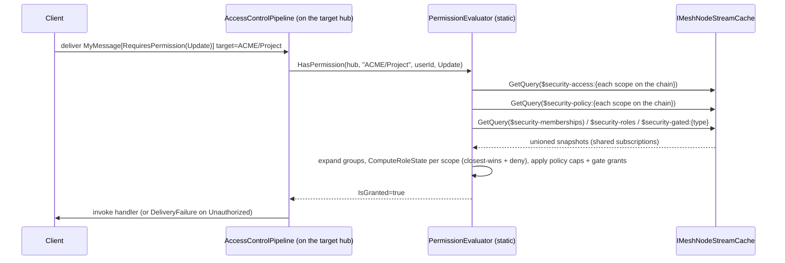
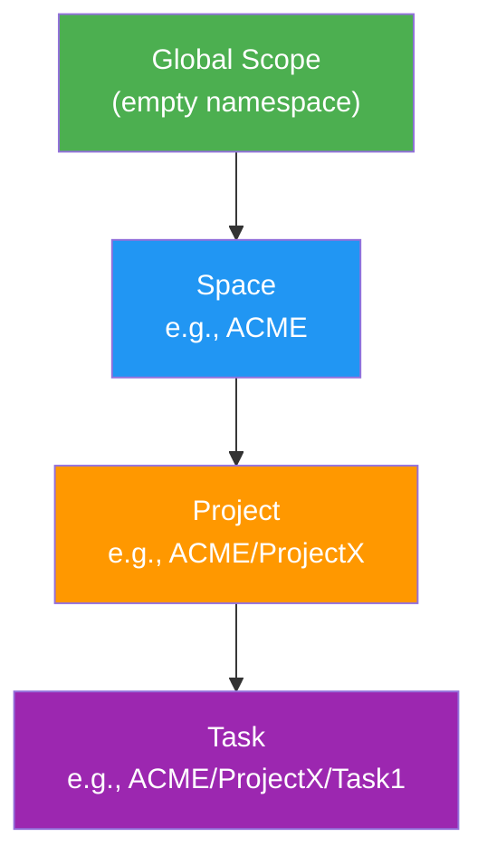
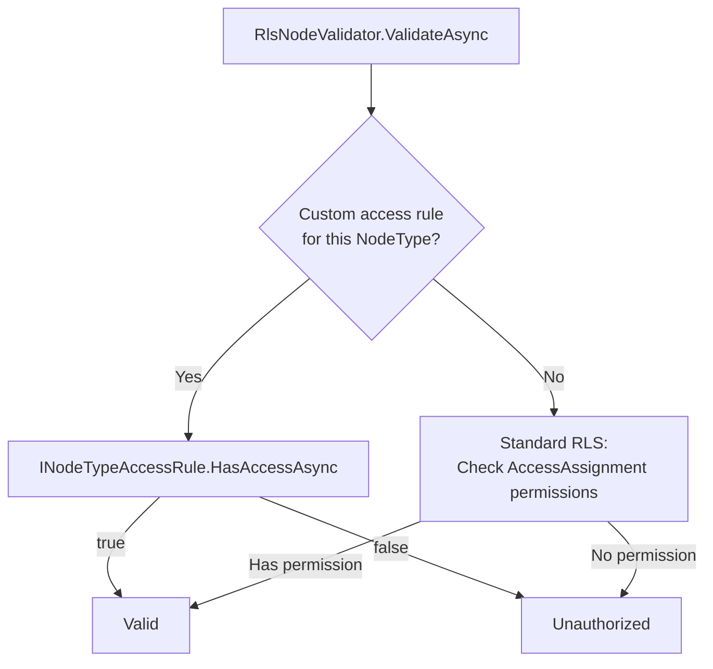
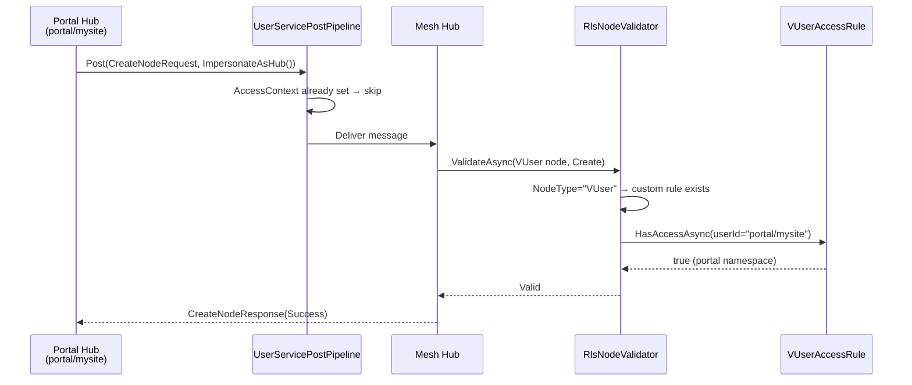

MeshWeaver implements row-level security through **AccessAssignment MeshNodes** stored directly in the mesh node hierarchy. Permissions propagate down the tree and are resolved from a live, fully reactive cache — no storage walks, no TTLs, no cache invalidation needed.

<svg viewBox="0 0 760 370" xmlns="http://www.w3.org/2000/svg" style="width:100%;max-width:760px;height:auto;display:block;margin:20px auto;" font-family="sans-serif" font-size="13">
  <defs>
    <marker id="arr" markerWidth="8" markerHeight="8" refX="7" refY="3" orient="auto">
      <path d="M0,0 L0,6 L8,3 z" fill="currentColor" fill-opacity=".55"/>
    </marker>
    <marker id="arrB" markerWidth="8" markerHeight="8" refX="7" refY="3" orient="auto">
      <path d="M0,0 L0,6 L8,3 z" fill="#26a69a"/>
    </marker>
  </defs>
  <rect x="1" y="1" width="758" height="368" rx="10" fill="none" stroke="currentColor" stroke-opacity=".12"/>
  <text x="380" y="24" text-anchor="middle" font-size="14" font-weight="bold" fill="currentColor" fill-opacity=".75">Access Control — Reactive Scope Inheritance</text>
  <rect x="260" y="38" width="240" height="68" rx="10" fill="#1e88e5"/>
  <text x="380" y="62" text-anchor="middle" fill="#fff" font-weight="bold">Root Hub (global scope)</text>
  <text x="380" y="80" text-anchor="middle" fill="#fff" fill-opacity=".85" font-size="11">LocalAssignments ∪ StaticBaselines</text>
  <text x="380" y="95" text-anchor="middle" fill="#fff" fill-opacity=".85" font-size="11">➜ scope grants, unioned downward</text>
  <rect x="35" y="48" width="180" height="48" rx="8" fill="none" stroke="currentColor" stroke-opacity=".25"/>
  <text x="125" y="70" text-anchor="middle" fill="currentColor" fill-opacity=".65" font-size="11">_Access/Public_Access.json</text>
  <text x="125" y="87" text-anchor="middle" fill="currentColor" fill-opacity=".55" font-size="11">→ Viewer (all users)</text>
  <line x1="215" y1="72" x2="258" y2="72" stroke="currentColor" stroke-opacity=".3" stroke-dasharray="4 3" marker-end="url(#arr)"/>
  <rect x="545" y="48" width="180" height="48" rx="8" fill="none" stroke="currentColor" stroke-opacity=".25"/>
  <text x="635" y="70" text-anchor="middle" fill="currentColor" fill-opacity=".65" font-size="11">_Access/Alice_Access.json</text>
  <text x="635" y="87" text-anchor="middle" fill="currentColor" fill-opacity=".55" font-size="11">→ Admin (Alice)</text>
  <line x1="545" y1="72" x2="502" y2="72" stroke="currentColor" stroke-opacity=".3" stroke-dasharray="4 3" marker-end="url(#arr)"/>
  <line x1="380" y1="106" x2="380" y2="138" stroke="currentColor" stroke-opacity=".4" stroke-width="2" marker-end="url(#arr)"/>
  <text x="395" y="128" fill="currentColor" fill-opacity=".45" font-size="11">parent-scope fold</text>
  <rect x="260" y="138" width="240" height="68" rx="10" fill="#43a047"/>
  <text x="380" y="162" text-anchor="middle" fill="#fff" font-weight="bold">ACME Hub</text>
  <text x="380" y="180" text-anchor="middle" fill="#fff" fill-opacity=".85" font-size="11">Inherited ∪ Local ∪ Policy caps</text>
  <text x="380" y="195" text-anchor="middle" fill="#fff" fill-opacity=".85" font-size="11">➜ scope grants, unioned downward</text>
  <rect x="35" y="148" width="190" height="48" rx="8" fill="none" stroke="currentColor" stroke-opacity=".25"/>
  <text x="130" y="170" text-anchor="middle" fill="currentColor" fill-opacity=".65" font-size="11">ACME/_Access/Bob_Access.json</text>
  <text x="130" y="187" text-anchor="middle" fill="currentColor" fill-opacity=".55" font-size="11">→ Editor (Bob)</text>
  <line x1="225" y1="172" x2="258" y2="172" stroke="currentColor" stroke-opacity=".3" stroke-dasharray="4 3" marker-end="url(#arr)"/>
  <line x1="380" y1="206" x2="380" y2="238" stroke="currentColor" stroke-opacity=".4" stroke-width="2" marker-end="url(#arr)"/>
  <text x="395" y="228" fill="currentColor" fill-opacity=".45" font-size="11">parent-scope fold</text>
  <rect x="260" y="238" width="240" height="68" rx="10" fill="#f57c00"/>
  <text x="380" y="262" text-anchor="middle" fill="#fff" font-weight="bold">ACME/Project Hub</text>
  <text x="380" y="280" text-anchor="middle" fill="#fff" fill-opacity=".85" font-size="11">Inherited ∪ Local (deny overrides)</text>
  <text x="380" y="295" text-anchor="middle" fill="#fff" fill-opacity=".85" font-size="11">➜ scope grants, unioned downward</text>
  <line x1="380" y1="306" x2="380" y2="338" stroke="currentColor" stroke-opacity=".4" stroke-width="2" marker-end="url(#arr)"/>
  <text x="395" y="328" fill="currentColor" fill-opacity=".45" font-size="11">parent-scope fold</text>
  <rect x="260" y="338" width="240" height="22" rx="6" fill="#8e24aa"/>
  <text x="380" y="353" text-anchor="middle" fill="#fff" font-size="11" font-weight="bold">hub.CheckPermission("ACME/Project/Task1", …)</text>
  <line x1="500" y1="72" x2="600" y2="72" stroke="none"/>
  <rect x="545" y="148" width="180" height="48" rx="8" fill="none" stroke="#26a69a" stroke-opacity=".5"/>
  <text x="635" y="170" text-anchor="middle" fill="#26a69a" font-size="11">IDataChangeNotifier</text>
  <text x="635" y="187" text-anchor="middle" fill="currentColor" fill-opacity=".55" font-size="11">live push, no TTL</text>
  <line x1="545" y1="172" x2="502" y2="172" stroke="#26a69a" stroke-opacity=".5" stroke-dasharray="4 3" marker-end="url(#arrB)"/>
</svg>

*Permissions flow top-down: evaluating a path folds each scope's `_Access` grants together with its parent scope's, so a grant made anywhere on the ancestor chain is visible to every descendant path on the next emission of that scope's shared query.*

## 🔒 The scope invariant — `MainNode` MUST name a partition, and is never empty

**A grant is scoped by `MainNode`, NOT by the folder it sits in.** This one sentence is the whole
model, and getting it wrong is the most dangerous mistake available in the system.

```
{scope}/_Access/{subject}_Access     MainNode = "{scope}"     ✅ scoped to that partition
Admin/_Access/{subject}_Access       MainNode = "Admin"       ✅ GLOBAL ADMIN (the Admin partition)
Admin/_Access/{subject}_Access       MainNode = ""            🔴 ROOT — superuser over EVERYTHING
```

An **empty `MainNode` is not "scoped to the folder"** — it is a **root** grant that merely happens to
be filed under it: All on every partition, every space, every plugin and every user's private home,
by scope inheritance. It looks harmless in the node tree.

> ### 🚨 The rule
> **`MainNode` must name the same scope its path encodes.** A grant filed at
> `{scope}/_Access/…` with any other `MainNode` — above all an empty one — is **rejected at every
> write path** (`AccessAssignmentGuard`, enforced in both `CreateNode` and the upsert handler, with
> the structural invariants — before the validators and before their System bypass).
>
> That mismatch is the whole danger, and it is what the mesh actually had: the offending rows sat in
> `admin.access` — i.e. `Admin/_Access/{user}_Access`, reading as ordinary platform-admin grants —
> with `MainNode = ""` scoping them to root instead.
>
> **Admin partition ⇒ global admin.** A grant with `MainNode = "Admin"` IS the platform-admin
> grant. There is no other shape, and it must be given deliberately to a named operator —
> essentially never. See the section below.

> ### What is *not* refused, and why
> A **self-consistent** root grant — path `_Access/{subject}_Access` **and** `MainNode = ""` — passes
> the write boundary. It is still the superuser shape, so it is worth being explicit that this is a
> decision rather than a gap:
>
> - it is not what produced the incident (those were mismatches, above);
> - it is how the test harness grants mesh-wide rights — `AssignmentNodeFactory.UserRole(user, role)`
>   with no scope, at ~200 call sites, plus `TestUsers.PublicAdminAccess()`'s root entry — so
>   refusing it leaves those tests unable to be granted anything at all;
> - a human cannot produce it: `AccessAssignmentGuard.CanGrantAt` gives the access UI **no grant
>   surface** in a root context.
>
> Closing this remaining path means rescoping the harness's call sites first — a mechanical change
> worth doing, and one that should land on its own rather than inside a boundary fix.

### What it actually confers (measured, the control instance 2026-07-28)

Identical permission sets; only the **scope** differs:

| `MainNode` | Materialised `node_path_prefix` | Effective reach |
|---|---|---|
| `"Admin"` | `Admin` | Api, Comment, Compile, Create, Delete, Execute, Export, Read, Thread, Update — **inside the Admin partition only** (invitations, version tracking, the role catalogue) |
| `""` | *(empty)* | **The same ten permissions at ROOT** — every space, every course, every plugin, every user's private home. Including `Delete`. |

On that date **34 accounts** held the root shape — 21 of them external course participants who had
merely redeemed a coupon — against **two** correctly-scoped platform admins. They accrued one per
user from 2026-07-06 onward; the two correct rows predate that (2026-05-11, 2026-06-15), which is
the tell that a writer regressed rather than the model being misunderstood.

### Verify from the materialised truth, not the node tree

```sql
-- 🔴 MUST return no rows — anyone here is a superuser over the entire mesh:
select user_id, permission from admin.user_effective_permissions
 where node_path_prefix = '' order by user_id;

-- the grant rows behind it:
select path, coalesce(nullif(main_node,''),'<EMPTY=ROOT>')
  from admin.access where node_type = 'AccessAssignment' and coalesce(main_node,'') = '';
```

## 🛡️ The Admin partition — global / platform admin

**"Global admin" has exactly one meaning: an admin on the `Admin` partition.** `Admin` is a standard partition (schema `admin`, created by the migration) that holds platform-level data — version tracking, the role catalogue, and the platform-admin grants themselves. (The shipped catalogs are their own top-level partitions — agents under `Agent`, the AI model/provider catalog under `Provider` — not under `Admin`; see [NodeType Catalogs](/Doc/Architecture/NodeTypeCatalogs).)

A user is a **global (platform) admin** iff they hold `Permission.All` at scope `Admin` — i.e. there is an `AccessAssignment` granting them the `Admin` role in the **`Admin/_Access`** namespace:

```
Admin/_Access/{user}_Access   →   AccessObject = {user}, Roles = [ Admin ],  MainNode = "Admin"
```

> ## 🚨🚨 NEVER MAKE ANYONE A GLOBAL ADMIN
>
> **Global admin is not a convenience, a default, or something onboarding hands out. It is the
> single most dangerous grant in the system and it must be granted to a named human, deliberately,
> and essentially never.** If you are about to add a row to `Admin/_Access`, stop: the answer is
> almost always a **partition admin** on the one partition they actually need.
>
> ### `MainNode` is the whole ballgame — `""` means ROOT, not "Admin"
>
> | `mainNode` | Scope it resolves to | What the user actually gets |
> |---|---|---|
> | `"Admin"` | `Admin` partition | ✅ platform management only — the intended shape |
> | `""` (empty) | **ROOT** | 🔴 **DATA SUPERUSER — All on every partition, every space, every user's private home, by scope inheritance** |
>
> An empty `mainNode` does **not** mean "scoped to the folder it sits in". The grant is scoped by
> `mainNode`, **not** by its path — so `Admin/_Access/{user}_Access` with `mainNode: ""` is a
> **root grant that happens to be filed under `Admin/`**. It reads as harmless and is catastrophic.
>
> **Verify in Postgres, never by eyeballing the folder** — the materialised truth is
> `admin.user_effective_permissions`, and an **empty `node_path_prefix` means root**:
>
> ```sql
> -- 🔴 Anyone listed here is a DATA SUPERUSER over the entire mesh:
> select user_id, permission from admin.user_effective_permissions
> where node_path_prefix = '' order by user_id;
>
> -- ✅ Correctly-scoped platform admins:
> select user_id, permission from admin.user_effective_permissions
> where node_path_prefix = 'Admin' order by user_id;
> ```
>
> This is not hypothetical. On 2026-07-28 the control instance had **43 accounts with an empty `node_path_prefix`**
> — holding `Delete`, `Update`, `Create`, `Compile`, `Execute` and `Export` on everything —
> against exactly **one** correctly-scoped platform admin. Most were created minutes after the
> holder first signed in, so **user onboarding was minting mesh-wide superusers**, including
> external course participants who had merely redeemed a coupon.

### Where to look — global vs. partition admins

| Question | Where to look | Correct shape |
|---|---|---|
| Who is a **global/platform admin**? | `Admin/_Access/*` | `mainNode: "Admin"`, role `Admin`. Predicate: `hub.IsGlobalAdmin()` |
| Who administers **one partition** (a space, a plugin, a course)? | `{partition}/_Access/*` | `mainNode: "{partition}"`, role `Admin` |
| Who administers **their own home**? | `{user}/_Access/{user}_Access` | `mainNode: "{user}"`, role `Admin` |
| Who is a **root superuser** (should be nobody)? | `admin.user_effective_permissions` where `node_path_prefix = ''` | 🔴 must be **empty** |

### Every user is admin of their own partition — and of nothing else

Each user's home partition (`{user}/…`) carries exactly one grant — **`{user}/_Access/{user}_Access`,
role `Admin`, `mainNode: "{user}"`**. That is what lets someone manage their own space: their
installed courses, their exercises, their notes. It is the *only* admin grant an ordinary user
should ever hold. Onboarding must create this and **must not** touch `Admin/_Access`.

A grant elsewhere is a deliberate act: partition admin on a space they own, or — very rarely, for a
named platform operator — `Admin/_Access` with `mainNode: "Admin"`.

Such a user is a **platform admin — NOT a data superuser.** The `Admin/_Access` grant is scoped to the Admin partition (it covers `Admin/Invitation`, version tracking, the role catalogue, …) and **does not** confer access to **spaces** or **user partitions** — nor to the top-level catalog partitions (`Agent`, `Provider`), which carry their own grants (e.g. the `Provider/_Access` Admin grant seeded by `GlobalAdminSeed`). Standing access is platform management (send invites, delete things, platform config); emergency changes to space/user *data* require an explicit **elevation (break-glass)** — a separate, auditable step, never standing permission. `IsGlobalAdmin()` reports "is a platform admin" and gates the platform features; it is **not** a permission override (a root `_Access` grant — *that* is the data-superuser shape — is deliberately NOT how platform admins are provisioned).

### The one predicate: `hub.IsGlobalAdmin()`

Every "is this user a global/platform admin?" check goes through the single canonical extension — **never** an ad-hoc role-name (`Roles.Contains("PlatformAdmin")`) or root-scope (`GetEffectivePermissions("")`) check:

```csharp
hub.IsGlobalAdmin()          // current user (resolved from AccessContext)
hub.IsGlobalAdmin(userId)    // explicit user
// ≡ hub.GetEffectivePermissions("Admin", userId).Select(p => p.HasFlag(Permission.All))
```

Readers that gate on it: `AdminAppNodeType.AdminOnlyTab` (every tab of the [Admin app](../AdminApp)), `AdminMenuGate` (the admin-gated settings areas), `UserProfile`.

### Asking "what may I do HERE?" — `whoami` at an address (#5189)

Every surface above is a **gate**: it contributes a menu entry or does not, renders an area or refuses. None of them *tells* a person what they hold, so "am I an administrator here?" used to be answerable only by opening an admin area and reading its refusal — which looks exactly like a stale session. Access is per node, so the question is asked **at an address**:

- `MeshOperations.WhoAmI(path)` → `{ userId, name, email, path, permissions: ["Read", "Update", …], isGlobalAdmin }`.
- `POST /api/mesh/whoami` with `{ "path": "<node>" }` answers the same; with no `path` (what the SSR and the React clients send, `{}`) it stays the identity-only `{ userId, name, email }`.

It is derived at read time from the **same evaluator the gates consult** (`GetEffectivePermissions` + `IsGlobalAdmin`), never stored — a stored "you are an admin" is a second verdict free to drift from the assignments. It answers for the **caller only** and lists no assignment, so it discloses nothing the caller could not learn by trying the operation. A caller with no resolved identity is answered as `Anonymous` with the identity fields null — exactly what the gates evaluate such a request as. `permissions` lists individual flags, never the composite `All`: a platform admin asked at a Space sees `isGlobalAdmin: true` beside an empty list, which is the not-a-data-superuser rule above stated to the person it applies to. Pinned by `WhoAmIAnswersAccessPerNodeTest`.

### The two type-scoped exceptions: a Space the platform itself owns

"Not a data superuser" holds for every partition a **person** owns — there is always somebody to ask for a grant. It has no answer for a partition **nobody** can own: a Space with a ONE-WAY `_GitSync` is **system-owned** (`AccessAssignmentGuard.IsSystemOwned`) — the repo rewrites it on every sync, `IsForbiddenOnSystemOwned` refuses every Admin/Editor grant on it and `SystemOwnedAccessRetractionHandler` retracts the ones that predate the sync — and, because both of those act only on an event, the permission fold itself caps Create/Update/Delete out of every role on such a partition's CONTENT paths, so a grant that survived (or predates) the sweep confers no write (#5140; see [Granting Access](../GrantingAccess)). Measured on the public instance 2026-09-12: `MeshWeaver/_GitSync`, created by the platform in a Space owned by `system-security`, re-imported the whole core repository on every green build (Memex#237), and the platform admin got `Not found` on `get` and *"Delete permission denied for 'MeshWeaver/_GitSync'"* on `delete` — no human could remove it through any API.

So these node types carry an `INodeTypeAccessRule` whose non-admin leg is the ordinary fold and whose second leg is `hub.IsGlobalAdmin(userId)` — the same OR `GitHubActivityExtensions.TriggerAuthorizedAsSystem` already applies to every sync trigger ("triggering a sync is a platform action"):

| Node type | Platform admin may | Still on the fold | Where |
|---|---|---|---|
| `GitHubSyncConfig` (`{space}/_GitSync`) | **Read, Delete** — always, on every Space | Create, Update | `GitHubSyncConfigAccessRule` (MeshWeaver.GitSync) |
| `Space` (the ROOT node only) | **Read** — only while the Space is system-owned | Update, Delete, and every child node | `SpaceAccessRule.ReadAccess` (MeshWeaver.Graph) |
| `Thread` (a conversation, root or delegated) | **Read, Update, Comment, Thread** — observe and steer: read it, post into it, stop or redirect its round | Delete; every thread in ANOTHER person's home partition; the thread's `MainNode` and every other data node | `ThreadAccessRule` (MeshWeaver.AI, MeshWeaver.Plugins) |
| `ThreadMessage` (a conversation's cells) | **Read**; Create and Update of the cells the admin's OWN rounds write | Delete; Update of a cell somebody else wrote; home-partition threads as above | `ThreadAccessRule` (MeshWeaver.AI, MeshWeaver.Plugins) |

**Observing and steering system agent threads (maintainer, 2026-10-04).** The conversations the platform's own agents run — the pull-request babysitter and fixer, triage, the bug-fix pool, supervisor relaunches — live in system and package partitions (for example under `Hosting/Triage/_Thread`), where no person holds a write grant. *"Make a standing rule for global admin for access … same as Claude Code"*: a platform admin must be able to open such a thread, type into it while it runs and stop or redirect its round. That is the third row above, and it is the ONLY data-shaped widening a platform admin has. Steering a round means the round's next turn runs as the admin who sent the message — exactly as it would for any other sender — so it acts with the admin's own grants, never with the agent's. A thread in a person's home partition (a partition whose root is a `User`) is that person's private conversation and is not covered. Non-CRUD permissions (`Comment`, `Thread`) reach a rule through `INodeTypePermissionRule`, which the delivery gate consults after a denial exactly as it consults `INodeTypeAccessRule` for Read/Update/Delete; and the stream-cache read gate now consults the Read rule too, so a node view, a query and a subscription answer the same question the same way. Pinned in core by `NodeTypePermissionRuleTest` and in the AI engine by `GlobalAdminThreadAccessTest`.

The fold itself is untouched — `GetEffectivePermissions` still answers `None` for the admin on both paths, which is what `SystemOwnedSyncConfigIsVisibleToPlatformAdminsTest` pins: the widening comes from the rule, consulted by all three seams (`RlsNodeValidator`, the `[RequiresPermission]` delivery gate, the delete pre-flight) through `NodeTypeAccessRuleGate`, so an ordinary viewer's check is byte-for-byte what it was. A sync config carries the repo, branch and last-sync state — never a credential; that is the separate `GitHubCredential` node in the owner's own partition. Deleting the **Space** of a system-owned partition is deliberately NOT widened: a paid plugin's Space is system-owned too, and its `_Access` entitlement grants would go with it.

**Issuing a grant where nobody else can (#5904).** Seeing a system-owned Space is not reading it: its records stay behind the fold, and no person holds the `Create` on `{space}/_Access` that issuing a grant demands — nor on an OWNERLESS partition (no grant, no `_Policy`), which denies everyone. Measured on client-a-control 2026-09-29/30: Space `Deployments`, GitSynced right after it was created, carried no grant once the retraction ran; the refusal told the platform admin that *"a platform admin"* had to grant access under `Deployments/_Access`, and refused that very grant — so every `Hosting/InstanceAction` whose approval re-reads `Deployments/*` as the approver was unapprovable. So on exactly those two partition shapes a platform admin may **create an `AccessAssignment`** (`PlatformAdminGrantRepair`, consulted by `RlsNodeValidator` only after the fold denied). It is an explicit, audited grant node, never an implicit read, and every other validator still applies: on a system-owned partition `IsForbiddenOnSystemOwned` still refuses anything that confers write, so what the admin can issue there is a `Viewer`/`Commenter` entitlement. On a partition that has an owner (a grant or a policy) and no one-way sync the admin is refused as before. The platform's own partitions (`Admin`, the `User`/`Auth` mirrors, `Portal`, `Kernel`, `ApiToken`, `system-security`, `Anonymous`, the group partitions `Groups` and `ScopedGroups`, every `_`-prefixed namespace) are refused outright — the group partitions because their roots are provisioned by governed executors with no grant and no `_Policy`, so a grant there would let a global administrator change a group's membership and acquire the group's rights elsewhere without those executors' proposer and signer checks — and the fleet's (`Deployments`, `Hosting`, `Ops`, `Store`, … — the rest of `DeleteSpaceRunner.ProtectedPartitions`) take an entitlement only, whether or not they are system-owned. Pinned by `PlatformAdminCanGrantOnAnUngrantableSpaceTest`. The denial on a system-owned, grant-less partition now says so, instead of promising that the creator "regains access on their next write" — the bootstrap never restores a creator on a system-owned partition.

### Deleting a space nobody may delete: the governed break-glass action

A space whose owner is gone, or a stranded partition with no root at all, refuses every person's delete — the platform admin's included, by the rule above. The sanctioned way out is not a wider grant but the **`DeleteSpace`** kind of `Hosting/InstanceAction` (MeshWeaver.Plugins, `Hosting/DeleteSpaceAction`): it reads the space as system, parks with the full plan (rows per table, grants, GitSync configuration, the `Admin/Partition` record, the schema, the NodeTypes and their outside dependents), and after one approval of exactly that plan removes it through the framework's own deletes and the platform's partition teardown, verifies nothing is left and writes an audit record. It refuses the system and fleet partitions, a user's home and a package's partition that an install record (`Plugins/{id}`) still targets by name — that package is removed through the Store uninstall. A package partition with NO install record (one a `Store/Provision` installed) is planned like any other space, since the Store uninstall cannot remove it and nothing re-installs it. It is the audited, per-case elevation this page describes — never a standing permission.

### Where the grant comes from (db-init)

- **Config-driven** — `Auth:GlobalAdmins: [ "rbuergi", … ]` → `GlobalAdminSeed` seeds a static `Admin/_Access/{user}_Access` grant at boot. A fresh DB with the config set comes up with each listed user already a platform admin.
- **First user** — `UserOnboardingService.GrantPlatformAdmin` writes the same shape for the bootstrap user when the deployment has **no platform-admin grant yet** (the onboarding page probes `path:Admin/_Access scope:children nodeType:AccessAssignment` — the same path-scoped shape the evaluator itself loads admin grants with; config-seeded admins count, so a seeded deployment never mints a second bootstrap admin). Both writers stamp `MainNode = "Admin"` — the scope the path encodes — which `AccessAssignmentGuard` enforces at the write boundary.

> 🚨 **Platform-admin grants live in `Admin/_Access`, never root `_Access`.** A root `_Access` grant makes a user a **data superuser** (All on every partition via scope inheritance) — which platform admins must NOT be. An `Admin/_Access` grant scopes them to platform management only. Writers (`GlobalAdminSeed`, `GrantPlatformAdmin`) and readers (`hub.IsGlobalAdmin`) both use the Admin partition — they disagreed before 2026-06-08 (writers wrote root, readers checked Admin scope), which silently locked configured admins out of every admin tab.

> **Emergency / cross-partition data access** is out of scope for the standing grant — it will be a deliberate **elevation (break-glass)** flow (audited, time-boxed), not a permission a platform admin holds by default.

### 🚨 Broad grants only through a governed activity (`BroadGrantGuard`)

Access that reaches many people, or that the platform writes for someone else, is written **only** by an executing governed activity — never by a person's standing rights (a platform admin's included) and never by a platform sweep. Maintainer, 2026-09-30, after a new free plugin was granted to 72 users in three minutes by a System sweep, each grant mailed: *"i don't want to have this possibility in principle."*

`BroadGrantGuard` sits at the create and upsert write boundaries, next to `AccessAssignmentGuard`, **ahead of the validators' System bypass**. It finds three shapes:

| Shape | What it is | Passes when |
|---|---|---|
| `PublicSubject` | a non-denied grant to `Public` or `Anonymous` | an executing governed activity wrote it |
| `SystemForOther` | a grant written as System whose subject is not `AccessContext.OnBehalfOf` | the user acquires it themselves (`OnBehalfOf` = subject: subscription, coupon, purchase), or a governed activity wrote it |
| `AccessPolicy` | a `PartitionAccessPolicy` (`{scope}/_Policy`) | an executing governed activity wrote it |
| `GrantRule` | a declared type-scoped grant (`Admin/_GrantRule/{id}`, see [Declared grant rules](#declared-grant-rules-grantrule)) | an executing governed activity (`access.grant-rule`) wrote it |

A `Denied` assignment only removes access and always passes; a person sharing their own space with a colleague is not a broad grant.

**The one way through.** The governance executor opens System with `AccessService.ImpersonateAsSystemFor(governedBy: <activity path>, …)`, and the node it writes carries `content.governedBy` with the same path. The boundary then checks (`IGovernedActivityVerifier`, default: read the activity node) that the activity is `Executing` a standard on the allowlist — `access.grant-broad`, `access.revoke`, `access.policy-change`, `package.provision`, `package.provision-set`, `package.remove`, `store.enroll`, `pr.steward.admin-access`, the public-link standards `link.publish`, `link.revoke` and `group.org-create`, `group.scoped-create` — a group holding one non-Admin role at one path, whose one grant and whose proposer's Admin on the group node are written as System after the executor re-checks proposer and signer — `access.grant-rule`, which writes one declared grant rule, and the client-name gate's two caller grants, `namecheck.caller.grant` and `publicationcheck.caller.grant` — each writes ONE `NameCheckCaller` grant for ONE service identity (`svc-…`) on the scope the standard fixes (`Governance/NameChecks`, `Governance/PublicationChecks`), a `SystemForOther` shape that `Enforce` refused until they were listed, so triage held every post. `Access:BroadGrantGuard:Standards` REPLACES the list rather than extending it — deliberately, so a deployment can also NARROW it — which means an override must restate every standard it still wants, and a Governance standard that starts issuing a grant needs its id added to `BroadGrantGuard.DefaultGovernedStandards` in core (and to any deployment override); the Plugins package cannot add it. A public link (MeshWeaver#4306) is the one shape that grants `Anonymous`/`Public`/an org group anything, and it grants `Viewer` on the LINK node only (`l/{publicId}`); the target is served as a delegated read re-checked at every render — design of record in MeshWeaver.Plugins `Essentials/PublicLinks`.

**Modes** (`Access:BroadGrantGuard:Mode`): `LogOnly` (the default for the first week after it ships), `Enforce`, `Off` (test harness only). In `LogOnly` every finding is one line, `[BroadGrantGuard] WOULD REFUSE {Kind} {Path} subject= writer= onBehalfOf= seat= governedBy=`. That grep is the inventory of legitimate writers that still have to stamp their context (the partition bootstrap's creator grant, invitation acceptance, the Store's root gating) before the mode flips to `Enforce`.

**A `governedBy` back-reference is a claim, checked where it is made — on any node type.** A control plane that ACTS on a node because it names an activity (the Store's `Admin/Provision/{package}` request is the case) would otherwise trust whatever its creator typed: a standing admin could create the request with `governedBy` pointing at some activity that happened to be executing, signed for a different package. So the create and upsert boundaries also check every node that INTRODUCES a `governedBy` (new, or changed from what the stored node carried — a claim the owner's own bookkeeping merely keeps was checked when it was introduced): its writer's context must carry the same `GovernedBy`, and that activity must be executing an allowlisted standard. The finding logs as `[BroadGrantGuard] WOULD REFUSE GovernedClaim {Path} …` and follows the same mode; under `Enforce` it refuses with `activity.node.governedClaim`.

**A reader that acts LATER decides on monotone facts.** The write boundary may ask "is the activity executing" because the executor's write happens while it executes. A watcher that runs after that write must not: the activity may have moved on to `Done`, and the answer would depend on which write it saw first. `hub.ReadGovernedActivity(path)` returns the activity's `GovernedActivityFacts` — standard, state, signed inputs — and `HasStarted` (`Executing`, `Done` or `Failed`, reachable only after the signatures were consumed, never left again) is the predicate such a reader uses, together with the signed inputs naming what it is about to do.

**A newly listed package waits for a governed provision.** The boot default install no longer installs a package just because a whole-source pattern (`Plugins/*`) covers it once the instance has been seeded (`InstanceAutoRegistrationService.HoldsForGovernedProvision`); it lands through a `package.provision` activity or an entry that names it. "Newly listed" means *unknown to the default-install ledger* (`KnownToTheLedger`), not merely "never seeded": a package the ledger recorded as FAILED is re-attempted on the next pass (the retry the ledger exists for), and one it recorded as SKIPPED is re-classified, exactly as before the hold. A fresh instance (empty seeded list) still seeds everything its patterns cover.

**The guard does not stop anyone from becoming System.** User-authored code that the mesh compiles at runtime, and gates on the trusted gRPC port, can still act as System for everything except a broad grant. For the log-only guards that measure this and the options for closing it, see [In-Mesh Impersonation](../InMeshImpersonation).

**Break-glass** once no person holds standing platform admin: a deployment pull request adds the name back to `Auth:GlobalAdmins` (applied by CD, so it is reviewed and on record), together with the Azure subscription Owner role through PIM for the infrastructure side. Nothing else is built for it.

---

# Public API — start here

Application code calls two extension methods on `IMessageHub`. Both return `IObservable<T>` — compose them with `CombineLatest`/`Select`, never `await`. Full reference: [PermissionApi](/Doc/Architecture/PermissionApi).

```csharp
using MeshWeaver.Mesh;

// Check a single permission for the ambient user
hub.CheckPermission(nodePath, Permission.Update);

// Get the full effective Permission set
hub.GetEffectivePermissions(nodePath);

// Explicit user identity (admin tooling, server-to-server)
hub.CheckPermission(nodePath, "alice", Permission.Update);
```

The rest of this page covers the **internals** that back those extensions: the AccessAssignment node shape, the recursive scope walk, the per-scope synced subscriptions cached on `IMeshNodeStreamCache` under system identity, and the RLS validator wired into the storage adapter.

> Do not resolve `PermissionEvaluator` directly from application code — it is framework-internal infrastructure that the extension methods wrap.

---

# Core concepts

## 🔒 A client cannot choose its own identity — `RequestIdentity`

Every client ingress stamps the DELIVERY with the authenticated caller: SignalR and the public gRPC port re-stamp each delivery with the connection's validated user, and the HTTP middleware and the Blazor circuit derive it from the sign-in claims. Three things a client sends could still name another identity. They are closed in core, so no ingress has to remember them:

- **Identity fields in a message body.** `CreateNodeRequest.CreatedBy`, `CreateNodesRequest.CreatedBy`, `DeleteNodeRequest.DeletedBy` and `CreateOrUpdateNodeRequest.RequestedBy` exist for the platform's own writers, whose AsyncLocal context does not survive every hop. RLS read them before the delivery's context, so a client that typed `createdBy: "system-security"` was authorised as System: measured, an identity with no grant created a node in another user's space. `RequestIdentity.Resolve` now decides. When the delivery carries an authenticated principal that is not the platform (not System, not a hub), that principal is the requester. A field may name somebody else only when the platform posted the message.
- **The author stamps on the node.** `CreatedBy` and `LastModifiedBy` are what control planes read as "who asked" (the Store's `InvokerOf`, the Governance package's signature admission). A person or service always records itself (`RequestIdentity.Author`). On the create path the node's carried stamps are replaced. On the in-process update path (`ApplyAuditStamp`) a lambda's choice is overridden. On the owner's merge of a client patch (`DataExtensions.StampAuthorFromSender`) a `lastModifiedBy` in the patch is replaced by the sender and a `createdBy` is dropped. Only the platform keeps a carried stamp, so imports and repairs still preserve authorship. A MOVE preserves authorship too (#3263), and it does so without letting the message choose: its copy leg names the STORED source (`CreateNodeRequest.AuthorshipFrom`). The create handler then re-checks Delete on that source's namespace, which is the entitlement a move requires, and reads the four stamps from storage. This matters beyond attribution. `AccessContextScope.FromNode` impersonates a node's `CreatedBy`, so a client-chosen `CreatedBy` would make owner-scoped work run as whoever it named.
- **A reserved id from a sign-in.** A session's id is the local part of the provider's `preferred_username` or email, and sign-in is multi-tenant. So `system-security@<any tenant>` signed in AS the System identity, and `public@…` as the pseudo-user whose grants everyone inherits. `RequestIdentity.IsReservedPrincipal` covers System, `Anonymous`, `Public` and hub-shaped principals. The middleware and `ResolveHttpCaller` resolve such a sign-in to anonymous, as they already did for a service id or a local part that collides with another person's User node.

What is NOT closed here, and needs a design decision: code that runs INSIDE the portal process can call `AccessService.ImpersonateAsSystem()` / `ImpersonateAsSystemFor(...)`, and the gRPC trusted loopback port runs a gate's deliveries as System by default. Both are reachable by user-authored code: a compiled NodeType or C# Code node in-process, and a python or node Code node in a gate sidecar. The trusted port no longer passes a carried `GovernedBy` or `OnBehalfOf` (MeshWeaver.Plugins), so such code cannot satisfy the broad-grant guard. It still holds the System identity itself.

## AccessAssignment MeshNodes

Access control is managed through **AccessAssignment** nodes — first-class MeshNodes with `nodeType: "AccessAssignment"`. Each assignment grants (or denies) a role to a subject at a specific scope.

AccessAssignment nodes are **satellite entities** stored in the `_Access` sub-namespace:

```
Node path: {scope}/_Access/{Subject}_Access
Node type: AccessAssignment
Content: {
  "accessObject": "Alice",
  "displayName": "Alice Chen",
  "roles": [
    { "role": "Editor" },
    { "role": "Viewer" }
  ]
}
```

On disk (file system persistence), access files live under `_Access/` sub-directories:

```
ACME/
  _Access/
    Public_Access.json     ← All authenticated users get Viewer
    Alice_Access.json      ← Alice gets Editor
  Projects/
    _Access/
      Bob_Access.json      ← Bob gets Viewer on ACME/Projects
```

In PostgreSQL, access nodes are routed to a dedicated `access` table — the `_Access` path segment maps to it through `PartitionDefinition.TableMappings`, seeded from `SatelliteTableMapping.Defaults` (`PartitionDefinition.DefaultSegmentTableMappings()`) — separate from the main `mesh_nodes` table.

Each AccessAssignment node maps **one subject** (User or Group) to **multiple roles** at a given scope. Storing all roles in one node reduces trigger invocations compared to a one-node-per-role approach.

**Key properties:**

| Property | Description |
|---|---|
| `AccessObject` | User or Group identifier |
| `DisplayName` | Optional display name for the subject |
| `Roles` | Array of `RoleAssignment` entries |
| `Roles[].Role` | Role to grant or deny (`Admin`, `Editor`, `Viewer`, `Commenter`, or custom) |
| `Roles[].Denied` | When `true`, denies the role instead of granting it |

## 🚨 Configuration-declared nodes are row-filtered like stored ones — definitions excepted

A node DECLARED in configuration — `builder.AddMeshNodes(...)`, or yielded by an `IStaticNodeProvider` — is served to queries from memory by `StaticNodeQueryProvider`. **Every declared row is decided by the same row filter the storage providers apply to a stored row**, for the same viewer (`QueryIdentityResolver`: the request's stamped `UserId` first, then the ambient identity), so a query and a point read of a declared node give the same answer. A System read is unfiltered, so the permission evaluator's own reads of the static grants and policies are unchanged.

**The one exception is the platform's vocabulary — DEFINITIONS** (`StaticNodeQueryProvider.IsDeclaredVocabulary`): a type's hub registration (no node type of its own AND a `HubConfiguration` — a missing node type alone identifies nothing, since content may be declared untyped), a `NodeType` definition, a `Role` definition and a `Partition` definition. Every caller resolves types, roles and partitions by them, and no grant is ever written on them — on a mesh with no public grants a viewer holds Read on almost none of them — so filtering them would empty every type picker and role list for everyone but an admin. METADATA is never vocabulary, whatever its shape: a satellite-table path (`_Access`, `_Thread`, …), a SIBLING metadata node (`{ns}/_Policy` — a regular row, which `SatelliteTableMapping.IsSatellitePath` does not see), and anything filed beneath an underscore metadata segment below the partition root. The classification reads the node's PATH, never how it is split between `Id` and `Namespace` — a full-path id (`new MeshNode("p/_Policy")`) is the same metadata. The root segment (`_Setting` is a partition NAME) and partition-catalog entries (`Admin/Partition/{name}`) are not metadata. Everything else declared — content, configuration, documentation, templates, catalogs, grants — is readable exactly where its PATH is readable: documentation through `Doc`'s `Public` grant, the `WhatsNew` registration through its own `PublicRead` `_Policy` (release notes are for everyone, so the access is declared on the partition — never an exemption in the filter), the model catalog through `Provider/_Policy`'s `PublicRead`, and so on.

**Why it changed.** Until the filter covered every declared row, only satellite rows were filtered and every other declared node reached every authenticated caller: a viewer holding no grant on a partition listed a node declared there through `IMeshService.Query` — with the viewer stamped explicitly on the request — while `GetMeshNodeStream` of the very same node refused them. Two read seams answering one question differently; the point read was the one that was right. Pinned by `DeclaredNodeIsRowFilteredInQueriesTest` (a stranger gets no row for a node declared in a partition only a reader may read, under `path:`, `namespace:` and a descendants walk; the reader gets it — the control; the stranger still resolves `Role/Viewer` and `Markdown` — the vocabulary control; an UNTYPED declared node without a hub configuration is filtered in a query and in an autocomplete drill-down) and, for satellite rows, `DeclaredAccessAssignmentIsRowFilteredTest` (the `Auth:GlobalAdmins` seed under `Admin/_Access`).

**The rule that still follows: never put a SECRET in a declared node's content.** The filter decides who may read a path, and a path can be public by design while one field on it is not — the model catalog is `PublicRead`, so a provider key on a declared `Provider/{name}` node was readable by every signed-in user through any read seam, filter or no filter (removed in MeshWeaver.Plugins#3490). Keep credentials, tokens and keys out of node content altogether; put per-user or per-tenant data in storage, where it is written with its owner.

## 🚨 Caller-facing verbs: a refusal looks like absence, and a write is authorized as one

Two rules every transport verb (`MeshOperations`, behind the MCP tools and `/api/mesh/*`) holds:

- **A refused read answers exactly what an absent path answers.** The owner's refusal names the path (`Access denied: user '…' lacks Read permission on '…'`); handing it on tells a caller who may not read a node that one exists there. `get` answers a refusal with its not-found answer (#6571); `render_area` (and the `get {path}/area/…` route) answers `Not found: {path}`, and `content/list` answers `Error: no matching node for path '…'` — the same strings a path that resolves to nothing gets. A refusal is still logged at Information on the server. Pinned by `RefusedReadLooksAbsentTest`, which compares a refused node with an absent sibling and an absent root, path masked, and keeps the grant holder as the positive control.
- **An upload is a write, and it is decided where its bytes are committed.** `upload` (MCP and `POST /api/mesh/upload`) posts the bytes to the node that owns the collection as a `SaveContentFileRequest`, as the caller captured at entry, and that node writes them (`hub.SaveContentFile(node).To(collection, path).WithAccessContext(caller).Post(bytes)`). The request carries `[RequiresPermission(Update)]`, so the owner's inbound gate — the same one every node write passes, consulting the node type's rule through `NodeTypeAccessRuleGate` — decides Update for that identity on the delivery that carries the bytes. A grant revoked after any earlier check is therefore refused here, and no path can store bytes in a node's content without passing it (#6585). The collection, its editability and the path are decided off the owner's own configuration, and only a collection the node DECLARES is written: a name the node merely inherits from its hosting hub (through the host's content service or the host's registrations) is the host's store, shared by every node it hosts, so Update on the node is refused as authority over it and nothing is written — and a large upload is refused before it stages, so not even a staged blob lands in the host's store. The Update pre-flight on the calling hub (the one `recycle` and `patch` use) stays as the early answer: a reader without Update is told which permission is missing, a caller who may not read the node gets the absent answer, and nobody stages bytes for a write that will be refused. A file larger than one delivery stages its bytes in the collection's reserved staging folder first ([Out-of-Band Content Transfer](../OutOfBandContentTransfer)); the staged blob is framework state, never served as content, and is reclaimed when the write answers, and it is this upload's alone (content hash plus a per-transfer nonce), so a concurrent upload of identical bytes never reclaims it mid-read; a blob a dead upload left behind (older than the staging window) is swept before the next upload stages, as a content sync does. Pinned by `UploadRequiresUpdateTest` (a reader is refused and nothing is stored; an editor uploads) and `UploadIsDecidedWhereItIsWrittenTest` (a grant revoked between the pre-flight and the write stores nothing; a reader posting straight to the owner is refused; an editor's direct write and a staged large upload are stored; an editor cannot write into a collection the node inherits from its host, inline or staged; a staged upload never reclaims another transfer's blob; a staged upload sweeps a stale blob).

## Built-in roles

Defined as static properties on `Role` (`src/MeshWeaver.Mesh.Contract/Security/Role.cs`):

| Role | Permissions |
|---|---|
| `Admin` | `All \| Compile` |
| `Editor` | Read, Create, Update, Comment, Execute, Thread, Api, Export, Compile |
| `Viewer` | Read, Execute, Api |
| `Commenter` | Read, Comment, Api |
| `PlatformAdmin` | `All \| Compile` |

## Deleting and moving — what each demands

**A move is a create at the target plus a delete at the source, and it demands exactly what those two
demand — nothing special to a move.** So the question "who may move this?" is answered by "who may
delete it?", and that has ONE answer, `DeletePermission.RequiredFor(path)`
(`src/MeshWeaver.Mesh.Contract/Security/DeletePermission.cs`):

| Deleting… | Demands | Who holds it |
|---|---|---|
| ordinary content — any node below a partition root | `Update` **or** `Delete` — either suffices | Editor and Admin, and any custom role carrying either bit |
| a partition root (a Space, a Partition, a user home) | `Delete` | Admin |
| anything under `_Access`, `_Policy`, `_GitSync`, `_Entitlements` | `Delete` | Admin |
| a node whose type's access rule decides Delete (Space, Partition, the sync config, …) | what the rule says | — |

Deleting content is an edit of the space it lives in; deleting what GOVERNS a space — its root, its
grants, its caps, its sync wiring, its purchases — is an administrator's call. **Holding `Delete` alone
also deletes ordinary content** (policy [`delete-suffices-for-content`](../PolicyNotProse)): the
content demand is `PermissionDemand.UpdateOrDelete`, met by EITHER bit, so a custom role that carries
`Delete` without `Update` keeps every delete right it held before deleting content became an edit —
demanding `Update` alone silently stripped such roles, and their refusals carried the "not settled,
retry" note because a custom role's definition is never taken as settled evidence (#7414). Evaluate a
demand with `PermissionDemand.IsMetBy`, never `HasFlag`: it is the ONE predicate behind the hub's
permission check, the delivery gate, `RlsNodeValidator`, the delete pre-flight and the menu, and it
reads every other demand as ALL of its bits, exactly as before. Every rule-less delete
path applies the same function: the `DeleteNodeRequest` / `ValidateDeleteRequest` delivery gates, the
delete handler's per-node pre-flight (`CheckDeletePermissionByPath`), `RlsNodeValidator`, the
`SatelliteAccessRule` fallback, `MoveNodePermissionAttribute` (the delete demand on the source
namespace + `Create` on the target namespace; `Delete` for a move into another partition — see below)
and the Delete / Move menu entries. A node type's own
rule still decides for its own type. `Role.Editor` and the permission numbers are unchanged — the
`Delete` bit still distinguishes an Admin, so `HasFlag(Permission.All)` (and `IsGlobalAdmin`) keep
meaning what they meant, and nothing in the PostgreSQL permission projection changes.

**A move carries its authorship, or it does not happen** (`MoveEntitlement` in `MeshExtensions`, the
ONE function behind the move, `CopyNodeRequest.PreserveAuthorship` and `CreateNodeRequest.AuthorshipFrom`).
`AccessContextScope` impersonates a node's `CreatedBy`, so carrying someone else's authorship into a
place their governance does not cover would let owner-scoped work there run as them. The stamps may
travel when the caller may delete the SOURCE NODE and carry its content — `Update` or `Delete` on it
(checked on the node itself, so a node-level deny holds) — AND either the target is in the SAME partition — the node stays under the governance that
already covered it, and a caller who may edit it in place gains nothing — or the caller holds
`Delete` on the source (an administrator). A move that may not carry them is REFUSED before it writes
anything, never turned into a re-authoring copy: a half-landed move resumes by recognising its own
stamps at the target, and relocated legacy content keeps its provenance. So `MoveNodePermissionAttribute`
demands `Delete` on the source namespace for a move into another partition, a preserving copy is
refused on the same terms, and `AuthorshipFrom` on a create records the requester when they are not
entitled. The `DeleteNodeRequest` / `ValidateDeleteRequest` delivery gate re-decides a denied check
through the node type's rule AS A DELETE (a comment's author may delete it although the standard
demand, Update or Delete, is not held), and the delete seal's early abort is authorised by the same demand.
Pinned by `EditorDeletesContentTest` (`test/MeshWeaver.Hosting.Test`) and
`SatelliteDeliveryGateTest` (`test/MeshWeaver.Graph.Test`).

## Permission flags

```csharp
[Flags]
public enum Permission          // src/MeshWeaver.Messaging.Contract/Security/Permission.cs
{
    None    = 0,
    Read    = 1,
    Create  = 2,
    Update  = 4,
    Delete  = 8,
    Comment = 16,
    Execute = 32,     // run code / launch kernels
    Thread  = 64,     // create + use chat threads
    Api     = 128,    // API-token (MCP / programmatic) access
    Export  = 256,    // download nodes as files
    Sync    = 512,    // static-repo import/export overwrite
    Compile = 1024,   // create a NodeType Release

    // Sync and Compile are DELIBERATELY excluded from All.
    All = Read | Create | Update | Delete | Comment | Execute | Thread | Api | Export
}
```

> 🚨 **`Sync` and `Compile` are not in `All` on purpose, and the exclusion is load-bearing.**
> `hub.IsGlobalAdmin()` is `HasFlag(All)`, and a read-only-capped Admin's effective set is folded
> against the role's integer value — folding a new bit into `All` would silently require the PG
> `user_effective_permissions` table to be re-materialised before any admin check passes again
> (that is the shape of the 2026-06-08 admin lock-out). The built-in roles grant `Compile`
> explicitly instead, so `All` — and every `HasFlag(All)` gate — stays byte-stable.
>
> The System identity is the one exception: `GetEffectivePermissions` short-circuits it to
> `All | Sync | Compile`, so an explicit `CheckPermission(System, Compile)` passes.

---

# Permission evaluation

Permissions are evaluated by **`PermissionEvaluator`** — an `internal static` class (`src/MeshWeaver.Mesh.Contract/Security/PermissionEvaluator.cs`) whose methods are **pure functions over `IMessageHub` + the process-wide `IMeshNodeStreamCache`**. There is no per-hub evaluator instance, no `IMemoryCache` layer, and no per-process mutable state: all per-scope state lives in the shared stream cache under well-known query keys.

**No storage walk on the read path. No TTL cache to invalidate. Live updates ride the cached queries' own change feeds.**

## Two reads per path: the partition, and the root

For a target path `ACME/Project/Task1`, `ObserveEffectiveAssignments` issues exactly **two** anchored reads and unions them with the static baselines:

```
partition "ACME"  → cache.GetQuery("$security-access:ACME")   path:ACME scope:descendants nodeType:AccessAssignment
root scope ""     → cache.GetQuery("$security-access:")       namespace:_Access nodeType:AccessAssignment
static baselines  → IStaticNodeProvider
                     └─ UnionByPath + DistinctUntilChanged
```

`_Policy` nodes fold the same way under `$security-policy:{partition}` / `$security-policy:`. Both keys are cached **process-wide**, so every hub in the process shares ONE upstream subscription per partition however many paths, hubs or viewers consult it.

**Why the partition and not the scope.** A grant lives at `{scope}/_Access/{id}`, and every scope on a path's chain except the root is a **prefix** of that path — so all of them live in the path's own partition, which is exactly where `_Access` is stored (one schema per partition; the `_Access` segment routes to that schema's `access` table). One partition-wide read therefore answers the whole chain.

Reading per SCOPE instead multiplied that one read by the depth of the path **and** by how many paths were checked, because a node's own path is always the LEAF of its own chain — so every node ever permission-checked minted its own live `$security-access:{path}` + `$security-policy:{path}` pair. Measured (issue #3093, `SecurityQueryScaleTest`): RLS-filtering a 4-node listing opened **13** security queries, a 32-node listing **69** — exactly +2 per node, and the population never fell below the stream cache's idle window. After: **5** either way.

**Why the verdict cannot change.** The fold never depended on which scopes were READ, only on which are CONSULTED. `ComputeScopeRoles` buckets whatever nodes it is handed by each node's OWN namespace, and `ComputeRoleState` then walks `GetScopeHierarchy(nodePath)` and reads only the buckets on the target path's chain. A partition-wide read is a strict **superset** of the per-scope walk, so no grant — and, more importantly, no group-scoped DENY — can go missing. That direction is the one that matters: a short read in this fold is indistinguishable from "denied", and a missing deny fails OPEN (see [Unanchored Security Reads](/Doc/Architecture/UnanchoredSecurityReads)).

**Which provider serves which leg** — worth knowing before changing either shape again, because the two legs are served by different code and only one of them is exercisable without Postgres:

| Leg | Query | Classified | Served by |
|---|---|---|---|
| grants | `path:{partition} scope:descendants nodeType:AccessAssignment` | **satellite-targeted** — `PartitionDefinition.IsSatelliteNodeType("AccessAssignment")` is true (`_Access`→`access`) | the in-repo `StorageAdapterMeshQueryProvider` on every backend (`DefersToNativeProvider` returns **false** for a scoped satellite read) |
| policies | `path:{partition} scope:descendants id:_Policy nodeType:PartitionAccessPolicy` | **content** — `_Policy` is not a configured satellite segment, so these live in `mesh_nodes` | deferred to the native per-schema delegate on Postgres |

🚨 **The same classification puts a `_Policy` under a satellite segment out of the fold's reach.** The policy read is a CONTENT query, so it never returns a `_Policy` whose scope lies under a configured satellite segment, such as `{partition}/_Storage/_Policy` or `{node}/_Thread/_Policy`. On Postgres that row is stored in the segment's table. In memory it is dropped like every other satellite row. The fold also reads only the id `_Policy`. Until `PolicyPlacementValidator`, both placements could be created, read back by path, and **never applied**. A `BreaksInheritance` policy at `{partition}/_Storage` left the inherited partition grant in force. The same node declared statically DID apply, because `CollectStaticPolicies` reads the static providers directly and never passes through the query. `PolicyPlacementValidator` now refuses a runtime `PartitionAccessPolicy` CREATE in either placement.

**A `PartitionAccessPolicy` is create-only, and ONE guard enforces it: `PolicyCommitGuard`, at the owner's COMMIT point.** It is created as `{scope}/_Policy`. Retyping an existing node into one is unsupported by design on every route. The guard is an `IEntityCommitGuard`, consulted in the turn that applies a write, against the entity exactly as it would commit and the entity the owner holds under that key. Three places commit into an owner, and all three consult the guards through the ONE helper, `EntityCommitGuards.FirstRefusal`:
- `ApplyMeshNodePatchInTurn`, the merge turn of a merge patch. This covers every `GetMeshNodeStream(path).Update` from another hub, `IMeshService.UpdateNode`, and the upsert's update branch.
- `WorkspaceOperations`, the apply turn of a `DataChangeRequest`. This covers a synced write-back, an entity-reference patch, a full entity or an `EntityDeltaUpdate`, and a node carried to a hub that is not its own.
- `MeshNodeStreamHandle.UpdateOwn`, the commit turn of an OWN write: `GetMeshNodeStream().Update` (or `Overwrite`) issued on the owning hub itself. Code that runs on the owner as a person writes this way: the `RollbackNodeRequest` handler (a client request that needs only Update), an activity script on its own hub, a layout-area action. Until this route consulted the guards, every commit-point rule was skipped on it, so a rollback or an own-hub write could commit what every routed write is refused. The writer judged is the identity the write was issued under. `AdoptPersisted`, which observes state that is already durable and writes nothing, is the one own commit the guards do not judge.

A new route that commits into an owner's store must call `EntityCommitGuards.FirstRefusal` in its commit turn; a route that does not is a bypass of every rule below. Pinned by `RetypingIntoAPolicy_ThroughTheOwnersOwnStream_IsRefused`, `AScopedToken_CannotRewriteItsOwnRecord_ThroughTheOwnersOwnStream`, `ARepointThroughTheSatellitesOwnStream_IsRefused` and `RollbackMeetsTheCommitGuardsTest`.

It refuses two things:
- **A node held as another type that would commit as a policy.** This applies whatever produced the value: a literal, a string splice, a stale-base three-way merge, or a patch queued behind another that changed the type first.
- **A policy committed to a hub that is not its own node's.** A delta that changes a policy's id lands this way too.

A policy that already is one commits, so a legacy policy stays editable. A first commit of a hub's own node is the create path's.

There is no delivery-time interpretation of patches. Judging the patch TEXT when it arrived had to re-implement the owner's merge, and it saw a predecessor that a queued write could change before the merge. The one case the commit point cannot see is a data change to an owner that has not loaded its node, since nothing is held under the key. `PolicyPlacementDataValidator` covers it: it establishes the node from storage first, and refuses as not loaded when the read answers nothing. The layout read behind create-time placement has two halves. An anchored query establishes only whether the `Admin/Partition/{partition}` record EXISTS; the record's content — its `TableMappings` — is then read through `GetMeshNodeStream` on that path, as System, never from the query's snapshot (#7359). A query is eventually consistent: a snapshot taken before a mapping change would carry the old layout and accept a policy under a newly mapped satellite segment. Existence is established only by a complete answer. An incomplete snapshot, a record the stream does not serve, or one that does not read as a `PartitionDefinition`, refuses the create as Unavailable.

Every route matches the type name case-insensitively, as NodeType resolution does. The upsert's transition gate (`NodeTypeTransitionGate`) reads the stored node when the caller did not, which covers a lost create race. It also holds each validator to one verdict: an empty completion is a refusal. An update of a node that is already a policy is not judged, so a legacy policy stays editable. A partition layout that could not be read refuses the write as Unavailable. It is never taken to be the standard layout. "Under a satellite segment" means what the partition's EFFECTIVE storage mappings say: `PartitionDefinition.TableMappings` on its `Admin/Partition` record, read as System, or the standard layout when it has none. They are matched as `ResolveTable` matches them, case-insensitively, so `_storage` and a custom segment count. The refusal is localized, and it names the main-node scope where the policy belongs, which is where a satellite's access is decided (`SatelliteAccessRule` delegates to the `MainNode`; a storage binding asks for Update on the partition root). A static declaration under a satellite segment still applies to that path's own fold. It is code-reviewed and the platform ships none. Pinned by `RuntimeInheritanceBreakingPolicyTest`.

That classification is what makes the grant read correct rather than lucky: a query that did NOT target satellites has satellite-path rows filtered out of its result (`RunQueryNodes`, mirroring PG's separate-table routing), so an anchored `scope:descendants` read of `{partition}` would silently return no `_Access` rows at all. It is the `nodeType:` filter — configuration, not the `_` character — that keeps them in.

**The Admin exception is gone**, absorbed rather than deleted. `Admin` is excluded from cross-schema global search (`searchable_schemas`), so a namespace-only query never reached `admin.access` and platform-admin grants silently never loaded; the fold used to special-case Admin-rooted scopes onto a `path:` query for exactly that reason. Every partition now takes that route, so there is no branch left to get wrong.

The other shared query keys, all on the same cache, are still global by necessity: `$security-roles` (the custom `Role` catalogue), `$security-memberships` (**every** `GroupMembership` node — group access is resolved globally, because a group defined in one partition can be granted in another), and `$security-gated:{type}` (one per `NodeTypeGate`). Anchoring **those** to a partition is the truncation [Unanchored Security Reads](/Doc/Architecture/UnanchoredSecurityReads) forbids; anchoring the per-partition legs above is not, because their subject is in that partition by construction.

## Evaluation flow

The check is a fold over those cached observables — no cross-hub permission request exists.



The user identity rides on the in-flight delivery's `AccessContext.ObjectId`; `ResolveUserId` falls back to `WellKnownUsers.Anonymous`.

Two — and only two — blanket short-circuits exist before the fold: `WellKnownUsers.System` (→ `All | Sync | Compile`) and the mesh-node cache's hydrator identity `cache/mesh-node-cache` (→ `Read` only). **There is deliberately no global-admin short-circuit** — see "The Admin partition" above.

### 🚨 The fold can produce NO answer, and that is a third outcome

`GetEffectivePermissions` is a `CombineLatest` over the grant and policy reads of the target's scope
and *every ancestor scope* — plus, through its `Zip` against the `Public` evaluation of the same
path, a second copy of that same fold. `CombineLatest` emits only once **every** leg has emitted.

A leg that **starves** never emits, never completes and never errors: `SyncedQueryMeshNodes` gates on
`SeenInitial` over a merge containing a `Subject` that is never completed, so it can only stall. The
fold therefore has **no terminal at all**, and a `.Take(1)` around it bounds the number of emissions
rather than the wait. This is not hypothetical — it is the ordinary cross-silo shape, where the
owning activation lives on a peer silo that is busy or has just gone away.

Not every leg is like that, and the difference is deliberate — see
[the convergence contract](#-the-convergence-contract--which-legs-may-be-seeded-and-why-the-gate-is-not-bounded)
below for the rule that decides it. `ObserveGatedNodes` starts with `.StartWith(empty)` precisely so a
slow leg cannot stall the fold; the grant, policy and membership legs **must not** be seeded. So an
unanswerable read cannot be projected onto the yes/no axis at all. It needs a third outcome:

| Outcome | Means | Reported as |
|---|---|---|
| granted | the fold decided yes | operation proceeds |
| denied | the fold decided no | `Unauthorized` — a statement about the caller's entitlements |
| **could not be established** | the fold reached **no decision** | `NodeRejectionReason.Unavailable` → `Node{Creation,Deletion,Move}RejectionReason.Unavailable` |

The message gate has the same *vocabulary* but a narrower reach: `CheckPermissionOutcome` catches a
**faulted** fold as `Undetermined` → `ErrorType.Unavailable`. It deliberately carries **no** bound
(see its "No Timeout here" comment), so a **silent** starvation still parks a `[RequiresPermission]`
delivery there. Giving the gate a terminal for that case changes the behaviour of every gated
message and wants its own argument; the node-operation validator below is bounded today.

**Decision callers give the check a terminal; live subscribers do not.** `RlsNodeValidator` bounds
its whole chain with `MeshOperationOptions.PermissionEstablishmentBudget` (default 20 s —
comfortably above any healthy cold fold, strictly below the 60 s hub `RequestTimeout`) and answers
`Unavailable` past it. That is *not* a ceiling that turns a slow check into a denial: reporting a
stalled read as a refusal sends a correctly-entitled caller to request permissions they already
hold, and files an availability incident as a policy decision so nobody goes looking for the read
that starved. It is still fail-**closed** — the operation does not proceed; it simply stops claiming
to know why. Same vocabulary and the same reasoning as `CompilationStatus.Unavailable` for a starved
*source* read, and as `PermissionCheckOutcome.Undetermined`, which already gives the message gate
this distinction for a *faulted* fold.

A live UI subscription is the opposite case and keeps no bound: it is not owed an answer by a
deadline, and it must re-emit when the grants finally land.

Before this existed, `CreateNodeRequest` simply sat `Executing` — 33 s in the reported case — until
its *caller's* `RequestTimeout` ended it, which names the caller's impatience rather than the read
that starved (#1446).

### 🚨 The convergence contract — which legs may be seeded, and why the gate is not bounded

The fold's liveness problem has one obvious cure — give every leg a `.StartWith(empty)` so
`CombineLatest` can never park on a slow source — and it is **wrong for three of the four legs**. The
rule that decides it is **monotonicity**:

> A leg of the permission fold may carry an empty seed **if and only if** its contribution is purely
> **ADDITIVE**. A leg that also SUBTRACTS must never be seeded: the seed drops its subtractions, and
> the fold's first emission is then more permissive than the truth.

| leg | additive contribution | subtractive contribution | seeded? |
|---|---|---|---|
| `ObserveGatedNodes` | `GateGrant` ORs in `Read` on a declared public surface | **none** — "a gate NEVER subtracts" | ✅ **yes**, `StartWith(empty)` |
| `ObserveEffectiveAssignments` | every runtime `AccessAssignment` grant | `Denied` role assignments, from the *same* nodes (`ComputeScopeRoles` returns `Granted` **and** `Denied`) | ❌ no |
| `ObserveScopePolicies` | `PublicRead` | `GetPermissionCap()`, `BreaksInheritance` — and their **absence widens** | ❌ no |
| `ObserveAllMembershipNodes` | group grants reach the viewer | the same subject set decides which **denials** match | ❌ no |

**There is no whole-fold seed either.** The fold used to emit a synchronous snapshot computed from
the STATIC assignments and policies alone (`AddMeshNodes` / `IStaticNodeProvider`), then the
enriched fold. That snapshot is a seed of all four legs at once, so the monotonicity rule refuses it
for the same reason: it drops every runtime subtraction. Measured in the monolith fixture: a subject
whose Admin came from a static grant kept `Delete` on every fresh check after a runtime
`AccessAssignment` denied Admin at the node — the deny was stored and ignored, and the long-lived fold
emitted `[true, false]` — while a runtime grant layered on a static Viewer answered its first check
without it. Production has the same shape wherever a static grant or a static `PublicRead` policy
supplies the role (the `Doc` partition ships both), so a runtime deny or cap there did not bind any
one-shot check. The seed is gone: the first emission is the enriched fold's, which already unions
the static layer in. Pinned by `RuntimeAccessChangeIsEffectiveTest` (both directions, each with its
sibling control).

**Why the first emission is the whole story.** `AccessControlPipeline` runs
`hub.CheckPermissionOutcome(…).TakeDecisionOutsideGate()`, and `TakeDecisionOutsideGate` is a
`Take(1)`. The fold's **first** emission *is* the verdict for every `[RequiresPermission]` delivery. A
seed is not a "brief pre-load window that settles a moment later" — from the gate's point of view it
is the answer, permanently.

Each refusal, concretely:

- **`ObserveEffectiveAssignments`** is fail-**OPEN** in the narrow direction (an empty seed drops a
  runtime *deny* of a role that survives the seed — a static grant, the self-partition Admin) and
  catastrophically wrong in the wide one: it drops every *runtime* grant, which is what almost all
  real grants are. The first emission on a cold scope is `Permission.None`, so an entitled user is
  answered **"Access denied"** — the false, actionable-looking verdict #974 exists to prevent, now
  fired on every cold scope. A hang is a bad answer; a wrong answer is worse.
- **`ObserveScopePolicies`** is fail-**OPEN**. `ComputeRoleState` falls back to the *static* policy
  map when a scope has no runtime policy, and a missing policy means `cap = (Permission)~0` with
  inheritance unbroken. An empty seed therefore hands the gate a verdict that ignores every runtime
  permission cap and every `BreaksInheritance` boundary.
- **`ObserveAllMembershipNodes`** is fail-**OPEN**. The viewer's subject set gates *denials* as much
  as grants, so an empty seed keeps a viewer's direct grant while dropping the group deny that
  revokes it.

**The conclusion, and it is a strong one:** there is **no permissive seed that is not a hole and no
conservative seed that is not a spurious denial**. The fold genuinely needs its inputs, so a starving
leg's only sound terminal is an **error** — which the fold already propagates as
`PermissionCheckOutcome.Undetermined` → `ErrorType.Unavailable` (retryable, and attributed to the read
rather than to the caller's impatience). **And the blast radius is the argument, not caution:** the
other shape the fan-in has for an unanswered provider — count it empty and NAME it on the frame — is
exactly the permissive seed the three bullets above rule out, so delivering one to this fold would be
a hole, not a diagnosis. What a CONSUMER can also do is refuse to convert a named-silent frame into a
verdict of its own; path resolution does that, and
[HubInitializationFailure](../HubInitializationFailure) → "Resolving the node is a READ" carries the
worked case (issue #1186) with the measurements.

### 🚨 The stall is now that error — the fan-in is rung 4 of the ladder

Making a *silent* starvation produce that error is a **query-layer** change, not a fold change, and it
has been made: policy [`query-fanin-stall-terminal`](../PolicyNotProse). `MeshQuery`'s
`InitialStallProbe` had **detected** this for a long time and only logged — on the control instance, over the 400
minutes to 2026-09-21T04:12Z, it emitted 200+ warnings whose own text reads *"the query is silently
stalled on its all-providers Initial gate and its consumer hangs with no error"*, alongside 95
`No MeshNode emitted for` faults (~14/hour), and nothing acted on any of them. It now **terminates**
the merged query with `QueryProviderStalledException`, naming the providers that did not answer.

**Nothing in this fold changed, and that is the point.** Every consumer that turns a mesh read into a
decision already classifies a fault correctly, because the three bullets above are what forced them
to: `CheckPermissionOutcome` answers `Undetermined` ⇒ `IsGranted == false` (#974, #2742),
`RlsNodeValidator` answers `NodeRejectionReason.Unavailable`, `AnonymousGate` projects to `false`, and
`MeshNodeStreamCache.EvictFaultedQuery` drops the chain so one terminal is not replayed for the life
of the process (#1316). The terminal is the input those classifiers were built for and never received.

**The budget is DERIVED, and it had to be.** The probe's diagnostic delay was a hard-coded 20 s —
*exactly* `PermissionEstablishmentBudget` at the production default. Promoting that constant to a
terminal as-is would have recreated #1198's defect precisely: equal is not an ordering, the outer clock
starts first, so the fan-in could never win and every stalled read would still have been reported as
"the check could not be established" with no provider named. `MeshOperationOptions.QueryInitialBudget`
is therefore **rung 4** — `Nest(PermissionEstablishmentBudget)`, 30 s / 25 s / 20 s / **15 s** at the
default — so the level that can name WHICH provider starved is the level that fires. `RlsNodeValidator`
has a fourth `why` arm for it, and reports the provider rather than its own budget.

| where the read stalls | what the caller is told |
|---|---|
| a leg of a `[RequiresPermission]` message gate's fold | `Undetermined` → `ErrorType.Unavailable`, naming the provider |
| a leg of a node operation's `RlsNodeValidator` fold | `NodeRejectionReason.Unavailable`: *"the effective-permission read of 'X' could not be read: query provider(s) [Y] did not emit an Initial within 15s"* |
| a leg of the anonymous gate | `AllowAnonymous == false`, warned once, naming the path |
| a layout area's own data read | `AreaErrorClassifier.IsStorageUnavailable` ⇒ the **localized** "temporarily unavailable, worth re-opening" frame, not a raw framework sentence |

Pinned by `StalledPolicyReadFailsClosedTest` — one user, one role, two partitions, and a provider that
stalls one partition's `_Policy` read: the control partition still **allows**, and the stalled one
answers `Undetermined` with the provider named, *for a caller who holds Admin there*. The fan-in's own
contract is pinned by `QueryFanInStallIsTerminalTest`, including the case that keeps the two apart — a
provider that **completes** without an Initial is still counted empty and named on the frame, never
faulted. Full account: [Query Fan-In Stall Terminal](../QueryFanInStallTerminal).

**The gate stays unbounded, deliberately.** `AccessControlPipeline` carries no `Timeout` (see its "No
Timeout here" comment) and this change does not add one. Bounding the shared gate would change the
behaviour of every `[RequiresPermission]` message; more importantly a ceiling there cannot attribute
anything — it would only say "the gate ran out of time", never *which* read starved. That attribution
is exactly what `RlsNodeValidator`'s `PermissionEstablishmentBudget` provides on the node-operation
path, and it is why the bounded twin's `Unavailable` is a *better* answer than the unbounded path's
60 s caller timeout even though both describe the same event.

**Silence is not consent (#2742).** The fold has **three** terminals, not two — emit, fault, and
*complete without ever emitting* — and only the first two were represented. `CombineLatest` completes
the moment any source completes having produced no value, so one silent leg empties the whole fold;
`CheckPermissionOutcome` passed that empty completion straight through; and an empty check is not a
refusal anywhere downstream — the pipeline's `.Take(1).Select(…).DefaultIfEmpty()` reads `null` as
"no check refused ⇒ every check was granted" and **invokes the handler**. Measured before the fix: a
`[RequiresPermission(Read)]` `GetDataRequest` was delivered and answered normally with no failure at
all — a full authorization bypass, reachable through the public `WithPermissionEvaluator` seam.
`CheckPermissionOutcome` now materialises that terminal as `Undetermined`, so it fails **closed** and
reports `Unavailable` rather than vanishing.

**Both consumers had the same hole, so both were closed.** `RlsNodeValidator` — the *node-operation*
gate — ends its chain in `TakeDecisionOutsideGate().Timeout(budget).Catch(…)`, which covers a value and
a fault. `Take(1)` on an empty fold completes empty; `Timeout` forwards that completion unchanged (it
bounds silence *before* a terminal, not an empty one); the `Catch` never fires; and the validator emits
**no** `NodeValidationResult`. `RunCreationValidatorsObs`'s `Concat` skipped a validator that yielded
nothing (since #6391 the runner itself refuses such a validator, for every validator — see
[Write Verdict Totality](../WriteVerdictTotality)), so "no verdict" read as "nothing objected" — measured: a caller holding **no grant at all**
created a node under a silent evaluator and got back `State = Active, CreatedBy = <that user>`. It now
ends in `.DefaultIfEmpty(UnestablishedCheck(…, cause: null))`, whose message names the silent case
apart from the stalled and the faulted one, because the three have different causes.

> **The rule, stated once:** wherever a permission answer is consumed, **"no outcome" is not consent.**
> A chain that can end without emitting must materialise that ending as a refusal — never leave it
> empty for a downstream `DefaultIfEmpty` / `Concat` / `Where` to read as "nothing objected".

Pinned by `PermissionFoldSilentTerminalTest` (message gate) and `RlsSilentFoldWriteTest` (node
operations), each with an over-reach control proving a healthy fold on the same mesh still answers; the
seeding rule above is pinned by `PermissionFoldLegSeedGuardTest`.

### 🚨 The budget is DERIVED, never configured beside the bound it sits inside (#1198)

A bound that is nested inside another bound only earns its keep by firing **first** — it is the only
level that knows *which* read starved; the level above it can say no more than "the operation ran out
of time". That ordering was left to coincidence and duly failed: on the delete path the enclosing
`MeshOperationOptions.Timeout`, the descendant handler answering the pre-flight fan-out, and this
establishment budget were **three independently-configured constants all reading 30 s**. Equal is not
an ordering — the outer clock starts first — so the innermost bound could never win, and every
starved delete reported the caller's timeout instead of the read.

There is now exactly **one** configured value, `MeshOperationOptions.Timeout`, and every nested rung
is derived from it by `MeshOperationOptions.Nest`, which contracts strictly:

| rung | what it bounds | default |
|---|---|---|
| `Timeout` | the mesh operation, as its caller bounds it | 30 s |
| `NestedTimeout` | a handler running inside one of that operation's stages — a descendant answering `ValidateDeleteRequest`, a cascade leg re-entering the delete handler | 25 s |
| `PermissionEstablishmentBudget` | one authorization fold inside such a handler | 20 s |

`RowLevelSecurityOptions` is gone: an independently-settable inner budget is exactly what drifted.
The contraction parameters (`NestingReserve`, `MinNestingFraction`) refuse a non-contracting value,
so the collision is unrepresentable rather than merely absent. The reserve is deliberately generous
about the delay between the outer clock starting and the inner one starting (post, routing, warm
activation); when a genuinely cold hub exceeds even that, the outer bound firing is the *correct*
answer — "the hub never answered" is what went wrong. The inner bound exists to attribute a starved
**read**, not a slow **start**.

## Reactive update semantics

When an `AccessAssignment` is created at scope `S`:

1. The shared `$security-access:{S}` query emits an `Added` delta (driven by the storage change feed).
2. Every scope chain that includes `S` re-unions and re-emits — `DistinctUntilChanged` suppresses no-op re-emissions.
3. The next `hub.CheckPermission` / `hub.GetEffectivePermissions` on any descendant path reflects the new assignment.

When a user joins or leaves a group, the `GroupMembership` node change lands on the global `$security-memberships` query, the viewer's transitive group set is re-expanded in memory, and subsequent checks see the updated set.

> On PostgreSQL the *SQL listing* path is a separate materialisation — `user_effective_permissions`, rebuilt by trigger (see "PostgreSQL integration" below). The evaluator above answers exact reads and every UI gate; the SQL fold answers query listing. They must agree.

### 🚨 A cached read verdict follows the fold's inputs, not a clock

The exact-node read gate in `MeshNodeStreamCache` caches each `(path, user)` verdict so a hot
`GetMeshNodeStream` path does not re-walk the scope chain on every subscribe. That entry used to be
valid for a flat 30 s, with nothing tying it to what it was computed from. Found chasing the
intermittent Education e2e denial on a freshly installed package page: a viewer who opened a page
**while its package was installing** — before the partition's `_Policy` existed — was denied, the
denial was cached, the installer then wrote the root, the PublicRead `_Policy` and the page, the
fold answered Read = true at once, and `get` (which reads through this gate) still answered
`Not found` for the rest of the TTL. A withdrawn grant was the mirror image: a cached grant kept
serving reads after the fold had stopped conferring it.

The rule now: **an entry is served only while the fold's inputs are the ones it was computed
from.** Every fold input is a cached query whose id starts `$security-`
(`SecurityQueries.QueryIdPrefix` — grants, policies and the sync config per partition; root grants
and policy, roles, memberships and gated nodes globally). Each committed snapshot of such a query
advances a generation — the partition's for a partition-anchored read, the global one otherwise —
and a verdict is stamped with the generation current when its evaluation *started*. A hit whose
stamp no longer matches is re-evaluated.

- **The commit is two-phase, around the delivery.** A new snapshot is committed as *begin*
  (in-flight +1, generation +1) → buffer the snapshot and notify the subscribers → *end*
  (generation +1, in-flight -1) (`FoldInputReplay`). A verdict reads the generations *before* the
  in-flight counts and is cached only when nothing was in flight. Either the read sees the commit
  in flight, and the verdict is answered but not cached, or the commit begins later and moves the
  generation past the stamp. Both single-phase orders are wrong. Advancing only *after* delivery let
  a read opened from a subscriber's own change callback (which runs inside the delivery) take the
  verdict cached under the previous snapshot. Advancing only *before* buffering would let a read in
  between stamp an old-snapshot verdict with the new generation.
- **Not a timer, not a re-subscribe.** The bump is a counter increment on the emitting thread; the
  next natural read re-evaluates. The TTL still bounds what the fold's queries do not carry — a node
  type's own read rule, re-decided only on a fold denial.
- **The delivery gate was never affected.** `AccessControlPipeline` asks the fold on every delivery
  and caches nothing; this applies to the stream cache's read gate only.

Pinned by `APolicyLandingAfterAProbeIsSeenTest` (`test/MeshWeaver.Graph.Test/`): both directions
fail on the unfixed build, on a single read taken right after the fold converged. A third test opens
the read from inside the fold's own change callback; it fails when the generation advances only
after delivery.

## Closest-wins semantics

When the same role is assigned at multiple levels, the **deepest assignment wins**:

| Scope | Assignment | Effect |
|---|---|---|
| `""` (global) | Alice: Admin | Grants All permissions globally |
| `ACME` | Alice: Admin (Denied) | **Overrides** global grant — no Admin at ACME |
| `ACME/Project` | Alice: Editor | Grants Editor at ACME/Project |

At `ACME/Project`, Alice has Editor permissions (Read + Create + Update + Comment) but not Admin.

## Deny override

A deny assignment blocks an inherited grant for a specific role, but does not affect other roles. Each node's `Roles[]` array can mix grants and denies:

```
Global:      Alice_Access → roles: [{ role: "Admin" }]
ACME:        Alice_Access → roles: [{ role: "Editor" }]
ACME/Secure: Alice_Access → roles: [{ role: "Admin", denied: true }]
```

At `ACME/Secure`, Alice has Editor permissions (inherited from ACME) but not Admin (denied at `ACME/Secure`).

---

# Node type architecture

Access control uses these shipped node types:

## AccessAssignment

- **NodeType**: `"AccessAssignment"`
- **Content**: `AccessAssignment` record with `Id` and `Roles[]` array
- **Path pattern**: `{scope}/_Access/{Subject}_Access`
- **Name pattern**: `{Subject} Access`
- Created like any other node — `meshService.CreateNode(...)` / `workspace.GetMeshNodeStream(path).Update(...)`, or through the Access Control UI. **There is no `AddUserRole` API**: the evaluator is read-only (see below)
- One node per subject per scope — multiple roles are stored in the `Roles` array

## User

- **NodeType**: `"User"`
- **Content**: `AccessObject` record (Id, Name, Description, Icon)
- Used as subjects in AccessAssignment nodes

## Service identity

- **NodeType**: `"ServiceIdentity"`, records at `Admin/_ServiceIdentity/svc-{name}`
- **Subject id**: the node id — always `svc-…`, a prefix no username may carry
- A non-person principal (integration, bot, CI job) with its own `mw_` tokens; granted like any
  subject, audited under its own id, never a global admin. See [Service Identities](../ServiceIdentities).

## Group

- **NodeType**: `"Group"`
- **Content**: `AccessObject` record
- Contains GroupMembership child nodes for members
- Groups can be nested (a group member can be another group)

## GroupMembership

- **NodeType**: `"GroupMembership"`
- **Content**: `GroupMembership` record (`Member`, `DisplayName`, `Groups[]`)
- **Path pattern**: `{Scope}/{Member}_Membership`
- Maps one member (User or Group) to one or more groups at a given scope
- Mirrors the AccessAssignment 1:1 pattern (one node per member per scope)
- `Groups[]` contains `MembershipEntry` records with a `Group` property

## Role

- **NodeType**: `"Role"`
- **Content**: `Role` record (Id, DisplayName, Permissions, IsInheritable)
- Custom roles extend the built-in set

---

# PermissionEvaluator — internal, static, read-only, 100% IObservable

`PermissionEvaluator` is an **`internal static` class in `MeshWeaver.Mesh.Contract`** — a pure algorithm over `IMessageHub` + the process-wide `IMeshNodeStreamCache`. It is **not** a DI service, not per-hub, not a singleton object: there is nothing to resolve and nothing to mock. Application code never touches it directly; go through `hub.CheckPermission` / `hub.GetEffectivePermissions` (see [PermissionApi](/Doc/Architecture/PermissionApi)).

> There is no `SecurityService` class any more, and **no write surface on the evaluator**. `AddUserRole`, `RemoveUserRole`, `SetPolicy`, `RemovePolicy`, `SaveRole` do not exist. Grants are ordinary MeshNodes: create/update them with `meshService.CreateNode(...)` / `workspace.GetMeshNodeStream(path).Update(...)` like any other node, and the shared `$security-*` queries pick the change up.

Roles and baseline AccessAssignments follow the [Extensible Defaults](/Doc/Architecture/ExtensibleDefaults) pattern — built-ins ship via `IStaticNodeProvider` (including the read-only `_Policy` at the root namespace) and mesh-level extensions live as user-created MeshNodes. `CollectStaticAccessAssignments` / `CollectStaticPolicies` read the static layer synchronously and union it with the two anchored reads, so a statically declared grant is part of the first emission — but that emission waits for the anchored reads too, because a runtime deny or cap must be able to override a static grant (see "The convergence contract").

## The read surface

```csharp
internal static class PermissionEvaluator      // src/MeshWeaver.Mesh.Contract/Security/PermissionEvaluator.cs
{
    // The path is always explicit — the evaluator is not bound to a hub's own address.
    IObservable<bool>       HasPermission(IMessageHub hub, string nodePath, Permission permission);
    IObservable<bool>       HasPermission(IMessageHub hub, string nodePath, string userId, Permission permission);
    IObservable<Permission> GetEffectivePermissions(IMessageHub hub, string nodePath);
    IObservable<Permission> GetEffectivePermissions(IMessageHub hub, string nodePath, string userId);

    // Catalogue / policy reads — all reactive, all from the same shared cache.
    IObservable<Role?>                   GetRole(IMessageHub hub, string roleId);
    IObservable<Role>                    GetRoles(IMessageHub hub);
    IObservable<PartitionAccessPolicy?>  GetPolicy(IMessageHub hub, string targetNamespace);
    IObservable<string?>                 GetRedirectOnDenied(IMessageHub hub, string targetNamespace);
}
```

`AddRowLevelSecurity()` wires `PermissionEvaluator.GetEffectivePermissions` into every hub's `MessageHubConfiguration` as the `EffectivePermissionsDelegate`. Without that registration the default delegate returns `Permission.All` (no gating), which is why `hub.CheckPermission` always emits `true` on a mesh that never called `AddRowLevelSecurity()` — call sites are identical either way.

**No `Task` returns anywhere on the surface** — every method returns `IObservable<T>`. Bridging to `Task` from hub-reachable code is the canonical deadlock pattern (see [Asynchronous Calls](/Doc/Architecture/AsynchronousCalls)); the only sanctioned bridge is at the test edge.

## Why per-scope caching, not per-user

The evaluator holds **no per-process mutable state**: no `_permissionCache`, no `_policyCache`, no `_customRoleCache`. Every cached observable lives in the process-wide `IMeshNodeStreamCache` keyed by *scope*, not by user — one upstream subscription per scope shared by every user and every hub. That is what removed the old per-user `MemoryCache` + 2-second `Timeout()` fallback, which fired hundreds of times per chat-thread render (every cold scope, every new user, every eviction) and is why a `Timeout` fallback is no longer needed: static baselines resolve synchronously and an empty scope simply emits an empty result.

## Writes are ordinary node writes

Creating or editing a grant is `workspace.GetMeshNodeStream(path).Update(...)` (or `CreateNodeRequest` / `DeleteNodeRequest` for lifecycle) — exactly like every other MeshNode; see [`GetMeshNodeStream().Update()` is the only mutation API](/Doc/Architecture/RequestViaStreamUpdate). The write goes through the usual validator chain (`RlsNodeValidator`, `AccessAssignmentGuard`) and the usual persistence path; the shared `$security-access:{partition}` query then re-emits and subsequent checks reflect it.

### Narrower than Update: stamped fields

Update on a node lets a caller write its content — except a field the node's type declares
**stamped** (`NodeTypeDefinition.StampedFields`): that one only the node's own hub writes, and a
client patch, data change or create that would set or change it is refused, naming the field. See
[Stamped Fields](../StampedFields).

---

# Anonymous and Public access

MeshWeaver distinguishes between two well-known user groups:

| User | Constant | Meaning |
|---|---|---|
| **Anonymous** | `WellKnownUsers.Anonymous` | Unauthenticated visitors (not logged in) |
| **Public** | `WellKnownUsers.Public` | Baseline permissions for all authenticated users |

When no user context is available (empty userId or virtual user), permissions are evaluated for the **Anonymous** user. Authenticated users automatically inherit **Public** permissions in addition to their own.

A grant to either is an ordinary `AccessAssignment` node — there is no dedicated API:

```csharp
// Grant Anonymous users read access to the Welcome page.
// MainNode MUST equal the scope the path encodes (AccessAssignmentGuard enforces it).
meshService.CreateNode(new MeshNode("Anonymous_Access", "Welcome/_Access")
{
    Name = "Anonymous Access",
    NodeType = AccessAssignmentNodeType.NodeType,
    MainNode = "Welcome",
    Content = new AccessAssignment
    {
        AccessObject = WellKnownUsers.Anonymous,
        Roles = ImmutableList.Create(new RoleAssignment { Role = "Viewer" })
    }
}).Subscribe(_ => { }, ex => logger.LogWarning(ex, "grant failed"));

// Reading back is the same reactive check every other call site uses.
hub.CheckPermission("Welcome", WellKnownUsers.Anonymous, Permission.Read)
    .Subscribe(allowed => /* ... */);
```

## 🔒 Closing an instance to anonymous callers — `Access:DenyAnonymous`

**An instance that must serve NOTHING to a logged-out caller states one configuration key:
`Access:DenyAnonymous = true` (environment form `Access__DenyAnonymous`).** Removing anonymous
grants node by node cannot hold that line: installed packages write their own
`{Package}/_Access/Anonymous_Access` and `Public_Access` Viewer grants (measured on a company
instance: AzureCostManagement, Signature, Governance, LearningRoadmap, Cursor, Codex and more), and
every future install writes more. The switch is instance-level and sits above every grant.

| With the switch on | Effect |
|---|---|
| A permission check for a logged-out caller — the `Anonymous` subject (an empty identity resolves to it), or the id a VIRTUAL ambient context carries (a visitor's `guest-…` circuit, which callers such as `MeshNodeStreamCache` pass straight through) | `Permission.None` — no `_Access` grant, no `PartitionAccessPolicy.PublicRead`, no `NodeTypeGate` public surface is consulted |
| `AnonymousGate` (navigation, SEO head, sitemap, content routes) | `Denied` — a logged-out visitor goes to `/login` first, and nothing is listed publicly |
| A query, `Select` or autocomplete whose viewer RESOLVED to the anonymous subject — named so, or an ambient context that is virtual or names nobody | one empty answer, on every backend |
| `hub.GetPublicPreview(...)` | only the OPERATOR can open it: a `publicPreview: true` counts only when a STATIC (declared) `_Policy` states it — the portal's `Seo:PublicPreview` root policy is that declaration. A policy written in the mesh can still state `false`, never `true`. With nothing declared, a link preview discloses nothing, not even a name (`DenyAnonymousPublicPreviewTest`) |
| A signed-in user, including the `Public` grants every signed-in user inherits | unchanged |
| `System`, hub credentials, the mesh-node-cache identity | unchanged |
| Sign-in pages, `/health`, `/ready`, `/alive`, static assets | unchanged — they ask the mesh for no permission |
| The webhook inbox (`POST /api/hooks/{target}`) | unchanged — it verifies the target's HMAC signature and then writes as System |

**Absent, empty or unparseable reads as off**, so a deployment that does not state the key behaves
exactly as before. The value is read live on each check (configuration is layered and reloadable),
and only when the subject is anonymous — a signed-in caller's check never reads it. On AKS the chart
renders it from `config.memex_portal.Access__DenyAnonymous` when a deployment sets it; on a
`Deployment` record it is `DenyAnonymous` (`WithDenyAnonymous()`).

**Where it is enforced, and why three places.**

1. **`PermissionEvaluator.GetEffectivePermissions`** — the entry every permission question passes
   through (the delivery gate, `AnonymousGate`, `CheckPermission`, the RLS node validator and with it
   the in-process query provider). The refusal sits ABOVE the fold, so no grant written later can
   reopen it. The `Public` leg a signed-in user's fold recurses into enters below this point, which
   is why their `Public` grants are unaffected.
2. **`MeshService`'s read boundary** (`Query`, `Query<T>`, `Select`, `Autocomplete`). The SQL-backed
   providers (PostgreSQL, Snowflake, Cosmos) filter rows in the database against the `Anonymous`
   subject's projected grants and never consult the C# evaluator, so without this a logged-out
   caller's query would still see every `Anonymous_Access` row. A read whose viewer is still
   UNRESOLVED at the boundary is internal (see [Query Identity](../QueryIdentity)) — not a logged-out
   caller — and is left exactly as it was.
3. **`RlsNodeValidator`** — every node operation consults a hub rule and a per-type
   `INodeTypeAccessRule` BEFORE the permission fold, and either may answer without reaching it. A
   named anonymous caller, or any caller on a VIRTUAL context (a request's audit id such as
   `CreatedBy` cannot override that), is refused ahead of that chain in the caller's language
   (`access.anonymousDenied.signInRequired`), so no type's own rule can admit one.

🚨 **What it does not cover.** A read that bypasses `IMeshService` and reaches a storage provider
directly with an anonymous viewer is not refused by the boundary; it is still subject to the
provider's own row filter over the Anonymous grants. The cached exact-node read passes an ambient
context that names NOBODY straight through without any check (that is the internal, unresolved
shape, unchanged here). A permission verdict the cache already holds for `(path, user)` lives for
its TTL, so flipping the key on a running pod takes effect on those entries only as they expire —
the key reaches a pod through its environment, which a roll replaces anyway. And a direct evaluation for the `Public`
pseudo-subject (`GetEffectivePermissions(path, WellKnownUsers.Public)`) is not refused — `Public` is
the signed-in baseline, never a logged-out caller. Pinned by `DenyAnonymousSwitchTest`
(`test/MeshWeaver.Graph.Test/`).

## 🧩 Library-seeded nodes need a library-seeded grant — the `Templates` partition

**A partition whose nodes are seeded by library code must have its access grant seeded the same
way, in the same call.** Otherwise the nodes exist on every mesh and are usable on none of them
except where an admin happened to grant the right by hand.

The `Templates` partition is the worked example. It holds the built-in "operations as scripts"
Code nodes — `Templates/Export/{Pdf,Docx}` (seeded by `AddMarkdownExport()`) and
`Templates/Import/{NodeCopy,Mirror}` (seeded by `AddGraph()`). Running one posts an
`ExecuteScriptRequest` at the template, which is gated by
`[RequiresPermission(Permission.Execute)]` **on the template's own path**. The templates shipped
with no grant at all, so every non-admin's export died at the click with
`"Access denied: user 'x' lacks Execute permission on 'Templates/Export/Pdf'"` (issue #423). The
gate was correct — the missing grant was the bug.

`ScriptTemplates.PublicExecuteGrant()` is that grant, seeded via
`builder.AddMeshNodesIfAbsent(...)` from both call sites (either alone must land it; both together
must land it once). Three properties make it the *minimum*, not a widening:

| Choice | Why |
|---|---|
| `Public`, **not** `Anonymous` | A run writes its `Activity` into the caller's home (`ActivityParentPath = "{viewer}"`), which a signed-out visitor does not have. Granting Anonymous would buy nothing. |
| `Viewer` (Read + Execute + Api) | Execute is what the gate checks; Read resolves the node. Viewer is the narrowest built-in role carrying Execute and grants **no** Create/Update/Delete — a user may run a template, never change one. |
| `MainNode = "Templates"` | Scoped to the partition, per the scope invariant above. An empty `MainNode` here would be a **root** grant for every authenticated user. |

> ### 🚨 Why this is seeded alongside the nodes and NOT as a migration
> `Doc`'s equivalent Public/Anonymous grant is seeded **both** ways — statically in
> `AddDocumentation()` *and* as PG rows by `DocumentationBackfill`. That second half exists because
> doc pages are backfilled into the `doc` schema, so the SQL fold and `partition_access` need real
> rows.
>
> `Templates` has no such half. Its nodes are `AddMeshNodes` statics served in-memory by
> `StaticNodeQueryProvider`; **they never reach Postgres**, on a fresh mesh or a long-lived one. A
> migration therefore could not cover them — it would write grant rows into a `templates` schema
> that does not exist and that nothing reads. Seeding the grant where the nodes live is the only
> placement that covers a fresh mesh and an existing deployment identically: both get it from the
> next image, with no backfill.

---

# Type-declared subtree gates (`NodeTypeGate`)

A node type that owns an entitlement-gated subtree — a storefront plugin, a paid course —
declares its access shape **once, on the type**, instead of materialising it per instance:

```csharp
builder.ConfigureNodeTypeAccess(access => access.WithGate(new NodeTypeGate("Store/Plugin")
{
    PublicSurfaces = [NodeTypeGate.Self, "Overview", "Subscribe"],
    RedirectOnDenied = "Subscribe",
}));
```

Read as: *every* node of type `Store/Plugin` keeps its cover (`Self`), its marketing page and its
checkout surface readable by everyone — anonymous visitors included — and a reader denied anywhere
beneath it is sent to `{plugin}/Subscribe`. Nothing else is written. No `_Policy` node, no
per-child deny, no root grant.

**The rest of the model falls out of what the framework already does:**

| Requirement | Mechanism |
|---|---|
| Everything except the declared surfaces is closed | The framework's deny-by-default — no grant, no Read |
| Purchase / coupon opens the whole subtree | ONE `Viewer` `AccessAssignment` at the plugin root; grants inherit downward |
| Denied reader is redirected | `NodeTypeGate.RedirectOnDenied`, resolved relative to the gated node |

## 🚨 A denial the durable store disagrees with says so (#4061)

The fold reads grants through a process-wide cached, SYNCED QUERY — `ObserveEffectiveAssignments`
→ `SecurityQuery` → `IMeshNodeStreamCache.GetQuery`, one entry per partition
(`$security-access:{partition}`). That is what makes it cheap; it also means a permission decision
is taken from a SNAPSHOT, and a snapshot older than the write that granted a right denies a right
the store already holds.

That state used to produce the LEAST information of any denial. `RlsNodeValidator` already runs a
durable probe on every refused create/update — `PartitionWriteGuardValidator` — but it answered one
question, *"is this the ownerless-partition residue (#638)?"*, and returned `null` as soon as ANY
grant existed. So the denial in which the fold is least trustworthy got the bare
`Access denied: Create permission required for node '…'` and nothing else. Measured on unmodified
`main`, that is verbatim what came back.

The probe now also takes the refused PRINCIPAL, and when `{partition}/_Access` holds a node at the
path that principal's grant is minted under (`{principal}_Access`) the message says so, and names
both causes it cannot tell apart:

- the fold answered from a snapshot older than the write that granted it — retrying normally
  succeeds; or
- that node is not a readable `AccessAssignment` (its content degraded to an untyped `JsonElement`,
  so `ComputeScopeRoles` skips it) — retrying will not help.

🚨 **It changes no verdict, and must not.** The decision is already taken when this runs; the
store-side grant is EVIDENCE, never an authorisation. Reading it as one would be a second,
unreviewed permission path that bypasses roles, denies, policies and group expansion entirely.

**A grant at that path is not yet a disagreement — its roles decide (#6637).** The note used to
fire on the path match alone, and so it fired on a create refused for a principal whose grant was a
readable `AccessAssignment` with roles Viewer + Commenter: neither carries Create, the denial was
settled and correct, and the note told the caller the opposite and invited a retry that could never
succeed. `RlsNodeValidator` now passes the refused permission, and the probe reads that ONE grant
(still only on a denial path). A typed `AccessAssignment` whose `AccessObject` names exactly that
principal, whose held roles are all BUILT-IN, and whose held roles do not authorize the write yields
a plain, localized note naming the roles held (`access.denial.rolesLackPermission`). "Held" and
"authorize" mirror the fold and the write authorizer: a role granted and denied in the same grant is
not held, and Sync authorizes Create/Update/Delete while Update or Sync authorizes Comment. The
disagreement note stays for every case the evidence still supports: the held roles DO authorize the
write, the grant names another principal, the node is not a readable `AccessAssignment` (untyped
content), a held role is a custom role (its definition is read from a cached role stream and may lag
the edit that gave it the permission), or the refused permission is unknown. `_Policy` caps and
inheritance are not re-derived here — the note says what the grant holds, not the fold's verdict.
Pinned in `DenialTheStoreDisagreesWithSaysSoTest`.

**What this does NOT do is fix the race**, and the residue is stated rather than implied. Two
in-memory controls stay green on `main`: the full delete→recreate→child-create shape
(`SpaceRecreateGrantVisibilityTest`) and the isolated read-after-write on the fold
(`AFreshGrantIsVisibleToTheNextCheckTest`) — so the reported PostgreSQL failure needs something an
in-memory mesh does not have, and neither control distinguishes the remaining candidates. Also
measured while building this: a grant written straight through `IStorageAdapter` is carried by the
adapter's own change feed and IS seen by the fold immediately, so "the store has it and the fold
does not" cannot be constructed by bypassing the mesh write path — only by content the fold skips.

## Two properties worth relying on

**A gate only ever GRANTS.** It never denies, never caps, and never removes a permission a role or
an entitlement confers. A declaration that can only widen a short, explicitly listed set of paths
cannot lock anyone out and cannot regress an existing deployment — which is why an actual `_Policy`
node still wins over the type-declared redirect, and why the older allow-then-deny gate keeps
working unchanged next to it.

**`Self` opens the node and nothing beneath it.** That asymmetry is the reason the gate must live
on the type at all: an `AccessAssignment` at the plugin root inherits strictly downward, so opening
the cover that way opens the whole subtree — which is exactly why the materialised shape had to
write a deny for every non-public child to claw it back.

## Why not materialise it per instance

Measured on the control instance, 2026-07-28 (issue #701), the per-instance shape failed three separate ways:

- **Churn.** The reconcile pass rewrote `_Policy` until its version counter reached six figures
  (`AgenticEngineering` 254,760), every write by `system-security`, as pure bookkeeping.
- **Writer/reader drift.** The written policies carried only `redirectOnDenied`, while the reader
  additionally required `publicRead: false` — the gate read as *not gated* in production.
- **Silent non-application.** Gating keyed off a `price` field, so two plugins that shipped
  `price: null` were completely ungated: every page anonymously readable.

A declaration on the type has no version counter to churn, no second condition to drift from, and
cannot be "not run" for an instance. A plugin that declares no price is gated for the same reason
every other one is — its type.

## Cost, and the evaluators

`PermissionEvaluator` resolves a target path's **nearest gated ancestor-or-self** from one
process-wide cached query per gated node type (`$security-gated:{type}`) — bounded by the number of
gated *nodes*, not their children, and seeded with the static providers so a statically declared
plugin resolves on the first emission. A mesh that declares no gate subscribes nothing and runs the
exact fold it ran before.

> ⚠️ **The SQL fold does not yet know about gates.** Postgres RLS decides *query listing*; the
> evaluator above decides *exact reads and every UI gate*. Until the gate lands in the SQL
> predicate, a declared public surface is readable by path but will not appear in an anonymous
> `search`. The asymmetry is strictly in the safe direction — SQL is stricter, never looser, so it
> cannot become a bypass — but it is a real gap, not a design choice.

---

# Declared grant rules (`GrantRule`)

"Every partition whose ROOT is of node type T — optionally only where the root's content field F
equals V — grants subject S the role R." A `GrantRule` declares exactly that, once, and both
evaluators COMPUTE the grant from it on every evaluation. No `AccessAssignment` row is ever written
for a rule, so there is nothing to sweep, reconcile, or drift: a partition created with a matching
root is covered the moment it exists, a root retyped away from the match drops out the moment the
retype lands, and deleting the rule removes the grant everywhere at once.

```json
{
  "id": "sales-members-clients-editor",
  "namespace": "Admin/_GrantRule",
  "nodeType": "GrantRule",
  "name": "Sales members edit every client",
  "content": {
    "$type": "GrantRule",
    "nodeType": "Crm/Counterparty",
    "contentField": "type",
    "contentValue": "Crm/CounterpartyType/Client",
    "accessObject": "Sales/Members",
    "role": "Editor",
    "description": "Sales members edit every client partition."
  }
}
```

| Field | Meaning |
|---|---|
| `nodeType` | The node type the partition ROOT must carry. Ordinal match. |
| `contentField` / `contentValue` | Optional. A TOP-LEVEL field of the root's content and the text it must hold. **Only a JSON string or boolean field can match** — a string as written, a boolean as `true`/`false` (the text Postgres' `content->>'field'` yields for those two kinds, so both evaluators agree). A number, array or object NEVER matches: `jsonb` re-renders those canonically, so their text need not equal what was stored, and a rule filtering on one grants nothing. A missing or null field never matches either. Omit both to match every root of the type. |
| `accessObject` | A user id or a group path. `Public` and `Anonymous` are never honoured — a rule is for a NAMED subject. |
| `role` | The role granted at each matching root — built-in or a custom `Role`. |

## Why it is shaped like this

**Instance data, not module code.** A `NodeTypeGate` is declared by the TYPE about itself and only
ever opens Read. A grant rule names a subject that exists on ONE instance (a group of that
deployment) over a type that ships to MANY (a package), so it cannot live in the package: it lives
in the **Admin partition**, at `Admin/_GrantRule/{id}`, where only a global admin can write. A rule
node placed anywhere else is inert — both evaluators read only that namespace.

**A broad grant, so a governed write.** One rule grants on every matching partition, including
ones that do not exist yet. `BroadGrantGuard` therefore treats any create or update of a
`GrantRule` as the `GrantRule` shape (above), and the one way through is an activity executing the
`access.grant-rule` standard. Deleting a rule only removes access and is an ordinary write by
anyone with Delete in the Admin partition.

**Not a sweep.** Materialising the rule as one `AccessAssignment` per matching partition is exactly
the platform sweep `BroadGrantGuard` exists to refuse, and it fails the way per-instance gating
failed (see [Why not materialise it per instance](#why-not-materialise-it-per-instance)): a sweep
has to run to cover a new partition, has to run again to retract a retyped one, and is wrong in
between.

## A rule-derived role is a role like any other

The fold adds a matching rule's role to the granted set at the partition ROOT's scope — exactly
where an `AccessAssignment` at `{partition}/_Access` would sit — BEFORE anything else is applied:

- **Group expansion** — the subject is matched against the viewer and every group they belong to,
  transitively, through the same membership read as every other grant.
- **Deny override** — an `AccessAssignment` that DENIES the role at the root or deeper subtracts it,
  as it subtracts an assigned role.
- **`_Policy`** — caps apply to it; an inheritance break BELOW the root discards it there (a break AT
  the root keeps it, as it keeps a grant made at the root).
- **System-owned partitions** — on a partition with a one-way `_GitSync` the repository-owned write
  cap removes Create/Update/Delete from it like from any other role: a rule confers Read there,
  never write.

## Cost, and the evaluators

**C# (`PermissionEvaluator`)** — one more fold leg, `ObserveRuleGrants`. It reads the rule set once
per process (`$security-grant-rules`, anchored on `Admin/_GrantRule`, one schema, never a fan-out)
and — only while at least one rule is declared — the target partition's root
(`$security-root:{partition}`, a point read in the partition's own schema, partition-anchored so a
teardown evicts it). A mesh that declares no rule never opens the second read. The leg is NOT
seeded, for the reason every grant-carrying leg is not: an empty seed would be a spurious first
denial for an entitled member.

**Postgres (`rebuild_user_effective_permissions`, MeshWeaver.Plugins)** — the per-partition
projection reads the rules from `admin.mesh_nodes` and the partition's root row, and inserts the
rule's permissions for the subject (and every leaf member of a group subject) at the root's prefix,
with the same deny-wins conflict rule as assignments, before the policy folds run. So a rule
reaches `user_effective_permissions` and `partition_access` like an assignment does, and search
lists the partition for the subject. A rule change re-projects every partition; a root whose type
or content changes re-projects its own partition, but only when some rule names its type.

**Both evaluators match the content filter against the SAME bytes: the root's STORED JSON.** The
fold's root read carries the query qualifier `content:stored` (`ParsedQuery.StoredContent`): a
provider that stores serialised JSON hands the `content` column back as a `JsonElement` instead of
deserialising it, and the node-stream cache passes such a result through untouched instead of
re-typing it for the caller's options. Without it the fold matched a DESERIALISED root written back
by the current serializer, and that round trip is lossy in two directions, both reachable on rows an
older serializer (or an untyped write) left behind (#7426):

- a field ABSENT from the stored JSON whose CLR member has a non-default initializer read as that
  initializer — the fold granted where Postgres' `content->>'field'` is NULL;
- an explicit CLR default stored in the JSON (`"approved": false`) was omitted on the way back — the
  fold denied where Postgres matches `'false'`.

Neither direction can be repaired by re-saving the root (for a row that already lost a value, the
stored bytes are the truth both evaluators now agree on). Pinned by `GrantRuleStoredContentTest`
(MeshWeaver.Hosting.Test: both directions on legacy-shaped rows, plus a typed row as the negative
control) and, for the Postgres provider honouring the qualifier, by MeshWeaver.Plugins'
grant-rule parity test.

> ⚠️ **One pre-existing difference between the evaluators applies here too.** The C# fold denies by
> ROLE (a `Denied: Viewer` removes the Viewer role and nothing else), the SQL projection by
> PERMISSION (a denied Viewer writes deny rows for Viewer's permissions, which also block an Editor's
> Read at the same prefix). A deny of the SAME role the rule grants behaves identically in both.

Pinned by `DeclaredGrantRuleTest` (MeshWeaver.Hosting.Test) on the C# side. To declare one, follow
[Granting Access → Recipe 4](../GrantingAccess#recipe-4--a-declared-grant-rule-every-partition-of-a-type).

---

# API tokens and the `Api` capability

An API token (`mw_…`, used by MCP and every programmatic client) authenticates as its **owner** and
gets that person's permissions — no more. On top of that it must clear one extra gate, the
**API-token clamp** in `PermissionEvaluator`:

```csharp
// a Bearer context that cannot reach the API surface here gets NOTHING here
if (currentContext?.IsApiToken == true && !p.HasFlag(Permission.Api)
    && !PublicSurfaceCarriesApi(publicGrant, permissionCap))
    p = Permission.None;
```

It zeroes the **whole** permission set, not just the `Api` bit — "may not use the API here" is not a
partial answer. There are exactly two ways past it, and both are read live off the target path on
every evaluation:

1. **The caller's own node permissions carry `Api`.** Every built-in role carries it (`Viewer`,
   `Commenter`, `Editor`, `Admin`), so an ordinary grant is enough; a *custom* `Role` that omits
   `Api` is the case where a real grant still leaves the token outside.
2. **This path's PUBLIC surface carries it** — a `PartitionAccessPolicy.PublicRead` scope or a
   declared [`NodeTypeGate`](#type-declared-subtree-gates-nodetypegate) segment — *and* no policy on
   the scope chain caps `Api` out. A page every anonymous browser may read is not secret from an API
   client. This is what keeps tokens working on `Doc/`, `Agent/` and every installed package
   partition, which `PackageInstaller` publishes through exactly that policy rather than through an
   `AccessAssignment`.

`PartitionAccessPolicy { Api = false }` is therefore meaningful in its own right: **"readable in a
browser, not reachable through the API."** The public grant is ORed in *after* the cap so the page
stays readable; the capability it confers is *not*, so the API surface closes. An inherited public
grant is still subject to a deeper `Read = false` policy, as described below.

## 🚨 Why the mint-time role snapshot existed — and why trusting it was the bug

`ApiToken.Roles` is a list of role ids captured **when the token was created**. It rides
`ValidateTokenResponse.Roles` and is stamped onto `AccessContext.Roles` by `UserContextMiddleware`.
Until 2026-09-01 the clamp's second escape hatch was that snapshot (`ClaimsCarryApi`), and the
comments around it gave a reason:

> per-node hubs intentionally don't register the synced `AccessAssignment` query (recursion
> avoidance), so without the stamp an API-token request sees 0 roles → 0 perms → the gate strips →
> DENY.

**That reason had been obsolete for months, and the comment outlived the mechanism it described.**
Two things had changed underneath it:

* The fold moved onto the **process-wide `IMeshNodeStreamCache`**. `AddRowLevelSecurity` registers
  no synced query at all any more — the mesh hub and every per-node hub run the *same*
  `PermissionEvaluator` over the *same* cached `$security-*` queries. There is no hub on which a
  grant is invisible, so there was nothing left for the stamp to compensate for.
* The **2026-08-05 paywall fix** removed claim roles from node permissions outright (they had made
  every claim a global, undeniable grant). After it, the snapshot's only remaining effect was this
  one capability hatch.

A snapshot answers a question about **now** with a fact from **then**, so it was wrong in both
directions at once:

| | What a stale snapshot does | Consequence |
|---|---|---|
| **Too restrictive** | It cannot see a grant made after the mint | A token minted before its owner held anything `Api`-bearing could not read a publicly-readable partition the same person's browser renders fine — and **no later grant could fix it**, because no later grant rewrites a minted token. Most IdPs emit no role claims at all, so `ApiToken.Roles` is usually empty: re-minting produced the same empty list and changed nothing. |
| **Too permissive** | It cannot lose a capability revoked after the mint | A token whose mint-time claims carried an `Api`-bearing role name kept the API surface open **forever**, over the top of a `PartitionAccessPolicy` written afterwards that said `api: false`. Withdrawing API reach could not withdraw it from the tokens that already existed. |

The second row is the security half, and it is the one that decided the design: **the failure that
must not ship is a token retaining authority someone took away.**

## The fix, and why this shape

The capability is now derived from `(publicGrant, permissionCap)` — two values the fold **already
computes for this path on every emission**. Concretely that buys freshness for free:

* **No new data source.** No extra query, no extra subscription, nothing added to the hot path.
* **No cross-schema fan-out.** "Does this person hold an `Api`-bearing role *anywhere*?" is the
  unanchored, all-partitions question that
  [Cross-schema fan-out elimination](/Doc/Architecture/CrossSchemaFanOutElimination) exists to
  forbid — a 188-schema `UNION` is a measured lock bomb. The question actually worth asking is
  path-scoped, and the scope walk already answers it.
* **No recursion.** Resolving the token's roles inside token validation would have put a permission
  read inside the authentication bootstrap. Nothing here re-enters the evaluator.
* **Undetermined is not a grant.** The predicate is only consulted on a fold *emission*, where both
  inputs are known. A fold leg that cannot reach a verdict terminates with an **error**, which
  surfaces as `Undetermined` / `ErrorType.Unavailable` and refuses the delivery — never as a
  permissive default. See [The fold can produce NO answer](#-the-fold-can-produce-no-answer-and-that-is-a-third-outcome).

`AccessContext.Roles` is now read **nowhere** in `PermissionEvaluator`, and **nowhere else that
decides anything**. It is still carried on a Bearer context as a diagnostic, and that is all it is —
a future "just check the claims" is a regression, not a shortcut.

> ✅ **Closed by #2976 — the clamp reaches the routed path too.** Until that fix, `Roles` had one
> remaining non-diagnostic use: `AccessControlPipeline` restored the sender's `AccessContext` on a
> receiving per-node hub only when `delivery.AccessContext` carried a **non-empty** `Roles` list. A
> token minted with no claims — the ordinary case — therefore arrived with no restored context at
> all, `capturedContext` was null, `IsApiToken` was never seen, and the clamp **did not run** on a
> message-routed check. It was never a hole in the read path (the exact-read gate
> `MeshNodeStreamCache.GetStreamRaw` → `ProbeEffectivePermissions` captures the caller's context
> itself and clamps correctly), which is why it survived unmeasured for so long. The restore is now
> keyed on the delivery carrying a **real principal**, not on role claims — see
> [Restoring the caller on the receiving hub](/Doc/Architecture/AccessContextPropagation#restoring-the-caller-on-the-receiving-hub).
> Pinned by `RoutedApiTokenClampTest`.

> 🚨 **The general rule this is an instance of.** A credential must not carry a *copy* of an
> authorization fact. Copies go stale silently and in both directions, and the permissive direction
> has no expiry: the moment authority is snapshotted onto a token, revoking it stops working for
> every token already minted. Authority is read from the authority, at the point of use.

Pinned by `ApiTokenCapabilityFreshnessTest` (core) and `PaywallRealGateShapeTests` (plugins).

## A token's principal is bound to its writer

An API token record's `UserId` is the principal every token verdict authenticates as (core
`ApiTokenVerdict`, and the Plugins `ApiTokenService.Validate`). So no writer except System may choose
it (`ApiTokenPrincipalBinding`):

- a node that newly carries a token (a create, or a write that turns a node into one) names only the
  WRITER, with no service identity. A service token is the one exception: it names a service object
  id only from inside that service's own token namespace, with the matching identity path, which only
  the platform admin surface can write;
- a node that already carries a token keeps its principal and its service identity path. A revoke or
  a relabel lands; a rename never does.

The credential is recognised by its CONTENT, read exactly as the verdict reads it
(`ApiTokenVerdict.ReadToken`), never by the node type, so retyping a node cannot hide a credential from
the rule. It is enforced at both write seams: the create chain (`RlsNodeValidator`, ahead of the
own-scope shortcut that otherwise lets a person write anything into their own partition) and the
owner's commit point (`ApiTokenPrincipalCommitGuard`, an `IEntityCommitGuard`), which every routed
update, merge patch, data change and own-hub write meets. Binding at the write side covers both verdicts at once.

A token record or index commits only at ITS OWN hub. A data change sent to another node's hub can
carry one, and that hub holds no predecessor under its key, so a rewrite would read as a create there
and a service token's replaced hash would pass in the service's own namespace. Such a carried write by
anyone but System is refused at the commit point.

**The verdict binds the principal to the record's LOCATION** (`ApiTokenVerdict.IsBoundToItsLocation`).
The write rules above cover the seams they see; several write routes do not reach them (a node cleared
and restored, a data change reaching a cold owner, a transient confirmed straight to storage, content
read differently by the writer and the verifier). So the verdict does not trust the record's `UserId`
on its own: the index is written only by the platform, as System, and names the path the token was
minted at. A person's token authenticates only from `{UserId}/…`, and a service's only from its own
token namespace under `Admin/_ServiceIdentity`. Whatever reaches a record in a person's own partition,
it can only ever be a credential for that person. The location is CLASSIFIED before its principal is
read: the service namespace authenticates only a service id, never its partition's name; the
pre-migration layout `User/{userId}/…` only its second segment; and a principal is never empty,
System, or a multi-segment path. A legacy index that carries the record itself never authenticates
as System.

**A writer-chosen main node outside the node's ancestry does not delegate alone.** Satellite delegation
(`SatelliteAccessRule`) authorises a satellite against its main node. When the WRITER chooses that
pointer — on a create, or on an update that changes it — and it is not the satellite's OWNER, the
write must also pass the path check where the node lands. The owner is the path before the satellite
segment only when that segment holds the node directly (`Space/Doc` for `Space/Doc/_Comment/c1`);
otherwise it is the parent, so a node under an ordinary `_` content segment or nested inside another
satellite never borrows an owner above a scope that can break the inherited grant. A stored off-partition main
node still governs reads. The own-main-node shortcut trusts only an ancestor main node
(`MainNodeTrust`).

**Delegation never skips a policy between the main node and the satellite.** When the main node is an
ANCESTOR of where the satellite lands (its parent on a create, its own path otherwise), the scopes in
between were never consulted: a `_Policy` that breaks inheritance on an intermediate segment
(`Space/_ledger`), or a static cap on a mapped container (`Space/Doc/_Comment`), did not stop a write
or read the main node's grant allowed. Now, while any policy on a scope strictly below the main node
and at or above the landing path RESTRICTS (`BreaksInheritance`, or a cap on any permission), the same
permission must also hold at the landing path, and the stricter outcome wins
(`PermissionEvaluator.ObserveRestrictingPolicyBetween`, read from the same runtime-then-static policy
chain as the fold). With no such policy the landing check is not run: the landing inherits every grant
of the main node, and additive surfaces declared on the main node alone (a type gate's public cover)
keep reaching its satellites. A role DENIED on an intermediate scope counts the same way: it is an
assignment rather than a policy, but it subtracts that role from everything beneath it, so while one
is denied to the caller (directly, or through any group they belong to) on a scope in between, the
landing check runs too (`PermissionEvaluator.ObserveDeniedRoleBetween`, read from the same assignment
and membership legs, and the same subject expansion, as the fold). Ancestry is decided on the
NORMALISED path, the same one the evaluator reads, so every spelling of the main node it accepts
(`@/Space/Doc`, `/` for the root) meets the policies and denials in between. The landing check is
composed with the caller's context, beside the main-node check, and only subscribed while a
restriction exists: the fold snapshots the ambient context when it is composed, and a check composed
inside the policy stream would read the emitting thread's context, so an API token admitted at the
main node would pass an intervening `Api = false`. Pinned by `SatelliteInterveningPolicyTest` (an
inheritance break on an intermediate segment refuses a create, a cap on a mapped container refuses a
read, a reference-spelled main node meets that cap, a token verdict composed under the token and
subscribed outside it meets an intervening `Api = false`, and a Commenter denied on the main node's
`_Comment` container is refused both; each with the same shape minus the policy or the denial as the
control).

**An update never repoints a satellite's main node.** The stored pointer decides who reads and writes
the satellite and where its grants project, so a write that changed it would let its writer decide
access: move a comment or thread under a main node they cannot write to, or point it at one whose
grants it then borrows. Any change to `MainNode` on an update of a satellite is REFUSED, for every
writer except System, even to a target the writer may write: this is the update half of the create
rule, ownership derives from the path or the stored node and is never chosen. The one change allowed
is path-derived: a never-set self-default moving to the satellite's owner, which is what the create
and upsert normalisation writes. A satellite here is a node type governed by `SatelliteAccessRule` or
a standard satellite type. A node that merely lives under an underscore segment (an app tile under
`_App`) keeps a pointer its owner chose.

The refusal is held at two seams, both reading `MainNodeTrust.Repoints`: the rule itself, when it is
asked about an update with the stored node, and the owner's commit point
(`SatelliteMainNodeCommitGuard`). The commit point is the one that matters for a routed write: a merge
patch reaches the owning hub, whose delivery check decides from the STORED node and never sees the
proposed pointer. An own-hub write (`UpdateOwn`, e.g. an activity script repointing its own
activity) meets the same commit point. A commit guard cannot read or wait, so it cannot re-validate a new target, which is
one more reason the rule refuses rather than re-checks. Pinned by `SatelliteMainNodeRepointTest`
(a routed repoint to a locked target and to the writer's own target are both refused; an update that
keeps the pointer lands; the rule refuses a changed pointer and allows the path-derived one).

**The invariant.** For every write by anyone but System that commits a satellite (a node of a
satellite type before the write, after it, or both), the committed `MainNode` is one of exactly two
values:

- the STORED satellite's pointer, unchanged byte for byte; or
- EXACTLY the satellite's path-derived security owner (`MainNodeTrust.OwnerOf`), and only where nothing
  satellite-shaped was stored: the stored pointer was never set (empty, or the node itself), or the node
  is entering the satellite class by a retype.

A satellite CARRIED in a data change to another node's hub is refused outright, because that hub holds
no predecessor and cannot tell a create from a rewrite. A create at the satellite's own hub is the
creation chain's decision (the landing check above). The comparison is RAW and ordinal: `""` and `"/"`
differ (the rule falls back to the node's own path for the first and delegates the second to the root
scope), and so do case variants, trailing slashes and `..` segments.

So a writer can move a satellite's delegation only to its path-derived owner, and only when nothing
chose it before. A pointer that differs from that owner was written by the platform (System) or by the
create chain, and has stood unchanged since. In particular the storage owner of the first satellite
segment, which the platform's create and upsert normalisation writes, is NOT accepted from a writer.
For a nested satellite it sits above the security owner (`Doc` against `Doc/_Thread/t1` for
`Doc/_Thread/t1/_Comment/c1`). A user's upsert of a nested satellite whose stored pointer is unset is
therefore refused; the platform repairs such rows as System.

**Why the owner is not simply always derived from the path.** The stored pointer is load-bearing for
satellites that are LEGITIMATELY governed by a node other than their path owner: an activity run for
another node, a notification addressed to a person, a user activity naming its target. It is also what
`is:main` and the SQL grant projection (`COALESCE(main_node, namespace)`) read. Deciding access by the
path alone would silently change who can read those satellites, in core and in every module. Holding
the WRITE side instead (only System or the create chain chooses a pointer; a writer keeps it or sets
the path owner) closes the same class without moving any existing decision.

A module's satellite type counts too: the guard classifies through the rule set
(`NodeTypeAccessRuleSet.IsGovernedBy<SatelliteAccessRule>`), which tests the leased rule itself rather
than the lease wrapper `Find` returns.

Pinned by `SatelliteMainNodeRepointTest.TheInvariant_HoldsForEveryRouteThatSetsAPointer`, one row per
route that can set a pointer:

- update and merge patch: keep, chosen target, the writer's own target, a stored off-ancestry pointer
  moved to the path owner;
- normalisation of an unset or self pointer: to the exact owner, to the outer storage owner of a nested
  satellite, to `/`, a trailing slash, a case variant, a `..` path, an ancestor;
- retype in with the owner, self, empty, a chosen pointer or the outer owner, and retype out;
- carried writes, whatever they carry;
- a create at the satellite's own hub.

A row that lands must leave the pointer at the stored value or exactly the path owner. Also pinned by
`ANestedSatelliteStoredUnset_CannotBeNormalisedToTheOuterOwner` (routed end to end) and
`ModuleSatelliteMainNodeRepointTest` (MeshWeaver.Compiler.Pipeline.Test).

**A create never trusts a caller-supplied `MainNode`.** The RLS own-scope shortcut keys on the path
(`{userId}/…`) and, for an existing node, on its STORED main node. It used to accept the main node a
create proposed, which let a person create anywhere — a service's token namespace in the Admin
partition included — by naming themselves. Every platform writer that sets the main node to the user
writes under `{userId}/…`, which the path shortcut covers.

Pinned by `ApiTokenPrincipalBindingTest` (the owner of a token cannot rename its principal to System
or to another person; a person creates a token only for themselves, whatever the node is typed as;
the owner's relabel and their own token are the controls; a stored record authenticates only as the
principal of its location; a person cannot write into a service token namespace by naming themselves
as main node).

## Auditing token principals

A token record's `UserId` is the principal every token verdict authenticates as. The **token principal
audit** (`TokenPrincipalAudit`, #7598) lists every token record on an instance whose principal is not
bound to it. It is **read-only**: it lists and never revokes.

**What it flags** (`TokenPrincipalFinding`):

- `PrincipalOutsideLocation`: a person's token outside `{UserId}/…`, or a service's outside its own
  token namespace (`Admin/_ServiceIdentity/{svc}/ApiToken`);
- `PrincipalDiffersFromCreator`: a person's token whose principal is not the person who created the
  record (records created by System, such as migrations, are not judged on this);
- `NamesSystem`: any token naming System, a case variant included.

The location test is the verdict's own (`ApiTokenVerdict.IsBoundToItsLocation`), never a copy, so the
audit lists exactly the records the verdict would not authenticate. That includes a service namespace
naming its partition (`Admin`), the pre-migration layout naming `User`, and a path-shaped principal.

Index rows (`ApiToken/{prefix}`, which name the record they point to) are not credentials and are
skipped. A finding names the record's path, id, label, principal and creator. The `TokenHash` field is
never copied into the report.

**How to run it.** A platform admin creates a request node in the Admin partition of the instance to
audit. The request's own hub checks again that its creator is a platform admin, then runs the sweep as
System and writes the result back onto the same node. Over MCP, on each instance:

```
create {"id":"audit-<date>","namespace":"Admin/_TokenAudit","name":"Token principal audit",
        "nodeType":"TokenPrincipalAudit","content":{"$type":"TokenPrincipalAudit","reason":"<why>"}}
get @Admin/_TokenAudit/audit-<date>
```

The `get` also activates the request's hub. Read `status` (`Running` → `Done`, or `Refused` /
`Failed` with `error`), then the DENOMINATOR before the findings: `partitionsRead` (null means the
store did not report it, and is never read as "all"), `tokensRead`, and `complete` / `incomplete`. A
result whose `complete` is false is a FLOOR. The sweep reads `nodeType:ApiToken partitions:all` and,
because a declared fan-out never enumerates the system schemas, the Admin partition on its own anchor.

Pinned by `TokenPrincipalAuditTest` (a mismatching token is listed, a matching one is not, no hash in
the report; a platform admin's request runs, an ordinary user's is refused).

## Scoped API tokens — a cap, never a grant

A token may carry an optional **`Scopes`** list (`ApiToken.Scopes`). A token **with** scopes can do
at most what they allow — and, inside that, still only what its owner's live grants allow. A token
**without** scopes (`null` or empty — every token minted before the field existed) is unscoped and
behaves exactly as described above. The motivating consumer is the **device relay**, which runs on a
person's own machine and holds a token only to keep one transport connection open: scoped to
`relay`, a copy of that token cannot read or write a single node, call MCP or mint another token.

The vocabulary is `ApiTokenScope` — an **open** set of string constants (policy
`open-vocabulary-string-constants`), never an enum. The platform's starting set:

| Scope | Kind | Allows |
|---|---|---|
| `read` | node | `Read` (and `Export`) on nodes the owner may read |
| `write` | node | `Create`, `Update`, `Delete`, `Comment`, `Thread`, `Execute` on nodes the owner may write — not `Read` |
| `mcp` | surface | calling the MCP endpoint at all |
| `api` | surface | calling the portal's REST endpoints (everything that is not MCP) |
| `relay` | surface | authenticating a transport connection (SignalR / gRPC), claiming the relay address of the token's **own** owner and answering its requests |
| `tokens` | surface | writing API-token records — and only tokens scoped to a subset of the writer's own scopes |

`Sync` and `Compile` are reachable by no scope: a scoped token never carries the privileged grants.

**Where it is enforced.** The token's scopes travel `ApiToken.Scopes` → `ValidateTokenResponse.Scopes`
(the shared verdict, `ApiTokenVerdict`) → `AccessContext.Scopes`, stamped by every site that
authenticates a token. From there:

- **Node scopes are a cap in the access layer**, so they hold on every surface that touches a node
  (MCP tools, REST, a transport connection, a layout area) without each surface knowing about them:
  - the permission fold (`PermissionEvaluator.GetEffectivePermissions`) ANDs every emission with
    `ApiTokenScope.PermissionCap`, read off the same caller snapshot the API-token clamp reads;
  - a node type's own access rule (`NodeTypeAccessRuleGate.Evaluate` / `EvaluatePermission`) is
    never asked for an operation the cap excludes — a rule may grant where the fold would not
    (a satellite's Delete as Update on its main node), and a capped token must not reach through it;
  - the RLS node validator refuses a capped operation **before** its own-scope shortcut, which
    otherwise grants a user everything in their own partition without asking the fold;
  - the stream cache's read-verdict key carries the scopes, so a scoped token never shares a verdict
    with an unscoped session of the same person — each value length-prefixed, because scope values
    are free strings and a plain join would let `["read\u001fwrite"]` or `[""]` reproduce another
    set's key; and the cap is applied **before** the cache's type-path shortcut (a path whose first
    segment names a satellite type, served from the privileged shared stream without asking the
    fold), so a token scoped to no read reads nothing there either;
  - a **query** by a token whose scopes allow no read answers nothing, decided once at the query
    boundary (`MeshService`) — because a listing never asks the fold: the SQL-backed providers filter
    rows in the database against the viewer's projected grants, and the in-process providers rebuild
    the row check's context from the viewer's id alone. A token that may read is capped to reading
    anyway, so the providers' own filtering is the whole answer for it.
- **Surface scopes are checked by the site that serves the surface** — `ApiTokenScope.Allows` /
  `Refusal(context, scope)` with that site's OWN value. The HTTP middleware gates MCP and REST, the
  transport registries gate the relay connection (MeshWeaver.Plugins).
- **A capped token cannot widen itself.** A write to an `ApiToken` record by a scoped caller needs
  `tokens`, and the record it writes must itself be scoped to a subset of the caller's scopes
  (`ApiTokenScope.MintRefusal`) — otherwise `write` would be enough to mint an unscoped token, or to
  patch the token's own record free of its cap. The RLS validator decides a create and a delete; it
  is owner-enforced, so the canonical `GetMeshNodeStream(path).Update` never runs it. The owner's
  delivery gate therefore holds the rule for every routed write: a scoped caller writing a node whose
  type is a token record (`ApiTokenScope.IsTokenRecordType`, case-insensitive) is refused, except a
  delete by a token holding `tokens` (`AccessControlPipeline.CapScopedTokenRecordWrite`). A scoped
  token never rewrites a token record — neither stripping its scopes nor retyping it out of the
  rule's sight while the verdict still authenticates its content; it revokes by deleting. The gate
  sees only the node the owner holds when the write arrives, so the same rule is also judged at the
  owner's COMMIT point against the merged result (`ApiTokenRecordCommitGuard`, an
  `IEntityCommitGuard`): a scoped writer commits a token record ONLY as a create at that record's own
  hub. A rewrite, a retype into or out of `ApiToken`, and a token record carried to another node's
  hub in a `DataChangeRequest` are all refused. Paired with the verdict authenticating only a node
  TYPED as a token record (content alone, untyped or foreign-typed, never authenticates), this is
  one invariant for the whole family: no scoped write can produce an authenticating record except a
  subset-ruled mint. And the mint binds WHOSE token it is (`ApiTokenScope.RecordMintRefusal`): a
  scoped minter writes only a token naming its own principal, never another person, System or a
  service identity, which would otherwise authenticate as that principal. And only a token RECORD authenticates: the hash index outlives its record, so `ApiTokenVerdict`
  refuses a record at the indexed path that is not typed as a token record — another type, or none at
  all — which a record deleted and recreated as a lookalike would be. A legacy index that carries the record itself is still read as before.
- **A hub-level grant never lifts the cap.** The delivery gate accepts a hub rule's grant (for
  example the User node's public read) only for a permission the caller's scopes allow; a capped
  check falls through to the fold, which applies the cap.

**Unknown values.** The set is open, so a value is never rejected for not being one of the
platform's constants — that would re-close it. A value no site claims simply allows nothing: a
token carrying only `"bogus"` is refused everywhere, and every refusal **names the scopes the token
carries** and the scope the operation needs. An unknown value is never read as "unscoped" or
"all". A module that owns a surface declares its own scope and checks it at its own site; no
registration and no change to core.

**Why this is not the snapshot problem above.** A scope is not a copy of an authorization fact — it
is a property of the credential, chosen when the token is minted, and it can only *remove*
authority. A stale scope therefore fails closed: a grant made later still reaches the token, up to
its cap, and a grant revoked later is gone for the token at once, because the grant itself is still
read live.

Pinned by `ScopedApiTokenTest` (refused outside its scopes, allowed inside them, unscoped
unchanged, an unknown scope refused and named, no minting a wider token, no rewriting its own record
through the routed update, no type-path read without `read`) and
`PermissionProbeCacheKeyTests` (`A_scoped_token_never_shares_an_entry_with_an_unscoped_one`,
`Scope_values_cannot_forge_another_scope_sets_key`).

---

# Build principals — a repository the mesh trusts, with no secret to keep

A `BuildPrincipal` node is the third caller class on the registry surface, beside a signed-in
**user** and a registered **instance**. Its subject is a **GitHub repository's CI**, it presents a
short-lived OIDC token GitHub mints for the run, and there is no credential anywhere to store,
rotate or leak. Introduced by #2483; the surrounding delivery design is
[Plugin build contract](/Doc/Architecture/PluginBuildContract) → *The build principal*.

## Why it exists

Fetching an upstream's sealed publication needed an Azure OIDC identity whose federated credentials
live in the Entra tenant — four of them, every one scoped to `ref:refs/heads/main`, none for
`pull_request`, so a gate could not fetch on the one event it exists for (`AADSTS700213`, measured
2026-08-27 on `MeshWeaver.SocialMedia#84` and `MeshWeaver.Reinsurance#100`). Nothing in the mesh
recorded that those credentials existed, which repositories held one, or who authorised them.

That is the shape of the plaintext-provider-key incident: **a security fact with no record a reader
can point at.** Here the rule IS a node — `search nodeType:BuildPrincipal partitions:all` lists every
repository this mesh trusts through a node and exactly what each may do, and revoking one is a node
write. An instance may also DECLARE a principal in its configuration (below); those are in no node,
and the public `/health` body lists them on its `build_principals` line. The two readings together
are the complete list.

|  | Azure OIDC federated credential | Build principal |
|---|---|---|
| what is stored | a subject rule, in Entra | a subject rule, on a mesh node |
| who can see which repos may fetch | whoever has tenant access | `search nodeType:BuildPrincipal partitions:all`, plus `/health` → `build_principals` for a declared one (which can never carry a fetch scope) |
| PR vs main | one credential per event subject, per subject *format* | one node; `event_name` is a claim it reads |
| secret in the repo | none (already) | none |
| verified by | Azure | the mesh, the way it already verifies `mwa_` tokens |

## One verifier, two issuers, a trust node per issuer

`InstanceRegistryAuthenticator.AuthenticateToken` forks on the token's `iss` claim, read
**unverified**, and that read only picks a verifier — it grants nothing, and every claim that
matters (`iss` included) is re-read from the verified payload afterwards.

| `iss` | verified against | resolves to |
|---|---|---|
| the registry itself | `SyncTokenSigningKeyService`'s HMAC material (HS256) | a `MeshWeaverInstance` + its `PluginGrant` |
| `https://token.actions.githubusercontent.com` | GitHub's published JWKS (RS256) | a `BuildPrincipal` node, or, only when no node exists for the repository, the principal the configuration declares |

Neither leg ever honours a token's own `alg`. The HS256 leg accepts `HS256` and nothing else; the
RS256 leg accepts `RS256` and nothing else, so `alg: none` and an RSA-public-key-as-HMAC-secret
forgery are refused before a key is looked up at all.

## 🚨 A verified signature is not an authorization

**Every workflow run on GitHub carries a token signed by these same keys.** The signature establishes
only *which repository, on which event, asked*. A verifier that checked it and stopped would
authenticate the entire public GitHub's CI.

So the token is checked on five things — signature, `iss`, `aud`, validity window, and a non-empty
`repository` — and then resolved to a node, or to a declared principal when no node exists. **No
node and no declaration ⇒ no caller ⇒ 401.**

* **`aud` is mandatory and unconfigured means REFUSE.** A registry with no
  `Plugins:Registry:BuildPrincipalAudience` has no build-principal surface at all, rather than one
  that accepts any audience. The audience is the only claim that distinguishes a token minted for
  *this* registry from one a workflow legitimately minted for Azure and someone replayed here.
* **`iss` is pinned in code, never configurable.** A configurable issuer is a configurable trust
  anchor: one overlay pointing it at another key set and every claim below is attacker-authored.
* **The path is a routing hint; the record is the authority.** `Admin/_BuildPrincipal/{owner}--{repo}`
  routes the read, and the node's own `repository` is then compared with the claim again. The match
  is exact — never a prefix, or `Systemorph/MeshWeaver.Evil` authenticates as `Systemorph/MeshWeaver`.

## The node

It lives at `Admin/_BuildPrincipal/{owner}--{repo}`, in the **Admin partition** — the same place
`PluginGrant` lives and for the same reason: *the subject of an access decision must not be able to
write the decision*. The partition's own access control **is** the global-admin gate, not a second
role check beside it that could drift.

```json
{
  "$type": "BuildPrincipal",
  "repository": "Systemorph/MeshWeaver.SocialMedia",
  "repositoryId": "123456789",
  "events":    { "push": ["publish", "fetch"], "pull_request": ["fetch"] },
  "eventRefs": { "push": ["refs/heads/main"] },
  "scopes":    ["publish:socialmedia", "fetch:plugins"],
  "issuedBy": "…", "issuedAt": "2026-09-01T00:00:00Z"
}
```

| field | meaning |
|---|---|
| `repository` | the `repository` claim it must match, exactly |
| `repositoryId` / `repositoryOwnerId` | optional pins on GitHub's **immutable** numeric ids — a name can be renamed and re-registered, an id cannot |
| `events` | which `event_name`s may act, with which verbs. An event that is not a key here may do nothing |
| `eventRefs` | optional per-event pin on the run's `ref`, so "`push` **on main** may publish" is expressible rather than merely intended. An event with no entry is not ref-constrained — a `pull_request` ref is `refs/pull/<n>/merge` and cannot be enumerated in advance |
| `scopes` | `verb:source`, matched exactly on both halves. **No wildcard**: `fetch:*` is a scope for a source literally named `*` |
| `issuedBy` / `issuedAt` | the audit trail the Entra credentials could not answer |
| `lastSeen` | advisory, and **nothing writes it yet** — stamping it on the authentication path is a write per request, so an absent value means *not recorded*, never *never used* |
| `requestedAction` / `isRevoked` | the stop, below |

### A principal a deployment declares

A deployment may also **declare** a principal in configuration, under
`Plugins:Registry:BuildPrincipals:<n>` (policy `declared-not-derived`), so an estate provisions the
same trust on every instance through its deployment records instead of a node created by hand on
each. It is deliberately narrower than a node: both immutable ids are **required**, every listed
event needs a ref allow-list, and the only scope it may carry is `verify:combo`. A declaration that
breaks a rule is refused whole.

The node stays the authority. The authenticator consults a declaration only when **no node exists**
for the repository, so a node narrows or revokes a declared principal with no roll, and an
unreadable node never falls through to it. "No roll" is not "the same instant": the authenticator
reads the node from the process-wide mirror the change feed keeps current, on every replica, so a
node write decides from the moment that feed has delivered it — the same propagation every node
revoke on this leg has always had. Because a declared principal is in no node, the search above is no
longer the complete list on an instance that declares one; the public `/health` body names every
declaration in force, and every refused one, on its `build_principals` line. Shape and rules:
[Combo gate wiring](../ComboGateWiring) → *Provisioning an instance*.

**The scope split is the security tie.** The identity that publishes a source is the identity that
may fetch what it depends on, and it can do neither outside its scopes: SocialMedia's principal holds
`publish:socialmedia` + `fetch:plugins`, so it can never publish *as* Plugins and never fetch a
source it does not declare in `requires`. Both facts on one node.

### Creating and revoking one

Both are ordinary node writes into the Admin partition — `create` the node, or write
`requestedAction: "Revoke"` onto it. There is no bespoke request type and no service: `stream.Update`
(and the `create`/`patch` tools that ride it) is the only mutation API, and the Admin partition is
the gate.

🚨 **The revoke is honoured immediately, not folded by a watcher.** `BuildPrincipal.IsActive` reads
`requestedAction` itself, so a principal stops authenticating on the very next request, on every
replica, with nothing running in between. `isRevoked: true` is the equivalent permanent form for an
admin who wants the record to read as revoked rather than as *asked to be*. **A security stop that
waits for a reactor is a security stop with a window.**

## Both subject formats, or a valid principal silently stops working

This fleet's federated credentials already carry two forms — `repo:Systemorph/<repo>:ref:…` and the
immutable `repo:Systemorph@<orgId>/<repo>@<repoId>:ref:…`. Matching is therefore done on a
**normalized** `owner/name`: an `@<all-digits>` suffix is stripped from either half, which is
unambiguous because neither a GitHub login nor a repository name may contain `@`. Both forms also
resolve to the **same** node path. Without this, the day GitHub moves an organisation onto immutable
ids is the day every build principal in the fleet stops authenticating and nobody changed anything.

## JWKS: cached, bounded, and fail-closed

`GitHubOidcKeyService` is a **mesh-scoped singleton holding the key set on an instance field** — never
a static cache, which would outlive the mesh and bleed across tests and deployments. The HTTP read
runs through `IIoPool`, and the promise is held so concurrent callers share one round trip; a failure
nulls it, so the next caller starts a genuinely new attempt rather than replaying a latched
`OnError`.

* **Discovery may move the path, never the host.** The `jwks_uri` a discovery document advertises is
  accepted only when it is HTTPS on the pinned issuer's own host; otherwise the pinned
  `/.well-known/jwks` is used.
* **Refresh is bounded twice.** The set is re-read when older than an hour; an unknown `kid` — the
  signal of a GitHub key rotation — may force **one** early re-read, but only past a one-minute
  floor. Without that floor a caller presenting invented key ids turns every unauthenticated request
  into an outbound fetch.

### 🚨 Undetermined is a third state, and it must not authenticate

A key set that cannot be read is **not** a denial and certainly not an admission. The read errors,
the authenticator answers `InstanceAuthResult.Unavailable`, and the endpoint answers **503 +
`Retry-After`** — never the 401 a genuinely bad token gets. This is the same distinction the
instance-key leg adopted in #2695 and the same rule core #2901 states generally: *collapsing an
unreachable check into a boolean is a defect.* A build told "your identity is unknown" goes hunting
for a credential that was never the problem.

The unknown-`kid` case is graded rather than flattened:

| what happened | answer |
|---|---|
| the key set was re-read and still does not hold the key | **401** — GitHub does not publish it. A verdict |
| the refresh floor suppressed the re-read | **503** — nothing was established; ask again past the floor |

## The node is read on every request — only the JWKS is cached

The instance leg caches its verdict for a minute because an install *polls*; a build asks a handful
of times per run, so there is nothing to buy by caching it and a revocation window to lose. Reading
the node every time is what makes `requestedAction: Revoke` take effect at once rather than when a
verdict cache expires.

## Where a build principal is admitted

The **prebuilt-publication routes** (`/api/plugins/bundles/prebuilt/…`) require
`fetch:<source>`. The release-input routes (`GET /api/plugins/roll-target`,
`GET /api/plugins/is-updatable`, and `GET /api/plugins/combo`) also admit a build explicitly
granted `verify:combo`. `POST /api/plugins/combo-verification` accepts that build's off-portal
verification result and records it through `UpdatePolicyNodeType.RecordVerification`. It accepts
a `ComboVerification`, never a mesh path or a policy patch. The existing policy, including `None`,
is preserved, and success is returned only after the node carries the recorded verdict.

This is a system identity for the build process, not a user or a global-admin token. The grant
is local to the portal whose configured OIDC audience the token must match. Provision
`Admin/_BuildPrincipal/systemorph--meshweaver` for `Systemorph/MeshWeaver`, binding its immutable
repository and owner IDs. Permit `verify` only for `workflow_run` and `workflow_dispatch`, both
restricted to `refs/heads/main`; grant only `verify:combo`. This gives pull requests and other
repositories no compatibility-check rights. Revocation applies on the next request.

The verifier runs outside production; its grant does not install modules, apply an update, read
arbitrary user content, edit access grants, or change update policy. Authentication outages still
return 503, distinct from a refused credential.

A build is not an installation: it has no instance record, no plan and no
`PluginGrant`, so every other bundle route — which decides per package against exactly those — keeps
refusing it with the same 401 as before. The narrowing is expressed once, in the group filter, so a
route added later is refused by default rather than by remembering to.

Pinned by `GitHubBuildTokenTest`, `BuildPrincipalDecisionTest` and `BuildPrincipalAuthenticationTest`
(core, `Memex.Portal.Shared.Test`). Every refusal there starts from a token that WOULD be accepted
and moves exactly one thing, so a passing assertion can only mean that one thing was checked.

---

# Hierarchical access pattern



**Examples** — each is one `AccessAssignment` node whose `MainNode` equals the scope its path encodes:

| Intent | Node path | `MainNode` | Role |
|---|---|---|---|
| Space Editor: edit within ACME and its descendants | `ACME/_Access/Alice_Access` | `ACME` | `Editor` |
| Project Viewer: read-only at ProjectX and below | `ACME/ProjectX/_Access/Bob_Access` | `ACME/ProjectX` | `Viewer` |
| Platform admin (rare, named operator) | `Admin/_Access/Roland_Access` | `Admin` | `Admin` |

🚨 There is no "global admin ⇒ full access everywhere" shape. An `Admin/_Access` grant is scoped to the Admin partition; the root shape (`_Access/{subject}_Access` with an empty `MainNode`) is the data-superuser shape and must not be provisioned — see "The scope invariant" above. Copy-pasteable recipes: [Granting Access](/Doc/Architecture/GrantingAccess).

---

# Access Control UI

The Access Control layout area (`AccessControlLayoutArea`, Settings → Access Control) provides:

1. **Parent scope** (read-only) — the AccessAssignment nodes inherited from the parent scope, rendered via the AccessAssignment Thumbnail area.
2. **Current scope** (editable, admin-only) — the assignments at this node; role dropdown + Deny toggle bind directly to each assignment's node stream.
3. **Add row / Add Assignment dialog** (admin-only) — subject picker + role select that creates the AccessAssignment node.
4. **Advanced** — the partition policy (`PartitionAccessPolicy`) capping permissions for everyone at this scope and below.

The subject picker binds the canonical queries from **`AccessSubjectQueries`** (`MeshWeaver.Mesh.Contract`): users at the root namespace (served by the `auth` lookup mirror via `UserNodeType`'s routing rule) plus groups in the scope's partition subtree. It loads the subject set once (capped at 500) and filters it in-memory, diacritic-insensitively (`SearchText`); beyond the cap, typed text falls back to the server-side search and the union is shown. Hand-rolled subject queries are forbidden — the legacy `namespace:User` / `namespace:Group` shapes target dropped schemas and silently return zero rows (issue #213). See [Granting Access](/Doc/Architecture/GrantingAccess) for the UI walkthrough and MCP recipes.

---

# Partition access control

In multi-tenant PostgreSQL deployments, each organisation has its own schema (partition). Access to partitions is controlled by the `partition_access` table:

```sql
CREATE TABLE public.partition_access (
    user_id    TEXT NOT NULL,
    partition  TEXT NOT NULL,
    PRIMARY KEY (user_id, partition)
);
```

Populated automatically by `rebuild_user_effective_permissions()` in each partition's schema. When a user has any role in a partition, they receive a `partition_access` entry.

## Partition access in search

Cross-schema search enforces partition access at the SQL level — in the UNION branch `PostgreSqlSqlGenerator.GenerateCrossSchemaSelectQuery` emits per schema. The access control clause requires:

1. **Partition access** — user must have a `partition_access` entry for the schema (always required)
2. **Node-level permission** — user must have Read permission on the node's `main_node` path

```sql
-- Access control: partition_access is ALWAYS required, and the node-level
-- permission fold has no bypass.
WHERE partition_access_exists AND node_level_permission
```

## 🔒 There is no node-type public read (issue #953)

The predicate above used to carry a third term — `public_read_node_type OR …` — reading a per-schema `node_type_permissions` table. **It was deleted, not connected.** The short version:

- **It was inert.** Nothing in the product ever wrote a row (its only writer hung off a zero-caller extension method), so the term evaluated `false` in every deployment. Removing it changed no behaviour.
- **Connecting it would have been a breach.** ~24 node types declared public read, including `Thread`/`ThreadMessage` (private conversations), `Markdown`/`Code`/`Document` (most content), and `Course`/`Module`/`Exercise`/`ExerciseAttempt` (paid course content and learners' own submissions).
- **The shape was unsafe regardless of the type list.** Being an unconditional `OR` in front of the node fold, it short-circuited the longest-prefix resolution — i.e. it overrode DENY rows, which is precisely where store/course paywall gating lives. And `PermissionEvaluator` has no node-type-keyed term, so the SQL and evaluator paths would have diverged.

**Declare public read with a mechanism both read paths honour instead:** a `PartitionAccessPolicy` `_Policy` node with `PublicRead = true` (issue #603 — projected as allow-`Read` rows for `Public`/`Anonymous` that *participate in* the prefix fold, so a deeper read **cap** still wins), or a [`NodeTypeGate`](#type-declared-subtree-gates-nodetypegate) (issue #701) for a type that opens a short, explicitly listed set of surfaces on its own subtree.

🚨 **A deeper ROLE DENY is a different question, and the two read paths answer it differently.** The parenthetical above says *cap* on purpose: read as "a deeper deny of any kind still wins" it is wrong for the C# evaluator, and that reading is exactly how a submission inbox came to be published under a public partition. The SQL projection resolves one row set by longest prefix, so a `Public`/`Anonymous` deny at a deeper prefix wins there ("the store-gating shape and it is intentional"); `PermissionEvaluator` instead ORs the public grant in separately from the role fold, so the same deny is inert. Measured 2026-09-20 and pinned by `PublicReadIsNotSuppressedByADenyTest`. Full account, and what each remedy costs: [PublicRead and Denies](../PublicReadAndDenies) (MeshWeaver#4716).

### Public policy grants and deeper read caps

`PublicRead` follows scope order. At each scope, the evaluator first applies that policy's cap to
the inherited public grant, then adds the scope's own public grant. This preserves the PostgreSQL
projection's existing order: policy caps are projected first, public grants replace them at the
same prefix, and a more specific prefix wins when reading a descendant.

| Policies on the path | Read decision for a viewer without a role |
|---|---|
| Parent `PublicRead = true`; ordinary child | Allow |
| Parent `PublicRead = true`; child `Read = false` | Deny at the child and below |
| Same scope `PublicRead = true` and `Read = false` | Allow |
| Parent public; child read cap; grandchild `PublicRead = true` | Allow at the grandchild and below |
| `Read = true` alone | No grant |

`BreaksInheritance` resets inherited roles and their caps; it does not make a child's explicit
read cap ineffective against a public ancestor. Role denies continue to remove roles, while
`PublicRead` remains a separate grant. This rule does not change the additive `NodeTypeGate`
contract or the separate `Api` capability cap.

🚨 **"Role denies continue to remove roles, while `PublicRead` remains a separate grant" is the whole
reason a partition cannot be published with `PublicRead` and then have one segment taken back.** The
table above is about a read CAP; a deeper Public/Anonymous role DENY under a `PublicRead` policy
withholds nothing on this path and is honoured by the SQL fold, so the same node answers two ways —
and a read cap that would suppress it darkens the segment's own reviewers along with the public.
A partition that needs an exception is published through root Viewer GRANTS instead, which both folds
resolve identically. Full account, the installer's shape decision, and why the legacy gate heal may
never retire a deny it could not have written:
[Protected Segments on a Public Partition](../ProtectedSegmentsOnAPublicPartition)
([#4716](https://github.com/Systemorph/MeshWeaver/issues/4716)).

**Regression evidence (2026-09-11).** On core baseline
`3e731d947244b51b19f4c78b1114fc4273a9a840`, `PublicReadPolicyScopeTest` executed 14 cases against a
real monolith mesh without the fixture's default Public Admin grant. Four failed: anonymous and
signed-in reads through a deeper read cap, each with and without `BreaksInheritance`. The other ten
controls passed. The correction caps the accumulated public grant at each scope before applying
that scope's own `PublicRead`. Fixtures use invented subjects and scopes; no production records are
part of the test. After the correction, all 14 cases and the seven existing
`ApiTokenCapabilityFreshnessTest` cases passed (21 total). Both baseline and corrected builds used
`dotnet build test/MeshWeaver.Graph.Test/MeshWeaver.Graph.Test.csproj -c Release -p:CIRun=true -warnaserror`
and finished with zero warnings and errors. The corrected test selection was
`FullyQualifiedName~PublicReadPolicyScopeTest|FullyQualifiedName~ApiTokenCapabilityFreshnessTest`.
Two existing `RoutedApiTokenClampTest` cases also passed. Against the same corrected core, the
Plugins `MeshWeaver.Security.Test` project at `8ee8a192` built with the same strict flags and passed
33 existing cases selected by `PartitionAccessPolicyTests`, `StaticNamespacePolicyTests`,
`NodeTypeGateTests`, `AnonymousGateTests` and `UserPublicReadTest`. These include a signed-in,
unentitled viewer denied course content, public course surfaces and the entitled control.

The baseline evaluator SHA-256 was
`472c97c6d7419145178cff0e693bde17cad2e9d17d35ecbfb96bf222e1af3219`; this document's baseline SHA-256
was `f67ad347c579f8bd483906fe7bcb4276d4fdd5f258491758154ab376ed35ad9b`. The SQL comparison used
`MeshWeaver.Plugins` commit `39bd2e7ae0c2e1574ce44b26f3ef0b9938d98c04`,
`PostgreSqlSchemaInitializer.cs` SHA-256
`49515b4db3ffb27a5f6313577d239781447d10eb14087c1852a7b6d4162df026`. Its bulk and per-user
projection both apply same-prefix public grants after policy denies. These are source receipts;
the core regression does not execute PostgreSQL.

## Audience — a policy field the fold does not read

`PartitionAccessPolicy.Audience` (optional list of user ids or group paths — the subjects an
`AccessAssignment` can name; a role id matches nobody and is not supported) narrows a grant that
the OWNER of a partition derives — the Store's plan coverage is the first: an app whose tier the
instance's plan covers is open to every signed-in user, unless its root `_Policy` names an audience,
in which case the Store writes one Viewer `AccessAssignment` per audience id instead. The fold never
reads the field: it grants nothing and denies nothing by itself, and explicit assignments keep
working whatever it says (grants only add). Because the owner materialises its decision as ordinary
assignments, `PermissionEvaluator` and the PostgreSQL projection (`partition_access`, the search
filter) read the same rows and cannot disagree. The field lives on the policy record so a typed
round-trip of the `_Policy` node keeps it; an absent or empty list is the behaviour every partition
had before it existed.

## AI tool call identity

When AI agents execute tool calls (Get, Update, Create, etc.) during thread streaming, the user's `AsyncLocal` access context doesn't flow through the AI framework's async tool invocation chain. All tools are wrapped with `AccessContextAIFunction` (a `DelegatingAIFunction`) that restores the user's identity from `ThreadExecutionContext.UserAccessContext` before each invocation.

This ensures tool calls run with the correct user identity for permission checks.

## Satellite node permissions

### 🚨 Access is defined on the main node — satellites inherit it

**A satellite has no access rights of its own. Permissions are defined on its
`MainNode`, and whoever can Read the main node can Read every satellite under
it.** `MeshNode.MainNode` is a column on the node (the node *for which the
satellite exists*); a main node has `MainNode == Path`.

This falls out of the scope walk for free: `GetEffectivePermissions(path)`
(`PermissionEvaluator`) evaluates every scope from the root down through the
partition and every ancestor to the path itself. A satellite/sub path such as
`{user}/_Thread/{threadId}/{messageId}` therefore inherits the grants at
`{user}` (the partition / main node) — the partition owner gets Read on the
whole subtree without a per-satellite grant. **To answer "can I read this
thread / message?", you ask the security service for access on the path; you do
NOT probe the leaf node's own hub.**

Concretely:

- **Reads / subscriptions** — `MeshNodeStreamCache` gates each subscription by
  evaluating `hub.GetEffectivePermissions(path, user)` **locally** (the same
  evaluator every other decision uses), cached per `(path, user)` until a fold
  input changes (see "A cached read verdict follows the fold's inputs"). It does **not** post a `GetPermissionRequest` to the leaf
  path's hub. A satellite / cell sub-path (e.g. a `{thread}/{messageId}` the GUI
  subscribed to that was never persisted, or a brand-new thread) has no hub of
  its own — routing returns NotFound — so a leaf-hub probe would block on a grain
  that never activates and the subscribe would spin forever. Local evaluation has
  no such dependency: the scope walk resolves the main node's access and emits
  immediately. (This was the side-panel "thread won't open" spinner.)
- **Writes / CRUD** — `SatelliteAccessRule` delegates the create/update/delete
  check to `context.Node.MainNode` (Create on a satellite = Update on the main
  node, except `Comment` → `Permission.Comment`). Same rule, write side.

For PostgreSQL the main node is reachable in a single query — the path itself
determines schema (first segment) and table (satellite suffix, e.g. `_Thread`
→ `threads`), and every row carries its `main_node` column — but the read gate
doesn't even need that: the scope walk over the path already covers it.

### Required permission by node type

Satellite node types map to their required permission via `GetPermissionForNodeType`:

| Node type | Required permission |
|---|---|
| `Thread`, `ThreadMessage` | `Permission.Thread` |
| `Comment` | `Permission.Comment` |
| `ApiToken`, `ModelProvider`, `MeshWeaverInstance` | `Permission.Api` |
| All others | `Permission.Create` |

(`CreateNodePermissionAttribute.GetPermissionForNodeType`, `src/MeshWeaver.Mesh.Contract/CreateNodeRequest.cs` — it feeds the `CreateNodeRequest` permission check, not just satellites.)

---

# PostgreSQL integration

For PostgreSQL deployments, a denormalized `user_effective_permissions` table enables fast query-time permission checks. A trigger on `mesh_nodes` automatically rebuilds this table when AccessAssignment or GroupMembership nodes change.

```sql
-- Trigger fires on AccessAssignment/GroupMembership changes
CREATE TRIGGER mesh_node_access_changed
    AFTER INSERT OR UPDATE OR DELETE ON mesh_nodes
    FOR EACH ROW EXECUTE FUNCTION trg_mesh_node_access_changed();
```

The rebuild function:
1. Reads AccessAssignment MeshNodes from `mesh_nodes`, unnesting each node's `roles` JSON array via `jsonb_array_elements(content->'roles')`
2. Expands GroupMembership recursively (nested groups)
3. Joins with Role definitions (built-in + custom Role MeshNodes)
4. Produces per-user, per-permission rows in a shadow table
5. Atomically swaps the shadow table into the live table

---

# Node validation (INodeValidator)

The `RlsNodeValidator` (`src/MeshWeaver.Graph/Security/RlsNodeValidator.cs`) integrates with the mesh node CRUD pipeline. It declares **four** supported operations — Read as well as Create, Update and Delete:

```csharp
public class RlsNodeValidator : INodeValidator, IOwnerEnforcedNodeValidator
{
    public IReadOnlyCollection<NodeOperation> SupportedOperations =>
        [NodeOperation.Read, NodeOperation.Create, NodeOperation.Update, NodeOperation.Delete];

    public IObservable<NodeValidationResult> Validate(NodeValidationContext context) { … }
}
```

Before it consults any permission, `Validate` applies two synchronous short-circuits:

1. **System bypass** — `userId == WellKnownUsers.System` is always valid.
2. **Own-scope shortcut** — a node whose `MainNode` equals the caller, or whose path is `{userId}` / `{userId}/…`, is valid unconditionally. Every user owns the partition named after their userId, so their own home never walks the access-rule chain.

Otherwise it checks the hub rule, then any registered per-type `INodeTypeAccessRule`, then the **partition-owner create rule** (below), then `hub.CheckPermission` for the operation's required permission.

### Creating a partition — any signed-in user, for EVERY partition-owning type

A create is decided on its PARENT, and a top-level node has none: the standard check falls back to the node's own path, where no grant can exist before the node does. So a top-level create needs a rule. `SpaceAccessRule` has had one for a Space since the Organization→Space migration — *any authenticated identity may create a top-level Space, and becomes its Admin* — but it was the ONLY one, and every other check on the create path asked the **static** registry (`FindStaticNode`) whether a type owns its partition. A type declared in mesh content — `Crm/Client`, `ownsPartition: true` in its package's `NodeTypeDefinition`, compiled live — was therefore not partition-owning to anybody:

| Check | What it did for `Crm/Client` | Now |
|---|---|---|
| `RlsNodeValidator` | no per-type rule → `CheckPermission` on the node itself → *"Access denied: Create permission required"* | `CheckPartitionOwnerCreate`: a TOP-LEVEL create of an owning type by an authenticated identity is allowed |
| `PartitionWriteGuardValidator` rule 3 | type not static → *"must be a Space"* | reads the declaration; an owning type's top-level create is the explicit partition-creation path, exempt from rule 2's existence probe |
| `OwnsPartitionProvisioningValidator` | type not static → schema never provisioned | reads the declaration and provisions before the root write |
| post-creation | no handler matched `Crm/Client` → no owner, no `Admin/Partition/{id}` | `InMeshPartitionOwnerPostCreationHandler` — the creator gets Admin and the partition definition is written, as for a Space |

Measured on the control instance, 2026-09-15: nobody — platform admins included — could create a new CRM client; the only way in was to create a Space and retype its root. The declaration is now read wherever it lives, through ONE resolver (`PartitionOwningTypes.OwnsPartition`): a static type answers synchronously with no read; an in-mesh type costs one anchored, unfiltered query of its definition, and only for a TOP-LEVEL create — the only create that can root a partition. A definition that does not answer is reported as an availability failure (`Unavailable`), never as "does not own a partition".

What it grants is what any signed-in user already had — creating a partition, with themselves as its Admin. A non-owning type is still refused at the root. The logged-out caller (who arrives NAMED `Anonymous`) is refused OUTRIGHT, never handed to the permission fold where an `Anonymous` grant could decide it — and the **own-scope shortcut** ("every user owns the partition named after their id") now requires an authenticated identity: it used to accept any non-empty id, so an anonymous caller creating a root named `Anonymous` bypassed every rule. Space and User keep their own rules and handlers; the in-mesh handler matches STRUCTURALLY (a partition root whose type is not registered in `src/`), the creation-side twin of the [partition teardown](/Doc/Architecture/PartitionTeardown), and for a non-System creator it FAILS the create unless ownership is positively re-established — a quiet skip would return an ownerless partition. Pinned by `InMeshPartitionOwnerTopLevelCreateTest`.

**Read the declaration the CQRS way.** The definition is one known path the create GATES on, so its content comes from `GetMeshNodeStream` (authoritative), after a `namespace:` listing of its parent has established that it exists — never from a query's index, and never with the caller's type interpolated into a `path:` term (a wildcard there could select another type's definition). The type must be a literal path.

**And read it ONCE per create.** The three validators above run back to back on one validation context and share a single resolution (`PartitionOwningTypes.OwnsPartitionOnce`); the post-creation handler, on the far side of the storage write, deliberately keeps its own. Why that split is [Partition Ownership Resolution](/Doc/Architecture/PartitionOwnershipResolution).

**And never below the root (#4449).** `OwnsPartitionProvisioningValidator` refuses a NESTED instance of an owning type — registered in `src/` or declared in mesh content — with `InvalidPath`. For an in-mesh type it reads the definition's durable row rather than the stream, so the refusal never activates the type's hub and never varies with which hubs are warm; a store that cannot answer refuses as unavailable. The design, and why a hub-fed projection could not carry it, is [Partition Ownership Resolution](/Doc/Architecture/PartitionOwnershipResolution). (A bulk `CreateNodesRequest` compensates a failed owner grant — [Bulk Create Compensation](/Doc/Architecture/BulkCreateCompensation).) `RlsNodeValidator` is registered by `AddRowLevelSecurity()` alongside `PartitionWriteGuardValidator`, `OwnsPartitionProvisioningValidator` and `PartitionRootDeletionGuard` — validators **AND**-compose, so a rejection by any one of them wins even when RLS would grant.

### An icon is drawing content, never markup that runs

`MeshNode.Icon` is a free string one user sets and every other user is shown. The renderers draw an inline-SVG icon as an inert image ([Display Controls](/Doc/GUI/DisplayControls)); the write boundary is the second line, and keeps a value that could only ever be active content out of the store. The rule is `IconSafety` (`src/MeshWeaver.Mesh.Contract/IconSafety.cs`), applied by `IconMarkupValidator` (Create and Update) and inline in the update branch of `CreateOrUpdateNodeRequest`, the one update verb that runs no validator chain. An icon may be:

- nothing, a Fluent icon name, or an emoji / short text with no markup characters and no scheme;
- an `http(s)` URL, a relative or root-relative path, or a `content:` reference;
- a `data:` URI that is exactly `data:image/(png|jpeg|gif|webp);base64,` followed by base64 characters — no other header parameters;
- an SVG, inline or as a `data:image/svg+xml` URI (header exactly `data:image/svg+xml,`, `;utf8,`, `;charset=utf-8,` or `;base64,`, and no `&`, `#` or `;` in the payload, so the URI a renderer loads is the document that was checked), that **parses as XML** (DTD prohibited, no resolver) and holds only allow-listed drawing elements and presentation attributes: no script, no `foreignObject`, no animation, no event-handler attribute, no processing instruction, every `href` / `url(…)` a `#fragment` inside the icon. No `title` or `desc` (HTML re-parses their content as markup), no CDATA, comment, processing instruction or DOCTYPE, no `<`/`>` in text, and no `style` attribute — CSS can load an image without a literal `url(` (`image-set`). Every attribute value follows one strict grammar of printable ASCII only (no Unicode whitespace or lookalikes, which a URL or CSS parser keeps): ASCII letters, digits, XML whitespace and `# . , % + - _ ( )` (quotes in `font-family` alone), and only colour, transform and `url(#fragment)` functions. The whole value is bounded (`MaxIconLength`, and `MaxAttributeLength` per attribute) before any rule reads it, so a write cannot buy unbounded work.

The SVG is judged as the element tree a parser builds, never by pattern-matching the string, and the refusal names the element, attribute, scheme or character it refused (`ValidationFailed`, so an importer treats it as a content verdict and does not retry it).

**It judges a CHANGE, never a state.** An update that leaves the icon as it is passes whatever it holds — and in both the upsert and `UpdateNode` the icon is re-judged inside the write lambda against the LIVE node the write is applied to, never only against the node read before it, which another writer can have moved — and nothing runs on a read, so a node whose icon predates the rule still loads and stays editable; replacing such an icon with an acceptable one is the repair. Every icon in the documentation and sample trees passes (`IconCorpusTest`), as did every icon in the plugin and satellite node trees when the rule was written, and the icons the node-initializer agent and the thread identicon generator produce.

**Not closed here.** A raw cross-hub `PatchDataRequest` runs RLS on the owner but none of the app-integrity validators ([Participant Ingress](../ParticipantIngress) → "Not closed here"), so this rule is a second line behind the inert renderers — never the only one. Pinned by `IconSafetyTest`, `IconMarkupValidatorJudgeTest` and `IconWriteBoundaryTest` (MeshWeaver.Graph.Test).

Node *reads* are validated through `MeshCatalog.ValidateReadAsync`, which runs the same validators; query *listing* is filtered separately, in SQL, by `user_effective_permissions` (see "PostgreSQL integration").

---

# Hub identity and sanctioned dedicated identities

## How messages authenticate

Every message in MeshWeaver carries an `AccessContext` that identifies the **principal** behind the operation. The `UserServicePostPipeline` decides the principal at post time:

1. **Explicit `PostOptions.WithAccessContext(...)`** — if the caller pre-set the context (e.g. via `accessService.ImpersonateAsSystem()` or a sanctioned dedicated identity), use it. Do not overwrite.
2. **User in scope** — if an authenticated user identity is set on `AccessService.Context` (or `CircuitContext` as fallback), attach it.
3. **Hub declared `PostingIdentity.System`** (routing, persistence) — its own otherwise-unattributed posts are stamped `system-security`.
4. **Fail closed** — otherwise, for a non-exempt message, the pipeline **logs an Error and fails the delivery** (`d.Failed(...)`), so an awaiting `hub.Observe(...)` gets a clean `OnError`. It does *not* deliver a null-context message. Exempt traffic (`[SystemMessage]`, `[CanBeIgnored]`, `DeliveryFailure`) is delivered with a null context. The "stamp hub-self as principal" fallback was removed 2026-05-21 because it silently masked the prod EventCalendar bug.

Per-message, per-delivery — the identity baton. The full propagation model is documented in [AccessContextPropagation.md](/Doc/Architecture/AccessContextPropagation); read it before adding any new impersonation callsite.

## Sanctioned dedicated identities — the only sanctioned override

When code legitimately runs as a component (cache hydrator, redistributor hub, onboarding writer) with no user behind it, **do not** stamp the running hub's accidental address as principal. Instead:

1. **Define** a named, dedicated identity (`cache/mesh-node-cache`, `portal/onboarding`, `protocol/sync-stream`). The identity reflects the COMPONENT, not the hub.
2. **Grant** that identity ONLY the specific operations it actually needs via per-NodeType access rules.
3. **Test** the boundary — every misuse must yield `UnauthorizedAccessException` with a meaningful message.

This is the `IsPortalIdentity` pattern (User-node onboarding) generalised: every sanctioned bypass is a single, named, controlled seat — never a wildcard like "all `sync/*` get protocol perms". See [AccessContextPropagation.md → Sanctioned exceptions](/Doc/Architecture/AccessContextPropagation#sanctioned-exceptions--fine-grained-exact-controlled) for the define / grant / test contract.

```csharp
// Pattern — define an internal constant
internal static class MeshNodeCacheIdentity
{
    internal const string Address = "cache/mesh-node-cache";
}

// Grant via per-NodeType access rule
config.AddAccessRule(
    [NodeOperation.Read],
    (_, userId) => userId == MeshNodeCacheIdentity.Address);

// Use at the point where the component acts
using (accessService.SwitchAccessContext(new AccessContext { ObjectId = MeshNodeCacheIdentity.Address }))
{
    // cache hydration runs here
}

// Test that misuse fails
[Fact]
public async Task MeshNodeCacheIdentity_CannotWrite()
{
    using (accessService.SwitchAccessContext(new AccessContext { ObjectId = "cache/mesh-node-cache" }))
    {
        // 🚨 Materialize, not act.Should().ThrowAsync() over an Rx ToTask bridge:
        // ToTask is forbidden repo-wide (2026-08-30), and folding OnError into a
        // value keeps the ORIGINAL exception type assertable. The write is cold, so
        // the assertion's Subscribe IS the write.
        var error = await meshService.CreateNode(someNode).Take(1).Materialize()
            .Should().Match(n => n.Kind == NotificationKind.OnError);
        error.Exception.Should().BeOfType<UnauthorizedAccessException>();
    }
}
```

## Identity resolution in node operations

When `HandleCreateNodeRequest` (and its `Update/Delete/CopyNodeRequest` siblings) receives a message, it resolves the identity:

1. If the request's `CreatedBy` / `UpdatedBy` / `DeletedBy` is explicitly set, use it.
2. Otherwise fill from `delivery.AccessContext.ObjectId`.

So the principal that ran through the baton ends up on the stored row's `CreatedBy`. For user-driven writes this is the user's ObjectId; for sanctioned-identity-driven writes it is the dedicated address — auditable, visible in logs and queries.

## Choosing the acting identity

When an operation needs an identity other than the calling user, pick from these — in order of preference:

- **Sanctioned dedicated identity** if there's a defined role for the operation (`cache/mesh-node-cache`, `portal/onboarding`).
- **`accessService.ImpersonateAsSystem()`** if the operation is genuinely system infrastructure with no narrower seat.
- **`accessService.ImpersonateAsHub(hub)`** when the hub itself is the natural principal (its address gets the permissions).
- **Carry the user's identity** if the operation is user-initiated — losing it is a bug, not a reason to impersonate.

---

# Per-node-type access rules (INodeTypeAccessRule)

Some node types require custom access logic that differs from the standard AccessAssignment-based RLS check. For example, VUser nodes should only be creatable by portal hubs, regardless of AccessAssignment configuration.

The `INodeTypeAccessRule` interface lets node types replace the standard RLS check with custom logic:

```csharp
public interface INodeTypeAccessRule      // src/MeshWeaver.Mesh.Contract/Services/INodeValidator.cs
{
    string NodeType { get; }
    IReadOnlyCollection<NodeOperation> SupportedOperations { get; }

    // Reactive — NOT Task<bool>. It composes into the data-layer chain without
    // awaiting a hub round-trip; a Task here would park the action block.
    IObservable<bool> HasAccess(NodeValidationContext context, string? userId);
}
```

When `RlsNodeValidator` encounters a node whose type has a registered `INodeTypeAccessRule`, it delegates to the rule **instead of** checking AccessAssignment permissions. The rule returns `true` to allow or `false` to deny.

## How it works



## Registering a custom access rule

Register via DI in your node type's configuration method:

```csharp
public static TBuilder AddVUserType<TBuilder>(this TBuilder builder)
    where TBuilder : MeshBuilder
{
    builder.AddMeshNodes(CreateMeshNode());
    builder.ConfigureServices(services =>
    {
        services.AddSingleton<INodeTypeAccessRule, VUserAccessRule>();
        return services;
    });
    return builder;
}
```

## Example: VUser access rule

The VUser node type uses a custom access rule that allows portal namespace hubs to create, read, and update VUser nodes:

```csharp
private class VUserAccessRule : INodeTypeAccessRule
{
    public string NodeType => "VUser";

    public IReadOnlyCollection<NodeOperation> SupportedOperations =>
        [NodeOperation.Create, NodeOperation.Read, NodeOperation.Update];

    public IObservable<bool> HasAccess(NodeValidationContext context, string? userId)
        // Allow if the identity is in the portal namespace; deny all others.
        => Observable.Return(
            !string.IsNullOrEmpty(userId)
            && userId.StartsWith("portal/", StringComparison.OrdinalIgnoreCase));
}
```

For the common "predicate over `(context, userId)`" case you don't write a class at all — `config.AddAccessRule(operations, (context, userId) => bool)` (`NodeAccessExtensions`) collects the predicates into a `NodeAccessRuleSet`, and `ToAccessRule(nodeType)` wraps them in a `FunctionalAccessRule` that returns the first `true`. `WithPublicRead()` and `WithSelfEdit()` are built on it.

**Key behaviors:**
- Only identities starting with `portal/` can create, read, or update VUser nodes.
- Other identities are denied — the standard AccessAssignment check is **not** performed for VUser nodes.
- Delete operations are not covered by this rule and fall through to standard RLS.

## 🚨 One question, ONE answer — every gate resolves the rule through `NodeTypeAccessRuleSet`

**A rule only governs a node type if EVERY path that decides that node type's access consults it.**
Until #2913 one did not, and the gap was invisible from either side.

- `RlsNodeValidator` built its own `nodeType → rule` dictionary and routed Read / Create / Update /
  **Delete** through it.
- The delete handler's **pre-flight** — `MeshExtensions.CheckDeletePermissionForNode`, the first gate
  a `DeleteNodeRequest` meets — demanded `Permission.Delete` on `MainNode ?? Path` outright and never
  looked at a rule at all.

Both are correct in isolation and both are on the same request. The effective policy was their
**conjunction**, so wherever a rule was *more permissive* than `Permission.Delete` the rule silently
did not apply. `SatelliteAccessRule` maps a satellite's Delete to `Permission.Update` on its
`MainNode` — creating a satellite is a modification of its main node, and so is removing it — and
`Role.Editor` held Update and **not** Delete, and at the time every delete demanded Delete (deleting
ordinary content now demands Update or Delete — see "Deleting and moving" above). So an Editor could **publish a
satellite onto a node and then be refused when erasing it**: "I can turn it on but not off", the exact state a
revocable-consent feature exists to prevent, reachable by an ordinary Editor. It surfaced only when
someone *ran* the writer (session presence, MeshWeaver.Plugins#1031), never by reading either file.

The fix is structural, not a second copy of the lookup: **`NodeTypeAccessRuleSet`
(`src/MeshWeaver.Mesh.Contract/Services/NodeTypeAccessRuleSet.cs`) is the one index**, a mesh-scoped
singleton registered in `MeshBuilder`, and both `RlsNodeValidator` and the delete pre-flight resolve
their rule from it. Selection semantics live in one place: keyed by node type, case-insensitive,
last registration wins, and a rule applies only when its `SupportedOperations` is empty or contains
the operation.

**What that widened, precisely — and what it did not:**

| Case | Before | After |
|---|---|---|
| Node type with a Delete-supporting rule that ALLOWS | rule ∧ `Permission.Delete` | the rule (this is the fix) |
| Node type with NO rule | `Permission.Delete` | `Permission.Delete` — unchanged, closed by default |
| Rule that DENIES | refused | refused (now at the pre-flight, so `Unauthorized` rather than `ValidationFailed`) |
| Rule that FAULTS or reaches no verdict | n/a | refused as `Unavailable` — **fail-closed** |
| `WellKnownUsers.System` | allowed via the fold's `Permission.All` | allowed before any rule is consulted |

The only types that gained anything are those whose rule *chose* a lighter demand: the
`SatelliteAccessRule` family (`Comment`, `TrackedChange`, `Kernel`, `Activity`, `UserActivity`,
`ActivityLogSegment`, and in MeshWeaver.Plugins `Thread`, `ThreadMessage`, `TokenUsage`, `Portal`),
whose Delete is Update-on-`MainNode` by design. `Space` and `Partition` also carried
`Update`-for-Delete in their rules — nobody could reach that, because the pre-flight's own
`Permission.Delete` demand sat in front of it — so making the rule authoritative would have widened
them. Both rules now say `Permission.Delete` for Delete explicitly, which is exactly the policy that
was enforced before. **A disagreement between two gates resolves to the STRICTER of the two unless
there is a stated reason for the looser one** — and for satellites the issue states it: publishing
and erasing a satellite are the same act on its main node.

**Fail-closed is not optional here.** A rule reaches the same starve-able permission fold every other
check does, so it can fault or complete without emitting. Neither is permission to proceed: both
produce `DeletePreflight.Unestablished`, the delete is refused, and the response says
`NodeDeletionRejectionReason.Unavailable` rather than `Unauthorized` — an availability failure, not a
statement about the caller's rights (`Unavailable`, above). There is deliberately no
`.Catch(_ => true)` on this path: the identical instinct on the security-fold twin is what made a
group deny fail OPEN.

The caller-visible detail names the exception **type** and never its **message**. A rule is arbitrary
code, and its exception text can carry an internal path, a connection string or another tenant's
identifier — while the type is all a caller can act on ("retry, or ask an operator"). The full
exception, message and stack, goes to the log where only an operator sees it.

### 🚨 …and the DELIVERY GATE is the third seam — it was left out, and that is #3061

The paragraph that used to stand here said the message-level gate was deliberately *not* routed
through the rule: `DeleteNodeRequest` and `ValidateDeleteRequest` carry
`[RequiresPermission(Permission.Delete)]`, so on a route that passes through a per-node hub the
`AccessControlPipeline` demanded `Permission.Delete` on the receiving hub's own path before the
handler ran, and widening that was "a separate decision with a much larger blast radius". **That
decision has now been made, because the un-widened gate is a live defect** — and it is the SAME
defect #2913 fixed one seam earlier, which is precisely the shape a rule stated as "every path that
decides this node type's access consults it" exists to prevent.

**Measured, the control instance 2026-09-02 (#3061).** A recursive delete of the orphan NodeType `Edu/Course` was
refused with

```
Access denied: user 'rbuergi' lacks Delete permission on 'Edu/Course/_Activity/compile-…'
```

for all 72 of its `_Activity` satellites. Their registered `SatelliteAccessRule` says a satellite's
Delete is `Permission.Update` on its `MainNode` — the very reasoning #2913 wrote down — but
`RequiresPermissionAttribute.GetPermissionChecks` yields a RAW `(hubPath, Permission)` pair, the gate
folded it with no rule in sight, and the gate runs **first**. So the one repair for a dangling
NodeType was unavailable through any API.

The gate now consults the same authority, resolved through the same index
(`NodeTypeAccessRuleGate`, `src/MeshWeaver.Mesh.Contract/Services/NodeTypeAccessRuleGate.cs`), which
also owns the evaluation both seams share — its three terminals and the "detail names the exception
TYPE, never its message" rule. Reading it is what tells you the two cannot drift again.

**Where the reconsideration sits, and why there.** It is reached ONLY from a definitive denial:

| Fold outcome for `(hubPath, Permission)` | What happens |
|---|---|
| Granted | delivered — the rule is never consulted, so a hot `SubscribeRequest` reads no node |
| **Denied** | **re-decided through the node type's rule** — the rule's answer is the gate's answer |
| Undetermined | refused as `Unavailable` — "we could not check" is not a rule question |

and four conditions each leave the denial exactly as it was: the check is not on this hub's own path;
the permission names no operation a rule can decide about that node; nothing is served at that path;
or no rule governs `(node type, operation)`.

**`Permission.Create` deliberately maps to no operation.** A create names a node that does not exist
yet and the gate evaluates on the PARENT's hub path, so the node type a lookup here would find is the
parent's — and the parent's rule has no standing to decide a child's creation. `RlsNodeValidator`
keys the Create rule off the node BEING CREATED, which only the handler can supply. Everything
outside the CRUD four (Comment, Thread, Execute, Export, Compile, Api…) maps to nothing for the
matching reason: `INodeTypeAccessRule.SupportedOperations` is expressed in `NodeOperation`s, so a
rule cannot have an opinion about them.

**A node read that FAULTS answers `Undetermined`, never the original denial.** Falling back to the
denial would make a transient storage fault silently restore the pre-fix behaviour — the gate's own
input deciding whether the gate ran, the shape AGENTS.md bans and `MissingEvaluatorFailsClosedTests`
pins one level up. `Undetermined` is still fail-closed; it just stops claiming a verdict nobody
reached.

Pinned by `SatelliteDeliveryGateTest` (`test/MeshWeaver.Graph.Test`), whose cases are the verdicts
on one mesh: an Editor's satellite pre-flight is served, a Viewer's is refused `Unauthorized` (the
rule DENIES — consulting a rule never means granting), the same Editor at a plain `Markdown` child is
served (no rule, and deleting ordinary content demands Update or Delete), and the same Editor at a grant under
`_Access` is refused (what governs a partition keeps demanding Delete — nothing widened beyond
content).

Pinned by `DeleteHonoursNodeTypeAccessRuleTest` (`MeshWeaver.Plugins`, `src/MeshWeaver.Security.Test`), whose four cases
are the four rows of the table above — including the one that matters most, that a rule-less node
is decided by the standard demand (`DeletePermission.RequiredFor`).

## End-to-end: portal hub creating a VUser



---

# Declared point reads (PointReadDeclaration)

A node type can DECLARE who may read one of its nodes at that node's own path, named by the node
itself (MeshWeaver#4306). It is the admission a public link needs. The link's audience may open the
link whose id they hold, and no listing, query or scope walk ever names the link to them. A grant row
cannot express this: a grant serves a listing exactly as it serves a point read, so an `Anonymous`
`Viewer` grant on each public link let any logged-out caller list every anonymous link, and a
link's id is its only secret.

## The declaration

`NodeTypeDefinition.PointRead` (JSON `pointRead`) is a `PointReadDeclaration`. It names the
namespace it is honoured in, and three content properties of the node:

```json
"pointRead": { "subjectProperty": "audienceSubject", "namespace": "l", "areas": ["", "Overview"], "revokedProperty": "revokedAt", "expiresProperty": "expiresAt" }
```

- `namespace` is required. Only a DIRECT child of it is admitted, never a node elsewhere and never a
  descendant. It must be a namespace only the platform writes (public links: `l`).
- `areas` lists the layout areas of the node an admitted caller may render (`""` = the hub's default
  area, the page opened at the node's bare path). Empty admits the node itself and no area.
- `subjectProperty` holds the one grant subject admitted. `Anonymous` admits every caller, `Public`
  admits every signed-in user, a group path admits its members (transitively, through the same
  membership expansion the permission fold uses), and a user id admits that user.
- `revokedProperty`, when it holds any non-null value, admits nobody.
- `expiresProperty`, when declared, must hold an instant in the future.

## Who may declare it, and which nodes it admits

- **Only a type the platform owns.** That is a host-declared type node (a configuration node), or a
  stored type node in a system-owned partition (one-way `_GitSync`, which grants nobody write). A
  stored node cannot replace a host-declared type's declaration, and a declaration on any other
  type is ignored.
- **Only a node the platform issued**, meaning its last write was made by `System`, and only inside
  the declared namespace. A person therefore cannot open a node to the world by writing a subject
  into it: their write restamps the author, and they cannot create where the platform alone
  writes. A create may carry a stored source's stamps (`CreateNodeRequest.AuthorshipFrom`, a
  relocation) only when the source has the new node's NodeType, so another type's System stamp
  cannot be borrowed. Opening a node to everyone stays a governed act, exactly like the broad grant
  it replaces.
- **Never an API-token caller.** The permission fold clamps a token by its scope's live `api`
  policy. A declaration is a browser surface and does not reopen that.
- **Only the instance's own anonymous switch outranks it.** `Access:DenyAnonymous` refuses every
  logged-out caller whatever a type declares.

## Where it is honoured: point reads only, after the standard check denied

`DeclaredPointRead.Admits` is consulted on a DEFINITIVE denial, and its answer replaces the denial
only when it admits. A grant and an undetermined check pass through unchanged: a type rule that
faults is refused, never re-decided by the declaration. It is not a grant row and never enters the
permission fold.

**It is live, and decided from the owner's current state.** The node is read from its owner's
live stream as System, not from a stored snapshot the owner may already have moved past. The
type's declaration is followed live. The admission withdraws at the node's expiry and follows a
group audience's memberships. Each seam takes the first verdict, within the permission-establishment
budget; a stalled verdict is undetermined at the delivery gate and a refusal elsewhere. The node
stream keeps following the verdict and faults an admitted subscription with the read gate's own
refusal the moment the admission ends (revocation, expiry, a changed audience, a removed
declaration). Later revisions are therefore never delivered to a caller who lost the read.

**An open subscription ends with the read, and the revision that ends it is never sent.** Two
windows used to let an open subscription briefly outlive a revoked or expired admission (#4306,
follow-ups 1 and 2). Both are now closed by one rule: every revision is decided before it is
forwarded (`RevisionAdmission.AdmitEachRevision`, `MeshWeaver.Data`).

- **The node-stream read gate.** It used to switch on ONE live verdict. The revision that revokes
  the read therefore reached the caller before the verdict could turn, because the verdict only
  follows the node after that revision exists, and for a stored type the declaration is looked up
  asynchronously. Now each revision waits for its own verdict: the declaration decided on that
  revision's content (`DeclaredPointRead.AdmitsRevision`) and the live verdict from the owner's
  current state (`DeclaredPointRead.Admits`). The first refused revision ends the stream.
- **A direct owner-side subscription.** A `SubscribeRequest` to the node's own hub is admitted by
  the delivery gate on its first verdict. The owner's synchronization stream then forwarded every
  later revision for the subscription's life, after a revocation and after an expiry alike. Every
  per-node hub now registers a `ClientSubscriptionReadAdmission`
  (`DeclaredReadSubscriptionFollow`) beside its gate. A subscription the gate can have admitted
  through the declaration is followed per revision: a point-read shape, a trusted caller context,
  and a standing Read through the fold or the type's rule that is followed live
  (`DeclaredPointRead.ObserveStandingRead`, as the caller): while it grants, the declaration is not
  consulted; once it is a definitive denial, the declaration decides. The
  first refusal posts a `StreamErrorEvent` ("Access denied: …"), and the server-side stream is
  unregistered and disposed. A resubscribe then meets the gate afresh.

Nothing is dropped or reordered: a revision waits behind an earlier one whose verdict is pending,
so a patch chain stays contiguous. A verdict that stalls past the permission-establishment budget,
faults or answers nothing is a refusal. The expiry ends the subscription at its instant with
nothing else emitting.

**A standing GRANT on a direct subscription is followed live too** (#7298, the residual of
#7016). The follow's standing Read used to be the FIRST outcome of the standard read, so a grant row
deleted after the `SubscribeRequest` was admitted never ended the subscription: the owner forwarded
every later revision to a caller who could no longer read the node. It is now the live standard read
(`DeclaredPointRead.ObserveStandingRead`): a grant that turns into a definitive denial hands the
decision to the declaration, and for a node no declaration opens to that caller the subscription
ends with the refusal. That read differs from `ObserveStandardRead` in one respect only: while a
signal has withdrawn the verdict and its re-check has not answered, it emits `null` ("being
re-decided") instead of an undetermined outcome. The follow HOLDS on it, admitting no new revision
and ending nothing. Ending a subscription is terminal, and every access commit on the node's scopes
(any group membership or role in the mesh) withdraws the verdict while it is re-checked, so ending on
the pending marker would end subscriptions on unrelated commits. The re-check is bounded by the
permission-establishment budget; past it the answer is undetermined, which refuses.
Tests: `test/MeshWeaver.Graph.Test/OpenSubscriptionEndsWithTheReadTest.cs` (the revoking revision
never delivered, on the node stream of a stored type and on a direct subscription; a direct
subscription ended at the expiry; a link that is not revoked still streaming, as the negative
control; `ADirectSubscription_EndsWhenItsStandingGrantIsRevoked`, a revoked Viewer grant ending the
subscription while another reader of the same node, whose grant stays, receives the next revision).

**What a follow holds belongs to its subscription, never to the node hub.** The follow's standing
Read is shared, live, by every revision of the same subscription. Its connection
is released when the followed sequence ends (`ClientReadFollow.Lifetime`), on a refusal, a
completion or an unsubscribe. It used to be registered on the node hub, and a hub registration
lives until the hub shuts down, so every open-and-close of a direct subscription on a long-lived
node hub retained one. Measured: 20 closed followed subscriptions grew the owner's disposal
registry by exactly 20 before, and by 0 after
(`OpenSubscriptionEndsWithTheReadTest.ClosedFollowedSubscriptions_DoNotGrowTheOwnerHubsDisposalRegistry`).

**The cache exemption covers the INTERNAL cache only.** A participant ingress re-stamps a
delivery's identity but keeps the participant's own `Sender`, and `SubscribeRequest` is
participant-postable. A `cache/…` sender on an ingress-stamped delivery is therefore a claim, and
that subscription is followed like any other
(`OpenSubscriptionEndsWithTheReadTest.AParticipantDeliveryClaimingTheCacheSender_IsStillFollowed`).

**A refused subscription stays ended.** Both sides end it.
- **Owner:** it does not announce a `StreamEndedEvent` for a refused read, because that event is
  what the subscriber's recovery re-subscribes on.
- **Subscriber:** on a `StreamErrorEvent` it disposes its sync stream instead of only faulting
  it, which releases the change-feed staleness latch and the end/recycle re-arm.

Those recovery paths used to re-subscribe as System, which the follow exempts. Before this fix
they re-opened the revoked read, unfollowed, about two seconds after the refusal. The test
measures the owner's registry: it serves neither the refused stream nor a new one
(`ARefusedDirectSubscription_LeavesNoOwnerSubscriptionBehind`).

**Recovery re-subscribes as the subscriber.** A client stream recovers by itself. It posts a
fresh `SubscribeRequest` when the owner announces the end of the server-side half
(`StreamEndedEvent`, a recycle or deactivation), when the change feed proves the mirror is
behind, and when a frame is lost (`RequestFreshSnapshot`). Each of these is a NEW admission on
the owner. All three used to run as System, and the gate admits System. So when an owner was
recycled after a reader's grant was deleted, the reader's stream re-opened and received the
next revision. Now every re-subscribe runs under the identity the stream was opened for. That
identity is captured once, when the client stream is created
(`SynchronizationStream.SubscriberContext`), and applied explicitly with `RunAs`, never read
from the ambient context of the turn that triggers the recovery. A revoked reader's re-subscribe
is refused and the stream ends with the denial. An infrastructure mirror keeps its own identity:
one opened with no user (System, a hub address) re-subscribes as System, and the node-stream
cache re-subscribes as `cache/mesh-node-cache`. A mirror opened as its hub (`GetRemoteStreamAsHub`)
re-subscribes as that hub on every path, the frame-loss re-ask included. This holds even when a
user was ambient when the mirror opened (`FrameLossResubscribeKeepsTheHubCredentialTest`). Pinned by `RecoveryResubscribesAsTheSubscriberTest`.
A revoked reader is not served after a recycle, and the reader who keeps the grant recovers
(negative control). A reader who never had Read is never served by recovery; that case already
held before the fix.

**An open node-stream CACHE read follows its standing grant too** (Systemorph/MeshWeaver.Plugins#4418).
The cache's read gate used to decide a standard grant once per `GetStream` and then hand back the
shared upstream, which reads under the cache's own privileged identity. Its 30-second `AccessTtl`
bounded only new reads, so a revoked reader's open cache read kept receiving revisions until it
ended. Now a granted read is followed for its whole life (`MeshNodeStreamCache.FollowStandingRead`).
The gate's own decision (the permission fold, else the type's read rule) is re-taken on signals,
never on a timer:

- a committed snapshot of a permission-fold input query in the cache that can reach the decision
  (global, or anchored to the path's partition, to the partition of the MainNode the newest
  revision points at, or to `Admin`), announced after the commit ends so the re-check reads the new
  snapshot;
- an access commit on the invalidation feed that can reach the path or that MainNode
  (`DeclaredPointRead.AffectsRead`, which carries a type rule's inputs the fold's queries do not);
- every declared feed gap.

Any signal from outside the path's own partition and the global inputs re-checks past the verdict
cache, whose generation does not move with those inputs. The follow does not start from the
admission's verdict: it attaches its signals first, then takes the verdict again, so a revocation
that commits while the admission is still being decided is not missed
(`ACacheRead_RevokedWhileItsAdmissionIsDecided_IsNeverServed`). A grant the type's read RULE gave
(the fold denied, e.g. a satellite read through its MainNode) rests on the node's own fields, so the
rule is asked about each revision itself and again on every settled re-check: a satellite repointed
at a MainNode the reader cannot read is refused on that revision
(`ACacheReadAdmittedByARule_EndsWhenTheSatelliteIsRepointed`), and a revoked grant on a MainNode in
another partition ends the read (`ACacheReadAdmittedByARule_EndsWhenTheOffPartitionMainNodeGrantIsRevoked`).
The rule's per-revision answer is part of the ONE standing outcome the revision is decided on,
never a second verdict combined beside it: a rule check in flight is a pending re-check, so a
revocation's re-check cancels a rule check started under the grant
(`ACacheReadAdmittedByARule_ARevisionsRuleAnswerFromBeforeARevocation_NeverAdmitsIt`) and a rule
check that never answers shares the re-check's deadline. A rule refusal is a definitive denial
(handed to the declared point read, as at admission). The rule runs AS the reader, so the API-token
clamp applies to it (`ACacheReadAdmittedByARule_ForAnApiToken_EndsWhenRepointedToABrowserOnlyMainNode`).

A re-check in flight holds: a revision that arrives meanwhile waits for the settled verdict, bounded
by the permission-establishment budget. A grant admits, an undetermined re-check refuses, and a
definitive denial hands the decision to the type's declared point read, revision by revision. The
first refusal ends that reader's stream with the gate's `UnauthorizedAccessException`; the shared
upstream and every other reader are untouched
(`OpenSubscriptionEndsWithTheReadTest.ACacheRead_EndsWhenItsStandingGrantIsRevoked`, with an
unrelated grant on the same node and a second reader whose grant stays as positive controls).

What this does NOT cover: other subscription shapes on a node hub (a collection, an entity
reference) are admitted once, by a standing grant or not at all, and are not followed. Open
queries follow grants by their own mechanism (next paragraph).

**An open secured QUERY follows grants too** (MeshWeaver#7365). A live listing (`IMeshService.Query`
held open, `ObserveQuery`) filters its rows for the reader each time it runs. Before this, it ran
again only when a write landed UNDER its own scope. A grant or revocation lands elsewhere: on an
ancestor's `_Access`, in a group membership, or in a role. So a revoked reader kept every row they
held, and a newly granted reader saw nothing until they queried again. Now both query executors
re-run an open secured query when access changes. The in-memory executor is
`StorageAdapterMeshQueryProvider`. The Postgres executors, `PostgreSqlMeshQuery` and
`PostgreSqlPartitionedMeshQuery`, live in MeshWeaver.Plugins. Both take their triggers from ONE
core source, `SecuredQueryAccessFollow.RecheckTriggers`, which fires on the same signals as the
cache read above:

- a committed permission-fold input that can reach the query: a global one, or one anchored to an
  anchor's partition, to a held row's MainNode partition, or to `Admin`;
- an access commit on the invalidation feed on any scope above or below the query's anchors, any
  group membership, or any role (`DeclaredPointRead.AffectsRead` with a scope predicate). This is
  how the Postgres executor, whose permission projection is rebuilt by trigger in the same commit,
  learns of a grant immediately;
- every declared feed gap.

A trigger is only a trigger. The re-query is the sole source of rows, it re-runs the executor's own
row filter, and the result is diffed against what the query holds. So a revoked row leaves as
`Removed`, a newly readable one arrives as `Added`, and a grant that changes nothing for this reader
emits nothing. The in-memory row filter (`ValidateRead`) is bounded and fails closed:

- a validator that answers nothing refuses the row (`.All` over an empty answer used to admit it);
- a validator that faults refuses the row instead of ending the query;
- the check is bounded by the permission-establishment budget, and past it the row is withheld.

A run that could not read part of its scope is incomplete, and an incomplete run removes nothing it
could not read (MeshWeaver#7399). It still removes every held row it READ and REFUSED. Each run
records its refusals apart from its dropped reads, so a revoked reader never keeps a row just because
some other read in the same run failed. `AnIncompleteLiveRequeryStillRemovesARefusedRowTest` in
`test/MeshWeaver.Hosting.Test/` pins this.

A fault in the follow itself ends the query, because a listing that can no longer follow access
must not go on serving rows. A System query follows nothing, because no grant moves it.

Pinned on the in-memory executor by `OpenQueryFollowsAccessChangesTest` (`test/MeshWeaver.Graph.Test/`),
and on Postgres by the same scenarios in MeshWeaver.Plugins. Every grant in those tests sits on the
partition root, above the query's scope, and each test fails on the unfixed build:

- a revoked reader's held rows are removed by the revocation itself, and a row inserted afterwards
  never reaches her;
- a newly granted reader's open query admits the row with no write under its scope;
- an unrelated grant leaves another reader's result untouched while it admits the row for the
  reader it names (the negative control).

`AReadCheckWithNoVerdict_WithholdsTheRow` pins the fail-closed filter.

**Configuration-declared rows follow grants the same way.** `StaticNodeQueryProvider` serves
declared rows from memory, and storage holds no row for them, so no change-feed write can ever
re-decide one. It used to decide each declared row once, emit its Initial and complete. Now, when a
query holds a row that is decided per viewer (anything but vocabulary, see *Configuration-declared
nodes are row-filtered* above), it merges the same `RecheckTriggers`, anchored on those rows' own
paths and MainNodes. Each trigger re-runs the row filter, coalesced so only one run is in flight,
and diffs the result into `Removed` and `Added` frames. Its `ValidateRead` is bounded and fails
closed by the same three rules. A query that holds only vocabulary rows, a System query and a
provider built without a mesh still emit their Initial and complete, as before.

**The snapshot surface carries removals.** `IMeshService.Query(request)` (every frame the full current
set) reaches each provider through the default bridge `IMeshQueryProvider.Query(request, options)`.
That bridge folded `Initial`, `Added` and `Updated` and DROPPED `Removed`, so a row a provider removed
stayed in the snapshot for as long as it was open: a revoked reader kept it there, and so did every
reader of a deleted node. The bridge now removes it.

Both are pinned by `OpenQueryFollowsAccessOnDeclaredRowsTest` (`test/MeshWeaver.Graph.Test/`), each
test red on the unfixed build: a revoked reader loses the declared row, with a second reader whose
grant stands as the negative control; a newly granted reader receives it as `Added`; a grant to
somebody else leaves the first reader's result unchanged and emits no frame, while it admits the row
for the reader it names; and the snapshot surface drops both a declared and a stored row on
revocation, while the other reader's snapshot keeps both.

What this does NOT cover:
- a row whose Read is decided through a MainNode is re-checked when a fold or grant reaches that
  MainNode, but the in-memory executor learns of the MainNode only from the rows it already holds;
- the window between an access commit and the fold taking it in is not held, as it is for a cache
  read. A write under the scope in that window can re-admit a row. The fold's commit re-runs the
  query and removes it.

**A stored type's ownership is followed live.** A stored type's declaration counts only while
its partition is system-owned, meaning a one-way `_GitSync` that names a repository.
`DeclarationOf` reads that ownership from the sync config's OWNER, not from the store (#7298, F5).
The store is only the existence probe, re-taken on every commit to the config and on every feed gap
(a stale negative refuses, the closed direction). The content is the owner's current revision, then
followed live. Turning the sync two-way, emptying it or deleting it therefore ends an open admission
without any write to the node itself
(`AnOpenSubscription_EndsWhenTheTypesPartitionStopsBeingSystemOwned`, with a config change that
keeps ownership as the negative control). It also ends it before the change is persisted. The owner
acknowledges a write before its sampled save lands, and the feed announces the change only once the
row is written. Reading the store in that window admitted a fresh point read from the stale row and
left an open admission open. The test holds the store's write of the sync config, so the window lasts
as long as the test needs it, and checks the instrument first: the store still reads one-way
(`DeclaredPointReadOwnershipAndSelfReadTest.APartitionThatStopsBeingSystemOwned_WithdrawsTheDeclaration_BeforeTheStoreHasTheRow`,
with a second partition rewritten under the same hold but kept one-way as the positive control).

**Both live inputs attach their signals BEFORE the first read, and an ownership re-read is bounded**
(#7367). Each live decision here — the ownership re-check and the standard read's input set — used to
seed its first read with `StartWith`, which emits the seed before it subscribes its source. The first
read therefore ran before the invalidation feed's handler was attached, and a commit that landed
after that read captured its value was announced to nobody: the old decision stood until some other
signal arrived (a synchronous store read widens that window). Both now start from
`AttachedThenSeeded`, which subscribes the signals first and only then emits the seed. The ownership
re-read taken on each signal is also held to the permission-establishment budget until its FIRST
answer (`FollowOwnership`); past it the partition is not owned. Without that bound, a re-read that
stalled after a withdrawal kept the previous ownership decision in force for as long as it stalled.
The budget bounds the whole continuous unanswered period, not each re-read: a signal that replaces a
re-read still in flight continues the same period, so signals arriving faster than the budget cannot
restart the deadline and hold a stalled re-check open (the `BoundPendingPeriods` shape).
The trade-off is decided for failing closed: `false` ends an admitted subscription, and every sync
writes `_GitSync`, so an ownership re-read that cannot answer within the budget ends the open declared
reads of that partition's types. That is how every other permission check classifies a timeout
(undetermined, refused), and the reader re-subscribes to a fresh decision. A re-read in flight
withdraws nothing, so a sync that rewrites the config without changing its ownership does not blink
an open read. Pinned by `DeclaredReadLiveInputsTest`: the commit lands inside the first read, on a
hot feed that, like the process feed, drops an announcement no handler hears; the `StartWith` shape
under the same commit is the instrument's negative control, and an unchanged ownership and a re-read
answered inside the budget are the positive controls; signals every few seconds over a stalled re-read pin the single deadline per unanswered period.

**A hub's point read of its OWN path is decided locally** (#7298, F8). The declaration reads the node
from its owner. When the deciding hub IS the owner, that is its own-node stream, with no round-trip.
The round-trip was not just redundant there. Suppose a node hub sends a gated, declaration-only read
to itself under a visitor's context (`hub.GetMeshNode(hub.Address.Path)`). That read is decided at
the hub's own delivery gate, and the System probe of the owner carried the same sender. The gate
releases deliveries in order per sender (`SenderOrderedRelease`), so the probe queued behind the very
read whose verdict waited for it. The read timed out after the permission-establishment budget and
was refused. Remote paths keep the owner round-trip
(`DeclaredPointReadOwnershipAndSelfReadTest.AHubsOwnPointRead_UnderAVisitorsContext_IsDecided_NotDeadlocked`,
with the same self-issued read of a revoked link refused beside it).

**The follow runs as the subscriber, and only the follow does.** The owner hub's own work never
takes the subscriber's identity: a watcher on the node reacts to each write as its writer (or as
System, or a hub credential), with a direct subscriber followed or not
(`FollowedSubscriptionOwnerIdentityTest`). Two seeded leaks did not turn that test red, so it pins
the outcome for a direct subscriber and does not reproduce the shape measured in MeshWeaver.Plugins
for a stream the node-stream cache opened (that shape is excluded from the follow).

| Seam | Point read? | Consults the declaration |
|---|---|---|
| The node hub's own data read (`GetDataRequest` on `MeshNodeReference`), through `RlsNodeValidator` with `NodeValidationContext.IsPointRead` | yes | yes |
| The `[RequiresPermission]` delivery gate, for a Read on the hub's own path, and ONLY for the allow-listed shapes `DeclaredPointRead.RequestShape` names: a `GetDataRequest`/`SubscribeRequest` for the node itself (`MeshNodeReference`) or for a layout area the declaration lists | yes | yes |
| Any other message to that hub, including a `CollectionReference`, an entity or pointer reference, or another path: the hub's workspace holds the node's satellites too | no | **no** |
| The node-stream read gate (`MeshNodeStreamCache`), never cached, and followed live for the whole subscription | yes | yes |
| `NodeTypeAccessRuleGate.CheckFor` | n/a | **no** |
| A listing or query row (`StorageAdapterMeshQueryProvider`, `StaticNodeQueryProvider`), where `IsPointRead` stays false | no | **no** |
| The Postgres permission table (`user_effective_permissions`) | no | **no** |

`IsPointRead` defaults to false. A seam that does not say it serves a point read is treated as a
listing, which is the closed direction. A page that must follow whether its viewer may still read
the node it shows uses `DeclaredPointRead.ObservePointRead(hub, path, viewer)`, with the viewer's
whole context so a virtual visitor or an API token keeps its flags. It is never used to filter a
listing. It decides the way `RlsNodeValidator` decides a point read, live:

1. `Access:DenyAnonymous` refuses a logged-out viewer before anything else.
2. The node type's `INodeTypeAccessRule` for Read decides when one governs: a denying rule
   outranks a grant the fold would give, and a granting rule admits. Otherwise the permission fold
   decides. Either leg is composed **under the viewer's context**, never the ambient one, because
   the fold reads the caller's flags off the ambient context. Composed under the ambient context,
   it answered a Bearer viewer as a browser (the API-token clamp never ran) and a browser viewer as
   a token whenever a token was ambient.
3. A rule or fold that faults, or completes with no verdict, is undetermined. That fails closed and
   is never re-decided through the declaration.
4. Only a definitive denial consults `DeclaredPointRead.Admits`.

Steps 2 and 3 are `DeclaredPointRead.ObserveStandardRead(hub, path, viewer)`. It is **the** live
standard-read path, and any seam that must follow a read for a whole subscription builds on it. It
stays live in every input:

- **The node is the owner's current revision.** Storage is only an existence probe, because a
  stored snapshot may trail a write the owner has acknowledged and never re-emits. Each revision
  the owner acknowledges re-selects the rule and re-supplies its `Node`. So a repointed `MainNode`
  or a changed `NodeType` decides the next verdict. A node the owner no longer holds is denied.
- **One input set, both branches.** The evaluation is the type's Read rule when one governs,
  otherwise the permission fold. Either way it is one verdict, asked again on every signal of one
  shared input set. A rule's contract is one verdict (the lease takes the first, and so does
  `SpaceAccessRule`). The fold resolves a custom role from one value of the role catalog and does
  not re-emit when a role changes, so keeping an evaluation subscribed would not keep it current.
  Liveness comes from the signals alone.

**The contract: any input the evaluation reads must be in this set.** The set is derived from what
`PermissionEvaluator` and the platform's access rules actually consult:

| Input the evaluation reads | Who reads it | Signal |
|---|---|---|
| Grants and policies on the node's scope chain; group memberships; type gates; the partition's `_GitSync` (content ownership) | the fold (`ObserveEffectiveAssignments`, `ObserveScopePolicies`, `ObserveAllMembershipNodes`, `ObserveGatedNodes`, `ObserveRepositoryOwnedContent`) | the viewer's live fold on the **node** |
| The fold on the `MainNode` | `SatelliteAccessRule` | the viewer's live fold on the **MainNode** |
| Update on the **partition root**, which a descendant `_Policy` can cut off from the node's own fold | `StorageBindingAccessRule` | the viewer's live fold on the **root** of the node and of its MainNode |
| The platform-admin predicate (`IsGlobalAdmin`) | `SpaceAccessRule`, `GitHubSyncConfigAccessRule` | the viewer's live fold on **`Admin`** |
| Custom role definitions | the fold (`GetRole`, one catalog value per evaluation) | the **role catalog's** own emissions, changes and deletions alike |
| `{space}/_GitSync` content read from storage | `SpaceAccessRule` | feed commits on the node's scopes |
| Anything committed elsewhere and lost | — | feed **gaps** |

Feed commits count when they can reach the node:
- grants (`{scope}/_Access/…`), policies (`{scope}/_Policy`) and sync configs (`{scope}/_GitSync`)
  on an ancestor-or-self of the node or its `MainNode`, on the root, or on `Admin`, matched by
  namespace and id so a typeless deletion still counts;
- any typed group membership or role;
- a typeless deletion only when its path places it: the node, one of its scopes, or a membership
  (`{group}/{member}_Membership`). A typeless role deletion is carried by the role catalog.

A fold's or the catalog's first value establishes the verdict; every later signal withdraws it.

**Rules that only test the caller or the context read nothing from the mesh**: `VUserAccessRule`,
`SystemOnlyAccessRule`, the functional rule sets, and the denying placeholders.
`ReadInputSetGuardTest` lists every `INodeTypeAccessRule` in the core assemblies the suite loads,
with what its Read consults. A new rule fails the test until someone checks its inputs against this
table and adds its line. The guard cannot see what a rule reads, so it forces that review instead.
Rules in MeshWeaver.Plugins are outside it: `ThreadNodeType`, `ThreadMessageNodeType`,
`TokenUsage`, `PortalNodeType`, `DocumentPartNodeTypes`, `SessionPresenceNodeType` and
`DispatchSwitchAccessRule`. Each of them must also read only inputs in this table.
- **Fail closed while pending.** Every signal after the verdict is established withdraws it
  first. The verdict becomes undetermined ("re-check pending", refused), and only that re-check's
  own answer can grant again. So a stalled re-check stays refused, and a stream of signals cannot
  keep an earlier grant alive by restarting the check that would replace it. Each check is also
  one verdict held to the permission-establishment budget. The idle subscription is never timed
  out. The signals that establish the verdict (the first check, each fold's first value) withdraw
  nothing, so opening a page does not blink.
- **The cost of failing closed.** An open page may show "no access" for the length of one
  re-check after a matching signal, even when the answer comes back unchanged. The filters are
  kept tight for that reason: an access input matches only on the node's own scopes, and an
  ordinary content change never matches. A typeless deletion matches only by its path (the
  node, its scopes, or a membership), never wholesale. Because the delete pipeline publishes
  every deletion untyped, a wholesale match would blink every open rule-governed page on every
  delete in the mesh. What remains broad cannot be narrowed from the event: a typed membership
  or role change anywhere, and a declared gap.
- **Off every source gate.** Each signal (revision, fold emission, feed commit, gap) is re-emitted
  as its own pool work item, in order, before anything is evaluated. This is the `HopOffGate`
  shape, never a long-lived `ObserveOn`. So a re-evaluation that enters another fold never runs
  inside the gate that signalled it, and no thread is held per open subscription.
- **Fan-out cost.** Each open subscription holds the following, whether or not a rule governs the
  node:
  - up to five folds (node, `MainNode`, the root of each, `Admin`, deduplicated);
  - one subscription to the process-wide cached role catalog;
  - one feed handler and one gap subscription.

  On every commit anywhere in the mesh, the handler runs a string match against the node's scope
  set (a few entries). Only a matching signal costs a re-evaluation: one rule call or one fold read.
  An in-flight evaluation is superseded by the next (`Switch`).
- **Every evaluation is re-established as the viewer** at the moment it subscribes. A
  re-evaluation triggered on another thread never inherits that thread's context.

The RLS validator's own-scope shortcut (a user reading inside the partition named after them) is
not mirrored. Where the fold does not already grant such a read, the verdict errs closed.

Tests: `test/MeshWeaver.Graph.Test/DeclaredPointReadTest.cs`. The cases cover:
- a point read admitted while no listing sees the node, and the restored grant row leaking into the
  listing (negative control);
- each withdrawing input refused beside a positive control;
- audience matching;
- `Access:DenyAnonymous` outranking the declaration;
- the declared namespace (no descendant, nothing elsewhere), an API token and a virtual visitor;
- an open node stream cut on revocation, the original live verdict turning false on revocation and
  at expiry, and a refusal right after the owner acknowledged a revocation;
- an undetermined type rule not re-decided, and a borrowed System stamp not making a node
  platform-issued;
- the page's live verdict consulting the type's rule like the RLS validator (a denying rule
  outranks a grant, a granting rule admits, an undetermined rule is not re-decided, a definitive
  rule denial reaches the declaration), and evaluating the fold as the viewer rather than the
  ambient context (an API-token viewer clamped, an ambient token not clamping a browser viewer);
- a collection read or subscription on an admitted node's hub refused (no satellite returned), an
  undeclared layout area refused, and a declared one admitted.

# Message-level permission enforcement

## RequiresPermissionAttribute

Message types declare the permission they require via `[RequiresPermission]`. When a message arrives at a node hub with the `AccessControlPipeline` enabled, the pipeline checks whether the sender has the required permission on the hub's path. If denied, a `DeliveryFailure` with `ErrorType.Unauthorized` is returned.

```csharp
// Simple: single permission on the hub path
[RequiresPermission(Permission.Read)]
public record SubscribeRequest(...);

[RequiresPermission(Permission.Create)]
public record CreateNodeRequest(...);

[RequiresPermission(Permission.Update)]
public record DataChangeRequest(...);
```

### Built-in annotated messages

| Message | Required permission |
|---|---|
| `SubscribeRequest` | Read |
| `GetDataRequest` | Read |
| `CreateNodeRequest` | Create |
| `ImportNodesRequest` | Create |
| `ImportContentRequest` | Create |
| `stream.Update` (`PatchDataRequest`) | Update |
| `DataChangeRequest` | Update |
| `UndoActivityRequest` | Update |
| `RollbackNodeRequest` | Update |
| `UpdateUnifiedReferenceRequest` | Update |
| `DeleteNodeRequest` | Delete |
| `DeleteContentRequest` | Delete |
| `DeleteUnifiedReferenceRequest` | Delete |
| `MoveNodeRequest` | Custom (see below) |

### Custom permission checks

For messages that need non-trivial authorisation logic, inherit from `RequiresPermissionAttribute` and override `GetPermissionChecks`. The method receives the `IMessageDelivery` and the hub path, and returns multiple `(path, permission)` pairs — all must pass.

```csharp
// MoveNodeRequest needs Delete on source + Create on target
[MoveNodePermission]
public record MoveNodeRequest(string SourcePath, string TargetPath);

public class MoveNodePermissionAttribute() : RequiresPermissionAttribute(Permission.Update)
{
    public override IEnumerable<(string Path, Permission Permission)> GetPermissionChecks(
        IMessageDelivery delivery, string hubPath)
    {
        if (delivery.Message is MoveNodeRequest move)
        {
            yield return (GetNamespace(move.SourcePath), Permission.Delete);
            yield return (GetNamespace(move.TargetPath), Permission.Create);
        }
        else
        {
            yield return (hubPath, Permission.Update);
        }
    }

    private static string GetNamespace(string path)
    {
        var lastSlash = path.LastIndexOf('/');
        return lastSlash > 0 ? path[..lastSlash] : path;
    }
}
```

### Extending with custom permissions

🚨 **Bits 1 through 1024 are ALL taken by built-in permissions** — `Read` 1, `Create` 2, `Update` 4, `Delete` 8, `Comment` 16, `Execute` 32, `Thread` 64, `Api` 128, `Export` 256, `Sync` 512, `Compile` 1024. A custom permission must start **above** those, and the value must be picked by reading the enum, not guessed:

```csharp
// ❌ WRONG — 64 is Permission.Thread and 128 is Permission.Api. A message
//    declared [RequiresPermission((Permission)64)] silently demands Thread.
const Permission Approve = (Permission)64;

// ✅ Next free bit above the built-ins.
const Permission Approve = (Permission)2048;

[RequiresPermission((Permission)2048)]
public record ApproveDocumentRequest(string Path);
```

Before adding one, check `src/MeshWeaver.Messaging.Contract/Security/Permission.cs` for the highest bit currently in use — and note that a new bit is **not** part of `Permission.All`, so no built-in role grants it until you add it to one explicitly.

## AccessControlPipeline

The `AccessControlPipeline` is a delivery pipeline step registered by `AddRowLevelSecurity()` on all default node hubs. It runs before the message handler and:

1. Reads the `RequiresPermissionAttribute` from the message type (cached per type)
2. Calls `GetPermissionChecks()` to get the list of `(path, permission)` pairs
3. Checks each pair against `PermissionEvaluator.HasPermission(...)` (returns `IObservable<bool>` — composed into the pipeline, never awaited)
4. If any check fails → sends `DeliveryFailure(ErrorType.Unauthorized)` back to sender

Messages without `[RequiresPermission]` pass through unchecked. System messages (`PingRequest`, `InitializeHubRequest`, etc.) are not annotated and are always allowed.

### 🚨 A sender's gated deliveries are acted on in arrival order

The pipeline step returns at once and the handler runs when the verdict arrives — the turn is never held for a permission fold, which may itself need this hub to answer something. That verdict always arrives OFF the turn: the decision hops to the pool (`TakeDecisionOutsideGate`, #899), and a cold permission cache answers later still. Acting on each verdict the moment it arrived let two writes from one sender race to their handlers, and the second could commit first. Measured on a freshly activated node: 20 patches posted in order were applied `1,3,2,4,…`, and the last one posted did not stay (#6589).

So the verdicts are still evaluated concurrently, but acting on them — invoking the handler, or posting the refusal — is released **in the order the deliveries reached the hub, per sender** (`AccessControlPipeline.SenderOrderedRelease`). That is the ordering an actor guarantees between one sender and one receiver. A delivery with nothing to evaluate, from a sender that still has a delivery waiting, queues behind it too, so it cannot overtake it.

The scope is per sender, never per hub, on purpose: a verdict that needs a reply from this hub (the node type's rule reading the node, an access-cache refresh) arrives from another sender, so it can never queue behind the delivery that waits for it. A sender's ungated messages still run on the turn, as before.

Pinned by `GatedWritesKeepTheSendersOrderTest`. The first write's verdict is held through the evaluator seam, and the second write from the same sender must not commit until the first does. The control: a write from another sender commits while the first sender's verdict is held.

### 🚨 A verdict the hub's teardown releases still answers its delivery

Each verdict's connection is owned by the hub, so the hub's ShutDown phase releases a verdict that is still in flight. A released connection emits nothing to whoever waits on it, so the delivery it gated got no handler, no refusal and no NACK, and its sender waited out its whole budget. The common way to get there is a recycle. `RecycleNode` posts the `DisposeRequest` and then its read. The read is admitted by the activation it just asked to dispose, because that activation still reads `Started`, and the teardown then releases the read's verdict. `GetMeshNode` timed out after 60 s, and its trail ended at `ROUTED onTarget=True state=Submitted` (`ActivityActionReferenceDurabilityTest` on CI).

Each release therefore registers its own answer with the same owner. Whichever comes first settles the delivery, exactly once: the verdict is acted on, or the owner is disposed and the delivery is answered with the recycling NACK (`ErrorType.ShuttingDown`, worded so every re-probe classifier treats it as transient). The caller re-probes and lands on the fresh activation. When the hub is going down because its node was DELETED, the answer is the delete tombstone's verdict instead, the same fork `MessageService.NackThroughParent` takes: `ErrorType.NotFound`, `NodeAbsent = true` and the shared `DeletedAddressNack` sentence, because "retry" would park the reader on an address that will not reactivate. Every answer is posted through the hub's own `Post`. Past `DisposeHostedHubs` the post layer carries a correlated answer itself, through a live parent or else in-process to a requester still quiescing on it, so the pipeline never picks a carrier of its own.

Pinned by `GatedDeliveryReleasedAtTeardownTest`. A read's verdict is held through the evaluator seam while its hub is recycled, and the read must be answered `ShuttingDown`; held while its node is deleted, it must be answered `NotFound` with `NodeAbsent`. The two cases are each other's control, and the recycle's own read is answered by the fresh activation.

---

# Configuration

Enable row-level security in your mesh configuration:

```csharp
var builder = new MeshBuilder()
    .UseMonolithMesh()
    .AddFileSystemPersistence(dataPath)
    .AddRowLevelSecurity();
```

`AddRowLevelSecurity()` registers:

- the `EffectivePermissionsDelegate` → `PermissionEvaluator.GetEffectivePermissions`, on the mesh hub **and** every default node hub, so `hub.CheckPermission` resolves the real algorithm (without it the default delegate returns `Permission.All`);
- the scoped `INodeValidator`s — `RlsNodeValidator`, `PartitionWriteGuardValidator`, `OwnsPartitionProvisioningValidator`, `PartitionRootDeletionGuard`;
- `AccessControlPipeline` on every default node hub, for request-time `[RequiresPermission]` checks.

`PermissionEvaluator` itself is **not** a registered service — it is a static class.

---

# Best practices

1. **Start with hierarchy** — assign roles at the organisational level and let inheritance handle descendants.
2. **Use deny sparingly** — deny overrides only the specific role, not all permissions.
3. **Anonymous for unauthenticated access** — configure the Anonymous user with Viewer role on namespaces that should be visible without login.
4. **Public for authenticated baseline** — configure the Public user with Viewer role on namespaces that all logged-in users should access.
5. **No manual caching** — `PermissionEvaluator` is a static algorithm whose state lives in the process-wide `IMeshNodeStreamCache` under `$security-access:{partition}` / `$security-policy:{partition}` (plus their root-scope twins) / `$security-roles` / `$security-memberships`. Those queries are kept live by their own change feeds; there is no separate TTL cache to invalidate.
6. **Fail closed** — no roles assigned means no permissions (`Permission.None`).
7. **Audit via MeshNodes** — AccessAssignment nodes provide a clear audit trail of who has access to what.
8. **Use `ImpersonateAsHub()` for hub operations** — when a hub needs to perform operations as itself, use `PostOptions.ImpersonateAsHub()` instead of setting identity on `AccessService` directly.
9. **Custom access rules for special node types** — use `INodeTypeAccessRule` when a node type needs access logic that differs from standard AccessAssignment-based RLS (e.g., namespace-based identity checks).
