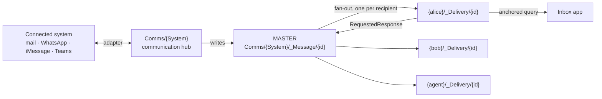

# The Communication Hub

Everything a person, an agent or an external system needs to be told — an approval to grant, a
question to answer, a job that finished — is **one message type family, delivered through one
fan-out, and read from one anchored inbox**. This page is the architecture: the participant
registry, the message types, the master-plus-copies delivery model, the per-system hub, and the
settings surface that registers a provider.

It generalises what already ships. [Notifications](/Doc/Architecture/Notifications) is the
special case where nothing is expected back; this page is the general case where something is.

## 1. The shape, in one picture



Three nouns carry the whole design:

| Noun | Is | Lives at |
|---|---|---|
| **Participant** | anyone or anything that can send or receive — a person, an agent, an external system, or a *configured channel account* (a mailbox, a WhatsApp number, an iMessage handle) | `Comms/_Participant/{id}` |
| **Message** | one typed communication — `ApprovalRequest`, `Notification`, `InformationRequest`, … | master at `Comms/{System}/_Message/{id}` |
| **Delivery** | one recipient's copy of a message, carrying *that party's* state | `{party}/_Delivery/{id}` |

## 2. Participants — the registry

🚨 **Every endpoint is registered, including the configured channel accounts themselves.** The
mailbox the platform sends from, the WhatsApp number it answers on, the iMessage handle — these are
not configuration buried in `appsettings`; they are participants, with the same identity shape as a
person. That is what lets an inbox row say *who* a message came from and *over what*, uniformly,
and what lets a reply be routed back the way it arrived.

```csharp
public record Participant
{
    [Key] public string Id { get; init; } = Guid.NewGuid().ToString();

    /// <summary>Display name — "Work mailbox", "Approvals bot", a person's display name.</summary>
    public string Name { get; init; } = string.Empty;

    /// <summary>WHAT this participant is — a <see cref="ParticipantKind"/> constant.</summary>
    public string Kind { get; init; } = ParticipantKind.Person;

    /// <summary>HOW it is reached — a <see cref="TransportKind"/> constant.</summary>
    public string Transport { get; init; } = TransportKind.InApp;

    /// <summary>The address ON that transport — the id a human recognises.</summary>
    /// <remarks>An email address, an E.164 phone number, a Teams conversation id, a handle.</remarks>
    public string? Address { get; init; }

    /// <summary>The party's mesh partition, when it has one. Null for a purely external party.</summary>
    [MeshNode] public string? MeshAddress { get; init; }

    /// <summary>Which way traffic may flow — a <see cref="TransportDirection"/> constant.</summary>
    public string Direction { get; init; } = TransportDirection.Both;

    /// <summary>A REFERENCE to the credential, never the secret itself.</summary>
    [Browsable(false)] public string? CredentialRef { get; init; }

    public bool Enabled { get; init; } = true;
}
```

### 🚨 These vocabularies are STRING CONSTANTS, never enums

Every closed vocabulary here — the kind, the transport, the direction — is a `static class` of
`const string`, **named exactly as the enum would have been**:

```csharp
public static class TransportKind
{
    public const string InApp    = "InApp";
    public const string Email    = "Email";
    public const string Teams    = "Teams";
    public const string WhatsApp = "WhatsApp";
    public const string IMessage = "IMessage";
    public const string Sms      = "Sms";
    public const string Webhook  = "Webhook";
    public const string Log      = "Log";
}

public static class ParticipantKind
{
    public const string Person         = "Person";
    public const string Agent          = "Agent";
    public const string System         = "System";
    public const string ChannelAccount = "ChannelAccount";
}
```

🚨 **And these sets are a starting point, never the permitted set.** A module, a satellite or a
customer deployment declares its **own** constants class and puts its own transport in the same
field — no registration, no allow-list, no change to core. That is what makes the hub extensible at
all: a channel nobody here has heard of is carried, stored, queried and rendered like any other, and
routed to whoever declared it.

The general rule, the two obligations it imposes on consumers (never validate against the platform's
own set; never let an unknown value take a meaningful default), and when an `enum` is still correct
are in **[Open Vocabularies Are String Constants](/Doc/Architecture/OpenVocabulariesAsStringConstants)**
— policy `open-vocabulary-string-constants`.

`Address` is the field the inbox row renders beside the transport glyph — a masked mail address or
phone number. **`CredentialRef` names a credential; it never carries one.** The hub resolves it, the
same encapsulation the plugin registry uses — see [Plugin Registry](/Doc/Architecture/PluginRegistry).

### Participant vs. NotificationChannel — two different things, both kept

`NotificationChannel` (`{user}/_NotificationChannel/{id}`) already exists and **stays**. The
distinction is worth stating because collapsing them is the obvious mistake:

- a **Participant** is an *identity* — this mailbox exists, this number is ours;
- a **NotificationChannel** is a *preference* — "reach me at this one".

A channel references a participant. `TransportKind` is the shared vocabulary, so the existing
`NotificationChannelKind` **enum** is converted to those constants and gains `WhatsApp`, `IMessage`,
`Sms`, `Webhook`, `Log`.

🚨 **That conversion is the migration the rule is built for.** `NotificationChannelKind` is a
`public` enum in `MeshWeaver.Mesh.Contract`; keeping the name and the member spellings means every
`NotificationChannelKind.Email` at every call site is untouched — only the declaration and the field
type change. Widening it *as an enum* would instead have broken every exhaustive `switch` under
`-warnaserror`, including in in-mesh NodeType sources that no `dotnet build` type-checks.

## 3. Message types — a family, not a switch

A message is a **node whose content type names what it is**. Adding a kind is adding a node type,
not editing a dispatcher:

| Type | Expects a reply | Terminal states |
|---|---|---|
| `Notification` | no | *(read)* |
| `ApprovalRequest` | yes, from each addressee | `Approved` · `Declined` · `Withdrawn` · `Expired` |
| `ApprovalResponse` | — | *(folds into its request)* |
| `InformationRequest` | yes | `Answered` · `Withdrawn` · `Expired` |
| `InformationResponse` | — | *(folds into its request)* |

Shared content: `ConversationId`, `From` (participant), `To` (participants), `Subject`, `Body`,
`About` (the node the message concerns), `CreatedAt`, `DueAt`; a response adds `InReplyTo`.

### 🚨 These are NODE CONTENT types, not wire messages

This is the one place the design can be misread into the exact antipattern the repo forbids. A type
called `ApprovalRequest` looks like the `XxxRequest`/`XxxResponse` pair that
[Data Access Patterns](/Doc/Architecture/DataAccessPatterns) rules out — and it is **not** one.

- ❌ There is no `IRequest<ApprovalResponse>`, no `hub.Post(new ApprovalRequest(...))`, no bespoke
  handler pair. A wire verb that mutates state races the watcher and wedges a hub.
- ✅ `ApprovalRequest` is the **content of a node**. It is created with `CreateNodeRequest` and
  changed with `GetMeshNodeStream(path).Update(...)`, like everything else.
- ✅ A state transition is a **`RequestedX` field plus the owning hub's watcher**: granting approval
  writes `RequestedResponse = Approve` on the recipient's own copy; the master's hub reacts.

The names describe *what the message is about*, which is domain vocabulary, not a transport verb.

## 4. Master plus copies — and why the copies are mandatory

One master, N deliveries:

- the **master** holds the payload and the *aggregate* — who was asked, who has answered, what the
  outcome is. It is owned by exactly one hub, so folding responses has a single writer and
  concurrent answers can never clobber each other.
- a **delivery copy** holds *one party's* state — `ReadAt`, `RequestedResponse`, `RespondedAt`,
  `DismissedAt` — and a reference to the master. It lands in **that party's own partition**.

### 🚨 The copies are what make the inbox legal

Fan-out sounds like the thing this codebase spent August eliminating. It is the opposite, and the
distinction is exact: [Cross-Schema Fan-Out Elimination](/Doc/Architecture/CrossSchemaFanOutElimination)
is about **unanchored queries on a render path**, not about writes.

Consider the alternative — one shared row per message and an inbox that asks *"every message where I
am a recipient"*. That query names no partition, so `PostgreSqlCrossSchemaQueryProvider` emits one
`UNION ALL` over every partition schema. That is precisely the shape measured on 2026-08-31 seizing
both production portals, and measured again on the bell at **4 476 rows across 201 of 201 schemas,
9–10 s per render, filtered to 0 rows in memory** on an idle replica.

With a per-party copy the inbox is `namespace:{me}/_Delivery` — **one schema, pinned, no registry
lookup**. The copy is not a convenience; it is the mechanism that keeps the read anchored. The
`_Delivery` segment routes the copy to the partition's satellite table exactly as `_Notification` does
today ([Postgres Schema Architecture](/Doc/Architecture/PostgresSchemaArchitecture)).

Two rules inherited from the bell, and both are load-bearing:

- 🚨 **One leg per partition, never a `namespace:A|B` alternation.** A single concrete `namespace:`
  pins to one schema; an alternation leaves the path null, takes the fan-out route, and is narrowed
  by intersection with `searchable_schemas` — which excludes `Admin`, so the platform lane would
  vanish silently.
- 🚨 **Write-side fan-out is bounded and off the render path.** N copies on send, where N is the
  recipient count. If N is ever unbounded the message is addressed to a *group participant*, which
  is expanded at read time by the group's own hub — never by a query with no partition.

### Who can see a copy

Nothing special. The copy lives under the party's path, so `RlsNodeValidator` falls through to the
ordinary path-based permission fold and the answer is already right — the addressee, plus whoever
can read their partition. This is the same reasoning as
[Addressed Notifications](/Doc/Architecture/AddressedNotifications); no satellite access rule is
needed, and adding one would be the bug.

## 5. The per-system communication hub

Each connected system gets one hub — `Comms/{System}` — and it owns four things:

1. **its participants** — the accounts it can send as and receive on;
2. **inbound**: external event → master message node;
3. **outbound**: master message → the transport;
4. **its credential**, resolved from `CredentialRef` and never leaving the hub.

The adapters are not new. The pipeline below the transport is already transport-agnostic — *inbound
message → find-or-create thread → agent → reply* — so a channel is an adapter onto it, not a second
pipeline ([Email Ingestion & Channels](/Doc/Architecture/EmailIngestionAndNotifications)). Email
(Graph subscription → `EmailInboundProcessor`) and Teams (Bot Framework → `TeamsInboundProcessor`)
exist; WhatsApp and iMessage are the same shape, and
[Webhook Inbox](/Doc/Architecture/WebhookInbox) is the generic, fail-closed inbound door.

Three constraints the hub inherits and must not quietly drop:

- 🚨 **Mail is DraftOnly by default.** `Email:AgentSend` defaults to `DraftOnly`, and in that mode
  the send tools are never handed to the model at all. An outbound `ApprovalRequest` over the mail
  transport **drafts**; a person sends. See [Executive Assistant](/Doc/AI/ExecutiveAssistant).
- 🚨 **Nothing async.** Adapters return `IObservable<T>`; every transport edge goes through
  `IIoPool` ([Asynchronous Calls](/Doc/Architecture/AsynchronousCalls),
  [Controlled IO Pooling](/Doc/Architecture/ControlledIoPooling)).
- 🚨 **A hub binds its configuration once.** Registering a participant changes what the *next*
  activation loads; the running one keeps serving what it holds until a `DisposeRequest` reaches it.
  Recycle the hub after a provider change — see
  [Stale State Until Recycle](/Doc/Architecture/StaleStateUntilRecycle).

## 6. The inbox surface

### 🚨 The inbox is an ARRAY OF QUERY STRINGS — everyone brings their own food

**The inbox owns the table, not the food.** It holds no schema for other people's items and knows
nothing about approvals, mail or chat. Every provider contributes **its own query string**; the
inbox runs them all and merges the rows into one list. That is the entire contract.

```text
inbox(viewer) = merge(
    "namespace:{viewer}/_Notification nodeType:Notification sort:CreatedAt-desc",   ← notifications
    "namespace:{viewer}/_Delivery     nodeType:… sort:CreatedAt-desc",              ← messages
    …one leg per provider, each contributed by the provider itself
)
```

🚨 **Installing a package installs its queries.** A package that creates things a person must act on
ships, as part of its installation, the query leg that finds them — alongside its node types and its
views. A provider that has to be taught about in the inbox's own code is a provider that will be
forgotten; the inbox must never carry a list of the packages it knows.

Like the dispatch chain, the legs are **durable** — contributed as nodes, so a package adds one by
installing a node and the inbox picks it up with no redeploy. Same rule, same reason:
[Open Vocabularies Are String Constants](/Doc/Architecture/OpenVocabulariesAsStringConstants).

🚨 **Every leg names ONE partition, and this is where the master-plus-copies design pays for
itself.** A leg must be anchored or it becomes the `UNION ALL` over every schema described in §4 —
so a leg reads the VIEWER's own partition. But an approval lives beside the document it approves,
which may be in any partition at all, so *"every approval where I am the approver"* is exactly the
unanchored query that cannot be allowed. The copy in the viewer's partition is what the leg finds.

**This is not aspirational — the shipped Approvals package already works this way.**
`ApprovalActions.Request` writes the approval as an `_Approval` satellite of the document (the
master, beside the content, inheriting its access) and then dispatches a `Notification` to the
approver (the copy, in the approver's own partition). The bell's existing leg finds the copy. The
Communication Hub generalises a shape that is already in production, rather than introducing one.

Two rules inherited from the bell, both load-bearing: one leg per partition and **never a
`namespace:A|B` alternation** (an alternation leaves the path null, takes the fan-out route, and is
narrowed by intersection with `searchable_schemas`, which excludes `Admin` — so the platform lane
would vanish silently); and the platform leg is issued only for a viewer `hub.IsGlobalAdmin()`
confirms positively.

### The row

One row per item, whatever the channel:

```text
☐  🏢 Acme AG → Counterparty   Retype 8 partition roots, 3 fields  ⚙️ Approvals/Workspace   2m
☐  📄 A. Buyer (Acme AG)       Re: workshop follow-up              ✉️ a.buyer@acme.example  1h
☐  👤 B. Seller (Acme AG)      Question on the proposal            📱 +41 ·· ··· ·· ··      3h
```

🚨 **The leading glyph shows what is MISSING. A green check appears ONLY when the item is done —
never before.** An inbox item is an OPEN obligation: the whole reason it is in the inbox is that
something is still owed. A ✅ on a pending row reads as *already handled* and makes a list of
outstanding work look finished at a glance, which is the one thing this surface must never do.

- **open** → an empty box `☐`, whatever the channel
- **done** → `✅`, and only then
- **overdue** → its own mark, not a colour alone, so the state survives for a viewer who cannot
  distinguish red from green

### Three bands: what is owed, what is running, what just happened

```text
Needs you
☐  🏢 Acme AG → Counterparty   Retype 8 partition roots, 3 fields  ⚙️ Approvals/Workspace   2m

Running
⏳  📄 Quarterly export         Writing rows… 1 240 so far          ⚙️ Activities            4m
⏳  💬 Pricing review           Agent is answering…                 💬 Threads               1m
⏳  🏢 Acme AG bake             Compiling node types                ⚙️ Activities           12m

Last 24 hours
✅  🏢 Acme AG onboarding       Approved by you                     ⚙️ Approvals/Workspace   4h
❌  📄 Nightly import           Failed: 3 rows rejected             ⚙️ Activities            9h
```

All three are fed by the same mechanism — each band is one or more provider-contributed query
strings, anchored the same way. The bands differ only in what their legs select:

| band | selects | glyph |
|---|---|---|
| **Needs you** | open obligations addressed to the viewer | `☐` |
| **Running** | marked activities still going (`ActivityStatus.Running`) **and threads executing**; a marked activity that FAILED is in *Needs you* | `⏳` |
| **Last 24 hours** | *(core feeds it the approvals decided in the last 14 days — see the ledger under Approvals)* | `✅` |

🚨 **As built (policy `inbox-activities-need-someone`):** core's own Activities source lists only
the runs MARKED for the inbox (`ActivityLog.ShowInInbox`, set by the code that starts a run a person
asked for and waits on, or one that will need their decision) that still need someone: a run still
going is in *Running*; a run that FAILED is finished, so it is in *Needs you*, dealt with on its own
page. Background runs (scripts, Tests-area runs, indexing) are never marked, so they never appear.
A run that finished well is not listed; its own page keeps it.

**Running is its own band because it is neither.** It is not owed by the viewer — pushing it into
*Needs you* invents an obligation nobody has — and it is not finished, so it cannot carry a tick. It
is also the band that answers the question people actually open the inbox with when something is
slow: *is it still going?*

🚨 **Running is a live band, so it needs no poller.** The rows come from the same node streams
everything else binds to; an activity that finishes well leaves the band on the next emission. A timer that re-reads "is it done yet?" is the band's failure mode, not its
implementation.

This is also the only place a tick legitimately appears — the third band is *by definition* things
that are done. Keeping the bands apart is what lets the first stay an honest list of outstanding
work: one merged list sorted by time buries the single open item under twenty completed ones, which
is exactly what the glyph rule above guards against.

The activity legs read the viewer's own `_Activity` satellites — `namespace:{viewer}/_Activity
nodeType:Activity sort:LastModified-desc` — one partition, pinned, like every other leg. That is the
same shape the platform's existing **running-activities stripe** already uses, so the Running band
is a second reader of a query that ships today, not a new mechanism.

**A running THREAD is a second leg in the same band, contributed by the Threads app** — the potluck
working as intended: the inbox learns nothing about threads, it just runs the query Threads brought.
The leg reads the viewer's own `_Thread` satellites and selects the executing ones, and each row
**opens in the Threads app** rather than rendering a conversation inside the inbox. The inbox lists
what is in flight and hands off; it is not a second chat client, and a row whose only job is to link
must not grow the ability to answer.

🚨 **`Executing` is a thread's own `Status`, not an `ActivityStatus`, and the two must not be
conflated in one leg.** They are different vocabularies on different node types with different
lifecycles — a thread also has `Idle`, `StartingExecution` and `Done`, and `StartingExecution` is a
claim edge rather than work in flight ([Activity Control Plane](/Doc/Architecture/ActivityControlPlane)).
Two legs, each selecting its own type's own states, merged for display only.

🚨 **The 24-hour window is a display bound, not retention.** Narrowing it hides rows; it deletes
nothing, and it must never be mistaken for the retention pass that actually bounds the data
([Notification Retention](/Doc/Architecture/NotificationRetention)).

### Select many, then act — what ships today

The Inbox app (`/{user}/Inbox`, `InboxLayoutArea`) is ONE `Controls.DataGrid` over every leg, with
the platform's own selection column (`WithRowSelection`, [DataGrid](/Doc/GUI/DataGrid) → "Row
selection") — and everything above the grid is **data-bound**.

The page holds one piece of view state, an `InboxFilter` in its data section, and each control is
bound to a field of it. No control has a click handler that re-renders the page; the rows are a
function of the filter and the legs.

> **Layout (2026-10).** Every filter below lives in a side panel beside the list (a platform `LayoutGrid`: the
> panel stacks ABOVE the list on a narrow page), grouped under small titles — Kind, Tags, Source, Options. The
> toolbar over the list holds the bulk acts only, icon-only (the name is the tooltip and accessible name; all four buttons share one quiet appearance — none is picked out in the accent colour):
> Delete, Undo and — only while the list or the ticked rows hold an approval request the viewer decides
> (`InboxLayoutArea.ToolbarOf`) — Approve and Reject. The grid's first column is headed **Source** and shows the
> MEDIUM the item came through; `InboxSourceIcons` maps the leg's source id to a Fluent symbol (Approvals,
> Notifications, Activities, Mail, Chat, Conversations) or a small inline mark (Outlook, Gmail, iMessage,
> WhatsApp, Teams), falling back to the symbol the leg declared. The side panel lists each source with that same
> symbol and a switch. "N item(s) needing you are hidden by the source filter" is one quiet line with a Show all
> action that clears Only and switches every source on.
>
> Kinds, per-kind states, sources and "Show ignorable" are CHECKBOXES bound to the person's own `InboxPreferences` node
> (`kinds/{key}`, `activityStates/{group}`, `mailStates/{group}`, `chatStates/{group}`, `sources/{key}`, `showIgnorable` — see "What the inbox shows by default" below), the
> tags a bound list of `InboxTagItem`: the union of the ticked kinds or tags is listed, and none ticked lists all. A **State**
> column (`InboxState`, read from the node's own status or implied by the leg that found it) badges each row:
> Awaiting decision / Approved / Rejected / Expired for approvals, Requested / Running / Done / Failed / Cancelled
> for activities, Unread for mail and notifications. A check mark is reserved for done states; approval requests
> are symbolised by a gavel (`InboxSourceIcons`), never a tick.

| Control | Bound to | What it does |
|---|---|---|
| search box (top of the side panel) | `search` | the term goes to the query engine with EVERY leg, as free text (full text and the semantic index), under the owner's identity — never a match over the rows already loaded |
| one symbol + switch per CONFIGURED source (side panel, Source) | the preferences node's `sources/{key}` (the id, hex-encoded) | shows or hides what one provider brought, its symbol `InboxSourceIcons.Resolve`; a source with no entry is shown, so a leg a package brings later never arrives switched off. A source the viewer has not connected has no switch at all |
| the Account select (`SelectControl`), under the Only select | the preferences node's `account` (an address key, empty for all) | one option per configured ADDRESS — each mailbox, not each provider — fed from the addresses the rows reached; picking one lists only what reached it |
| the Only select (`SelectControl`), above the source rows | `only` (a source key, empty for all) | picking one source lists that source alone and wins over its switch; "All sources" gives the switches back exactly as they were. A side-menu category still wins over both |
| the Show ignorable switch (side panel, Options) | `showIgnorable` | items a triage judged `ignorable` (`InboxImportance` — spam, promotions, noise) stay out of the list until it is on; the notice above the grid counts what it hides. Items nobody judged are always shown |
| the tags (`RadioGroupControl`, side panel) | `tag` | GitHub's label filter over the triage's tags (`InboxRow.Tags`): Important first, then each tag by use, each with its count. A tag narrows the folder and sources shown |

| the grid's checkboxes | `inboxSelection` | the ticked row keys, read by Delete |

Three properties of that binding are load-bearing:

- **Every leg is a live read bound to the page.** Idle or searched, a leg is an `IMeshService.Query`
  folded from deltas into "what the leg selects now", ended when the term changes or the page closes.
  Never the process-wide synced query (`GetQuery`): that cache lives as long as the process, per
  distinct query text, and every leg is resolved for its owner — so it would keep a subscription and
  a snapshot per leg for everyone who ever opened their inbox.
- 🚨 **The term is free text, never grammar.** It is handed over as one quoted phrase with its quote
  characters removed, and the leg's bound is pinned on the request (`MeshQueryRequest.Limit`, which
  wins over any `limit:` in the string). Spliced in raw, `OR content.status:Archived` would parse as
  "(the leg) OR archived" and bring put-away rows back, and `limit:all` would lift the bound. A search
  narrows a leg; it never replaces its constraints.
- 🚨 **The filter is compared by VALUE.** The data section re-emits an id whenever any id in it
  changes — the grid's own rows included — and each emission is a freshly deserialized record. Read
  naively, the page feeds on its own writes: rows written, filter "changed", rows written again,
  without end. `InboxRows.Fingerprint` is what tells a change the viewer made from a re-emission.
- **One list, newest first by default.** The bands are a rank rather than three stacked lists:
  "what needs you first" is one choice in the settings menu, and an order the page does not
  recognise falls back to newest first.

**The list reads like a mail client's.** Each row starts with its source's symbol; its columns
are what, from whom and when. A source with read state brings TWO legs — one selecting its unread
items (`InboxQueryLeg.Unread`), one the rest — so "unread" is decided by the query, never by
reading content on the page: unread mail is "not `Read`", an unread notification is "not
`isRead`". An unread row carries `rowClass: inbox-unread` and the grid applies it per row
(`DataGridControl.WithRowClassProperty`), so it renders bold. A LIVE source that answers read and
unread items in one leg (a mailbox read from its provider) says so per item instead: a timed row
reads `isRead`, `from` (the sender, shown in the From column — else the source's name) and
`webLink` (an https address in the provider's own client) from its content.

**A click on a row opens it — always INSIDE the portal** (`DataGridControl.WithClickAction` →
`InboxLayoutArea.OpenTarget` → `InboxReadingView`; owner, 2026-10-16: *"when clicking, it should
always give me a memex view with the content, not redirect me"*). The row goes to the owner's
reading view, `/{owner}/Inbox/{item}`, where `{item}` is the row's node path base64url-encoded into
one segment (`InboxReadingView.ItemId`). There:

- an item whose path an **`IInboxItemReader`** handles (`Handles(path)` — a live mailbox or chat
  row, which no store holds) is READ LIVE by that reader as the owner — subject, sender, account,
  received time in the viewer's zone, the body and a conversation's messages. Everything a reader
  returns is PLAIN TEXT and rendered escaped; nothing is stored. A package registers its reader as
  a singleton service beside its `InboxQueryLeg` and `IInboxItemHandler`;
- any other (stored) item is shown by its own page, embedded (`Overview`);
- the provider's own client (`webLink`, https only) is a secondary **Open in …** link under the
  content — never where the click goes. The one transitional exception: a row with an https
  `webLink` whose path NO reader handles (its package predates `IInboxItemReader`) still opens in
  the provider's client, because no store holds it and the reading view would have nothing to show;
  it opens inside the portal as soon as its package ships a reader;
- only the owner's own items open: a path outside the owner's partition reads "not in your inbox".

Ticking a box, and shift/cmd-clicks, are selection gestures the grid keeps to itself.
The grid is paged (50 a page, the size selectable). A source without a symbol is toggled by a
button that shows its NAME — never a single letter, which the icon renderer read as an icon name
and drew as an empty button.

**Reading never reorders.** A row is timed by its node's `LastModified` unless its source names a
content property instead (`InboxQueryLeg.TimeField`, e.g. a conversation's last reply). Name one
whenever a write that is not news touches the node: clearing an unread mark refreshes
`LastModified`, and timing by it would move the item ahead of genuinely newer ones. The page keeps
`content` in such a leg's projection (`InboxQueries.TimedRowProjection`), and a row whose field is
missing falls back to `LastModified`. 🚨 The leg's own `sort:` still chooses which rows its bound
keeps: sort on the field only when every node carries it — a descending sort puts a missing value
FIRST on Postgres, so older nodes without it would crowd newer ones out.

**Approvals are their own source (✅), shown by default.** An approval request is the "approval
required" notification its flow sends the approver — a document approval, an instance action, a
governed-activity signature — so the Approvals leg reads the viewer's own `_Notification` partition
and the notification feed no longer carries them. 🚨 `NotificationType.ApprovalRequired` is the enum
DEFAULT and is omitted from stored JSON, so the leg NEGATES every stamped type
(`InboxQueries.StampedNotificationTypes`, pinned against the enum by a test).

**The approval is the row — never the announcement (2026-10-23).** The "approval required" notification
stays in the approver's partition after the request is decided, wherever it was decided (the inbox's
Approve, the approval's own page, an operator's button), and listing it for ever made the inbox a log of
decisions long taken (*"something announcing i had an approval?! … i should just see approvals which are not
approved yet"*). So the Approvals source files a request by what the node it names
(`Notification.TargetNodePath`, `InboxRow.Target`) says about it (`InboxApprovalTargets.Read`), **judged by the target's own
lifecycle, never by the absence of an approver** (2026-10-23, second round: a reconcile the control plane had REFUSED as stale
carried no `approvedBy` and so still read "Awaiting decision"). The target is OPEN only while it still waits: its lifecycle word
(`state`, then `status`) is not final and nothing closes it. It is CLOSED when that word is final — `Refused`, `Failed`,
`Cancelled`, `Stale`/`Superseded`, `Expired`, `Done`/`Completed`/`Closed`/`Merged`, or a decision being carried out
(`Running`, `Requested`) — when an end stamp (`finishedAt`, `closedAt`, `completedAt`) is set, or when it carries a
recorded decision: a `status` of approved/rejected, or an `approvedBy`/`approvedAt`/`approvalDate`/`rejectedBy`/`rejectedAt`/
`decidedBy`/`decidedAt`. The inbox knows no approval kind; any approval-gated type shares that vocabulary. A closed target keeps
its request as a **closed row**: its State is the outcome — **Stale** for a target retired because what it was planned against
moved on (a word `stale`/`superseded`, or a refusal whose `error` begins "stale"), else Approved, Rejected, Refused, Failed,
Cancelled, Expired or Done — and it is listed only under the *Done* state filter, so the default (*Open*) view lists the
requests that still wait. The grid's **Status** column carries the detailed text (`Refused · stale`, `Done`, `Awaiting
decision`; for a running activity `Running · step 3/7`), beside the short State badge. 🚨 A decision that is recorded but not yet CONFIRMED is not decided: with step-up required ([Approval step-up](/Doc/Architecture/ApprovalStepUp)) a recorded decision with no receipt stamped (`stepUpReceipts`) is HELD, so the request stays until the receipt lands — the approver who walked away from the confirmation still finds it. The target is observed live through its own stream (a decision taken on the approval's own page drops the request from an open inbox; a deleted and recreated approval is picked up again). A target read that fails or times out keeps the
request (logged); a target that answers completely with nothing — gone, or not the approver's to see — has
nothing left to decide and the request leaves altogether. A **click on the row opens the approval** (`InboxLayoutArea.OpenTarget`),
and the inbox address of such a notification (`/{user}/Inbox/{item}`, an old link) redirects to it
(`InboxReadingView`). A notification raised for the approvals feature is never a row of the Notifications
source, whatever its type: what became of an approval is the ledger's row below.

**The Approvals source also carries a ledger: requested by me, and recently decided.** Three groups
share the one Approvals switch and category, in band order. *Needs you* is the notifications above.
*Running* lists the approvals the viewer REQUESTED that still wait for their approver, each saying
"Requested from X". *Recent* lists the approvals decided in the last 14 days (`InboxQueries.DecidedWindow`)
where the viewer was the requester OR the approver, each saying "Approved by X" / "Rejected by X" and
timed by the decision, in the viewer's zone (`InboxRows.Of`, via `AccessService.ToDisplayTime`). These
rows are the approval RECORDS themselves (`Approval`, the `_Approval` satellites beside their documents),
opened at the approval's own page. 🚨 They are the one place a built-in leg is **not partition-anchored**:
a record lives beside its document, in any partition, and only the approver ever gets a copy in their
own — so the requester has nothing of their own to anchor on. Each ledger leg is instead keyed to the
viewer (`content.requester:{viewer}` / `content.approver:{viewer}`), bounded, projected and DECLARED
mesh-wide (`partitions:all`), and runs as the viewer, so access still narrows it.
`InboxQueries.IsLedgerQuery` admits exactly those shapes; a contributed leg that is not anchored stays
refused. Pending is the enum default and omitted from stored JSON, so *requested* negates the two
stamped decisions rather than matching `Pending`.

**Approve / Reject act on every ticked approval request.** The inbox sends the node the request
points at (its `TargetNodePath`) a `DecideApprovalRequest` **as the approver** — the decision is
authored by them and authorized by the node's own type, exactly as its own Approve button is — and
files the request away once the type answers `Done`. The inbox knows no approval kind: each type
handles the request on its own hub and answers a refusal with its reason. A decision is not
undoable from the inbox; it is the approval's own record.

**One step-up for the whole batch.** Where the instance requires a step-up confirmation, a type
records the decision and answers `StepUpRequired` with the binding its own control plane consumes
(`DecideApprovalResponse.StepUpBinding`). The item stays in the inbox, and its outcome carries the
target (`InboxItemOutcome.StepUp`). When the batch ends, the inbox sends the approver to ONE step-up
covering every held decision (`StepUpPaths.StartUrl` with all targets — the endpoint already stamps
a receipt per target), then back to the inbox. Each type's control plane consumes its own receipt
and ratifies, and the request leaves the inbox once its type files it away.

### What the inbox shows by default — and what it keeps (2026-10-23)

*"Default only open approvals and important notifications … let's configure the category filter on the left freely."*
The filters that persist are one node per person, `InboxPreferences` at `{user}/_Settings/Inbox` (the shape of
the notification settings): `kinds`, `sources`, `activityStates`, `mailStates`, `chatStates` (each `{key: bool}`), `account` and `showIgnorable`. The
checkboxes are bound **directly to that node** (`LayoutAreaReference.GetMeshNodeDataContext`, per-field writes
through the node stream — [DataBinding](/Doc/GUI/DataBinding)): there is no `/data` copy and no save subscription,
so a tick is one write, the next open of the inbox finds it, and a change from another device re-feeds the grid
live. The search text, the Only select and the tags stay in the page's data section: they are the view's, and end
with it.

A person who never chose gets the node on first open, seeded with `InboxPreferencesNodeType.Defaults`:

- **Kinds** — ticked: those whose legs say `InboxQueryLeg.DefaultKind` (Approvals and Notifications); every other
  kind is one tick away. Kinds and sources now **both** apply (a ticked kind used to replace the source switches).
- **States are per kind, never one shared list** (owner, 2026-10-25: *"emails should not count as Done — filters must be type specific"*; *"must be separate filters"*). Each kind owns its vocabulary, its stored field and its default:

  | Kind (`InboxStateKind`) | Filter field | Groups | Default |
  |---|---|---|---|
  | Approvals and activities (`activity`) | `activityStates` | Open / Done | Open only: an approval awaiting a decision, never one already decided, refused or retired as stale |
  | Mail (`mail`: Outlook, Gmail, copy-served alike) | `mailStates` | Unread / Read | both — a read mail is still listed and is never "done" |
  | Conversations (`chat`: Teams, WhatsApp, iMessage, portal threads) | `chatStates` | Unread / Read | both |
  | Notifications (`notification`) | none | important / ignorable (*Show ignorable*) | important only |

  A leg declares its kind with `InboxQueryLeg.StateKind`; left empty, the kind its category implies applies
  (`InboxStateKind.Resolve`: `Mail`, `Conversations`, `Notifications`, else activity), so a provider filing under those
  categories is right without saying so, and a new provider with its own vocabulary names the kind it wants. The side panel
  shows one group per kind, only while that kind is connected and enabled (ticked, or no kind ticked). A row answers only to the filter of ITS kind: a
  read mail is not hidden by an activities filter that shows open items only, and ticking Done on activities touches no mail.
  The triage buckets of mail (reply / act / working-on / waiting / fyi …) are the tag list and remain the primary
  grouping beside these filters.
- **Migration.** The retired global `states` choice maps to `activityStates` ONLY and is emptied once moved; `mailStates`
  and `chatStates` start at their defaults. `InboxPreferencesNodeType.Effective` applies this on read and `Completed` writes it once
  into the stored node (idempotent — a second pass finds nothing missing). Until 2026-10-25 the single global filter grouped a read
  mail as *done* and hid it, so an owner with the old default saw an empty mail inbox and none of its triage buckets.
- **Important notifications only.** A notification is `important` when it is a platform/system event and
  `ignorable` otherwise (`InboxRows.NotificationImportance`; a triage's own judgement wins), so the quiet ones stay
  out until *Show ignorable* is ticked, and the notice above the grid counts what it hides.

The page never overwrites a choice: a kind or source a package brings LATER is added by one idempotent merge of the
missing keys into the node's current content (sources at their `ShownByDefault`, kinds unticked, and a second
pass finds nothing missing — a pass that did would be logged as an error and not repeated).
🚨 A set of keys counts as written only once the owner CONFIRMED the write (`InboxSeedGuard`), and the loop check
reads the CONFIRMED node, never the page's own view of it. The rows, the filter and the tag ticks each re-run the
pass, and any of them can arrive before the committed write reaches the page: that pass sees the keys still missing,
which is a stale read, not a loop. Until #7260 the guard recorded the keys when the write STARTED, so that stale pass
logged *"written this session and are still missing … not writing again"* over a write that had in fact landed
(measured: the node's new version is stamped the same second as the error). A write that FAILS is released and
written again by a later pass, instead of being skipped for the rest of the session.

**By address.** A multi-account source is filtered by the ADDRESS an item reached, not by provider: a row's
`Account` is the content's `account` (a live mailbox stamps it) or the address of its `to` (stored mail); the
Account select offers one option per address the rows named — each once, whatever its case — and the choice is
the preference `account`. An address no row names filters nothing, so it has no option.

**Categories (policy `inbox-categories-by-kind`).** A side menu — the platform's one-choice
control (`RadioGroupControl`), its value bound to the filter's `category` and its options fed with
the live counts (`InboxLayoutArea.CategoryOptions`) — lists All, then each category with its symbol
and count (unread when it has any, else all): Approvals, Mail, Conversations, Notifications,
Activities. A source names its category (`InboxQueryLeg.Category` and
`CategoryLabelKey`; WhatsApp, Teams, iMessage and portal chats share **Conversations**), else its
source is its category. The picked category lives in the page's filter (`InboxFilter.Category`):
it shows every item filed under it, even from a source switched off by default, and All leaves the
source switches in charge. The counts are read before any filter applies
(`InboxRows.CategoryCounts`). The menu sits in a COLLAPSIBLE splitter pane: the platform
splitter's own handle hides it and gives the list the width.

🚨 **The chrome shows monochrome glyphs; a brand mark identifies a SOURCE** (maintainer, 2026-10-30:
*"icons from teams / outlook / google don't mix well with other icons"*). A category's symbol is
`InboxSourceIcons.CategoryIcon`: the table's Fluent glyph for the category (Conversations → a chat
bubble, Mail → an envelope), else the first Fluent glyph among its sources, else the fallback — never a
full-colour logo, even when the category's first source carries one (Conversations listed WhatsApp
first and showed its logo). Logos stay in the per-item Source column and on a source's account row.

**What a package puts on the inbox page** is declared as data: a `UiContribution` of context
**`Inbox`** (`UiContribution.InboxContext`) embeds its `Area` of the person's own user node — or of an
`Address` inside the contribution's own partition — above the list, beside the notices, in `Order`
(`UiContributionProjection.ProjectInboxAreas`). The Mail package uses it for its **Accounts** button,
which opens the Mail app's accounts view, and for a note per listed source that is not connected.

**Only connected sources (policy `inbox-connected-sources-only`).** A source names how to tell it is
connected for a viewer — `InboxQueryLeg.ConnectedWhen`, a query for its credential, its account
record or a first message over its channel, anchored on the viewer's partition exactly as the leg
is (an unanchored one is refused and logged with the leg) and asked for one node
(`InboxQueries.ConnectionProbe`). The page is a TEMPLATE, emitted at once: every source's toggle
and switch is declared, each with its style BOUND to `InboxLayoutArea.SourceStylesId`. The rows
feed asks every connection query once (`InboxLayoutArea.Connected`), publishes the styles and the
Only options, and reads only the connected sources' legs: a mailbox nobody connected is hidden
(`display: none`), not offered in Only or the side menu, and never read. Until the reads answer,
only the sources that need none are shown. A source is
listed for the viewer only when it is **always on** (`InboxQueryLeg.AlwaysOn` — the platform's own: approvals,
notifications, activities) or its connection query finds a node. 🚨 A leg that names NEITHER is not connected: "no
declaration" is not a connection, and the old reading (*no query ⇒ listed for everyone*) put every forgetful
provider's source — portal chats among them — on every viewer's page, configured or not (*"i should not see
those, only if they are really configured"*). A provider names the query that finds ITS connection; the
declaration lives in the leg, not in a list in the layout (`EveryBuiltInLeg_IsAlwaysOn_OrNamesItsConnection`). A connection query
that fails or does not answer within `InboxLayoutArea.ConnectionWait` LISTS its source and is
logged — an unreadable connection must never hide a mailbox the viewer did connect. So does an
INCOMPLETE empty answer (a silent provider, an unfinished storage read — `InboxLayoutArea.FoundConnection`):
only a complete empty answer hides a source. Whatever projection a provider wrote, the query runs for
the path alone (`InboxQueries.ConnectionQuery`). Every text the feed writes is resolved on the render turn, in the viewer's language — never on
the thread a connection read answers on. Core's own
stored-mail source is connected once mail is stored for the viewer. Owner, 2026-10-15: *"i see a lot
of stuff that's not even configured ==> must get only configured sources"*.

**Which account.** A person reads several mailboxes in one list, so a row names the account the item
reached when its source stamps one (the content's `account`, `InboxRow.Account`, the Account
column); a source with a single account per viewer may leave it empty.

**Put away everything before a day.** The order is ALWAYS newest first (policy
`inbox-newest-first`; `InboxFilter.Order` is no longer read and the settings menu offers no order). The search box also takes date bounds, `before:2026-10-01` (strictly
before that day) and `after:2026-10-01` (that day or later), in UTC: they narrow the rows by their
time (`InboxRows.SplitDates`), and only the remaining text goes to the sources. A bound that is not
a date stays text and is searched for as written. Tick all, then press Delete, to put away
everything in the range. It reaches the rows the page has read, each source's newest
`InboxQueries.LegLimit`; the "capped" notice says when a source has more.

The command row's Delete and Undo act on every ticked row; **Backspace or Delete presses Delete**
(`ButtonControl.WithShortcut`) — never while typing in the search box.

| Button | Does | Never does |
|---|---|---|
| **Delete** | puts each ticked item away through its own type's `IInboxItemHandler.Dismiss`, records the batch | remove a node from the mesh |
| **Undo** | brings the last batch back through `IInboxItemHandler.Restore` | touch anything Delete did not put away |

🚨 **Delete is SOFT, and what it means belongs to the item's type, not to the inbox.** The action
half of the potluck mirrors the query half: a package that brings a leg brings, as a singleton
service, the `IInboxItemHandler` for the node type its leg selects. "Put away" moves the item into a
state the package's OWN leg excludes — and Undo brings it back into that leg. Not the exact inverse:
the inbox keeps no record of the prior state, so Undo returns the item to a state its leg selects
again, chosen by the handler (an archived mail comes back as Read, whether it was New or Read):

| Item type | Brought by | Delete | Undo | The leg excludes |
|---|---|---|---|---|
| `Notification` | core | `Dismissed = true` | `Dismissed = false` | `-content.dismissed:true` |
| `Email` (`{user}/_Email`, inbound) | core | `Status = Archived` | `Status = Read` | `-content.status:Archived` |
| `Thread` | the Threads app | closes the conversation | reopens it | `-content.status:Done` |

Three rules follow, and each is pinned by a test in `InboxSelectAndDeleteTest`:

- **A row whose type has no handler is LISTED but not selectable**, and its disabled checkbox says
  why. The inbox never guesses a write for a type nobody taught it — a governed record (an approval,
  an instance action) deliberately has no handler and leaves the inbox by being decided.
- **A row in *Running* is never selectable.** It is not the viewer's to put away; it leaves the band
  by finishing.
- **An outcome never quotes an exception.** A handler's `Reason` is shown to the viewer verbatim, so
  it is a refusal the handler chose to state. A write that faults is LOGGED and answers with no
  reason; the page then says only that the item could not be changed.
- **A leg that does not read exactly the viewer's own partition is never run.** `InboxQueries.Resolve`
  drops it — its first term must be a `namespace:` or `path:` whose first segment is the viewer,
  literally, with no `partitions:all` — and the page logs it as an error naming the source. A
  provider's mistake is loud, and it can never become a fan-out over every schema on every render.
- **Every leg is read through the row projection.** The page appends `InboxQueries.RowProjection`
  (and the bound) to whatever a provider wrote: a leg with no `select:` would fetch whole thread and
  message bodies to render one line each.
- **A provider band has a display name too.** `InboxQueryLeg.BandLabelKey` names its catalog text;
  core's own three bands are named by core.
- **The orderings are a closed set**, owned by the page; a stored order outside it reads as the
  default, newest first.
- **A source has an id and a display name.** `InboxQueryLeg.Source` keys the switch; `SourceLabelKey` names the catalog text the row and the switch show in the
  viewer's language. A provider gives no key only for a name that is the same in every language.
  A key the running platform's catalog does not define falls back to the provider's own name, so a
  package may name a key a newer platform adds without the viewer ever reading the raw key. The
  Threads app's word-like sources (`Chat`, `Conversations`) have core keys; channel names
  (WhatsApp, Teams, iMessage) are the same in every language and carry none.
  The row's date is written in the viewer's time zone AND the viewer's date format.
- **A bulk act never leaves the owner's partition.** A search runs with the viewer's rights and may
  list a node elsewhere; a ticked row outside `{owner}/` is not a target.
- **A selection is the viewer's claim, not a grant — and it is the ONLY thing taken from the
  client.** The data section is two-way, so the click never trusts what is in it: the ticked keys are
  intersected with the owner's own feed, re-read from the legs at the click (which also supplies the
  node type that picks each handler), and every write is issued under the CLICKER's access context,
  opened around the handler call. The Undo batch is a host variable for the same reason — kept in the
  data section it would be whatever the client says it is.
- **"The write completed" is not "the item was put away".** A handler answers `Done` only when THIS
  call changed the content AND the content is now in the asked-for state. A no-op (an outbound mail)
  completes like any other write; and an item someone else already put away is in the asked-for
  state too — counted, it would enter this click's Undo batch and Undo would reverse the other
  writer's act.
- **Each source is asked for its newest `InboxQueries.LegLimit` rows — or fewer, when its provider
  names a smaller positive `limit:` — and the page says so when a source answered its full bound.**
  `limit:all` and a non-positive limit are UNBOUNDED to the parser, so they are capped like a leg that
  names none; the effective bound is also pinned on the searched read's `MeshQueryRequest.Limit`. Unbounded, the page folds every historical row into memory and into the
  client's payload on a surface that is open all day. Older items are found with the search, which
  goes to the query engine; "oldest first" therefore orders the listed window, not all history.
- **The read names the viewer.** A leg is (re)subscribed on a data emission, where the ambient
  identity is gone, so the live read takes the viewer as an argument.
- **A source that cannot be read is named — and read again only when the viewer asks.** It
  contributes no rows, is logged, and is listed in a notice above the grid: an unreadable source must
  never look like an empty one. It is re-read when the search changes or the page is reopened, never
  on a timer — a provider that stays broken would otherwise be re-queried and re-logged for as long
  as any inbox is open.
- **A source that does not ANSWER never holds the others** (2026-10-30, "mails load forever"). The legs
  are combined with one bound per leg on its FIRST answer (`InboxLayoutArea.FanIn`, `LegAnswerWait` =
  10 s): a leg still silent then stands in as an empty answer, the other sources are listed, and a
  notice names it — `inbox.slow`, *"Did not answer yet, so the list shows the other sources: Gmail"*. Its
  own answer replaces the stand-in whenever it arrives. Before the bound, `CombineLatest` waited for every
  leg, so one silent provider kept the whole list spinning.
- **The handler builds its write INSIDE the call.** `Update` captures the caller's identity when it
  is constructed, and the inbox opens the clicker's scope only around the call. A write deferred to
  subscription runs, for every item after the first, on the previous write's completion thread — as
  nobody — so a multi-row Delete would put away only its first row.
- **Delete and Undo hold the page one at a time.** They are separate buttons, so the click framework
  would run them side by side, and each rewrites the Undo batch when it finishes. A second act while
  one runs is refused with its own line; the claim is released however the first one ends.

🚨 **A default is OMITTED from stored JSON, so a leg negates the STAMPED value it excludes.**
`Dismissed` defaults to `false`, `Email.Status` to `New`, `Direction` to `Inbound`: a positive match
on any of those selects nothing that was ever written. The legs therefore read
`-content.dismissed:true`, `-content.status:Archived`, `-content.direction:Outbound` — the same trap
the activity legs document for `Running`.

**How a package brings a leg today:** as a service —
`services.AddSingleton(new InboxQueryLeg { Source = "Threads", Band = InboxBand.NeedsYou, Query = "namespace:{viewer}/… select:…" })`
— which `InboxQueries.All` runs beside core's own. That serves a COMPILED module. A node-native
package cannot register a service, so the durable, node-contributed form of a leg described above is
still owed (§11).

### Ordering: by date by default, importance one choice away

**The default order is newest first** — everything by date, as a mail client lists it (policy
`inbox-newest-first`). The first design put importance first; in use, the noise that made importance necessary came from one source — the
notification feed — so the fix is that source starting switched OFF, not a different primary key
for everything. What must be acted on is kept visible by **unread state in bold** (below) and by the
hidden-obligations notice when a switch hides it.

The other orderings stay in the settings menu: **what needs you first** (band rank, newest within),
oldest, by title, by source. Ordering is a view preference, and it never changes which legs run —
the same rows, arranged differently.

### Styling: an obligation must LOOK like one

The glyph alone is not enough. A row the viewer must act on carries **visible emphasis** — its own
accent, stronger weight, a persistent marker — so that "I have to do something here" survives a
glance at a full screen, not just a careful read.

🚨 **Never colour alone.** The distinction must hold for a viewer who cannot tell red from green
and for one reading in high-contrast or dark mode, so emphasis is carried by **position, weight,
glyph and an accessible label together** — colour is the fourth signal, never the only one. This is
the same rule as the transport marker: the meaning lives in something a screen reader can say.

### The filter bar — what shipped, and why it is not `MeshSearchControl`

The first design mapped the inbox onto `MeshSearchControl` (bands as scope tabs, ordering as
`SortOptions`, its own search bar). It was superseded when the inbox became **select many, then
act**: Delete and Undo need the platform grid's row selection (`DataGridControl.WithRowSelection`),
which a search result list does not carry, and a person working through their inbox wants every band
in ONE list rather than one tab at a time. What ships is the contract in
[Select many, then act](#select-many-then-act--what-ships-today): one `Controls.DataGrid`, with the
search box, order select and per-source switches as ordinary platform controls bound to ONE
`InboxFilter` in the page's data section. It is still not a hand-built filter bar — every control is
the platform's own, and the search still goes to the mesh query engine with each leg.

What carried over from the first design:

- **Ordering** is the page's own select; the default is newest first (policy `inbox-newest-first`;
  see "Ordering" above).
- **The provider legs ARE the queries.** A provider contributing a leg contributes the query text
  the page runs; nothing is adapted between them.
- **The term survives** a change of order or of the source switches: they are fields of the same
  bound record.

🚨 **A filter must never silently hide an obligation.** Switching a source off and seeing no
"Needs you" row is indistinguishable from having nothing to do — the same failure as a tick on a
pending row, reached a different way. When the switches hide open items, the inbox says so and how
many, in a bound notice above the grid (`inboxHidden`): *"3 items needing you are hidden by the
source switches."* The count is taken before the switches apply, so it is never filtered away with
the rows.

Built from framework controls only — `Controls.DataGrid` with `PropertyColumnControl<T>`, composed
in `Controls.Stack`. 🚨 **No `StringBuilder`, no `Controls.Html(markup)` for the rows**: structured
data gets a control ([Data Binding](/Doc/GUI/DataBinding)).

🚨 **The transport marker is a glyph plus a localized tooltip, never a translated visible label.**
Chrome rendered inside a content flow follows the viewer, and the glyph says the same thing in every
language while the accessible name stays localized — dropping the label without one trades a
language bug for an accessibility bug. See
[Chrome and Content Language](/Doc/Architecture/ChromeAndContentLanguage).

Copies age out rather than accumulating; retention follows
[Notification Retention](/Doc/Architecture/NotificationRetention).

## 7. The settings screen — registering a provider

🚨 **Provider setup is a Settings tab ON THE INBOX NODE — it is never its own application.** The
communication module ships **no `App` record of its own**, so it mints no tile and appears nowhere in
the apps grid. A user who wants to connect WhatsApp opens the Inbox app and goes to its settings;
there is exactly one place to look, and the apps grid does not grow a second entry for something
that is not a second app.

That is a rule about what the module *declares*, not a filter applied afterwards. An `App` node
(`MeshWeaver.Mesh.Contract/App.cs`) is what puts a tile on the grid, and the Store stamps its
`Group` from the package `category` at install ([Apps Home](/Doc/Architecture/AppsHome)). Declaring
no `App` is the whole mechanism; there is nothing to hide.

The Settings area at `/{nodePath}/Settings` already assembles itself from tabs registered through
`AddSettingsMenuItems`, is permission-filtered, and is searchable by the fields inside a section, so
the tab is contributed from the **Inbox node type's** hub configuration and lands at
`/{inbox}/Settings/Providers` — see [Settings Page](/Doc/GUI/SettingsPage).

```csharp
// On the INBOX node type's configuration — not a standalone app, not the global settings page.
.AddSettingsMenuItems(_ => [
    new SettingsMenuItemDefinition(
        Id: "Providers",
        Label: "Providers",                      // localized
        Group: "Communication",
        Order: 20,
        ContentBuilder: BuildProvidersTab,
        Keywords: ["whatsapp", "imessage", "email", "mailbox", "teams",
                   "phone number", "provider", "channel", "connect"])
])
```

The tab renders the participant registry as a `DataGrid` and edits a row with the `Edit` macro over
`Participant` — `[UiControl<T>]`, `[Description]` and `[Editable(false)]` on the record decide the
form, so there are no hand-built selects. Connecting a provider that needs consent hands the user
the just-in-time consent link rather than failing: a tool answering *"I don't have access to your
mailbox and calendar yet"* is the consent step, not a missing capability.

🚨 **`Transport` is a string, so its picker comes from the MESH, not from the type.** An `enum`
property renders as a dropdown automatically (`PickableEnumType`); a `string` would render as a
free-text box, and hard-coding the platform's constants into a `Select` would re-close the
vocabulary in the UI — the exact thing
[Open Vocabularies Are String Constants](/Doc/Architecture/OpenVocabulariesAsStringConstants)
forbids. The field therefore carries `[Dimension]` **without** `Options`, which streams the members
live from dimension nodes (`EditorExtensions` → `GetStream(host, dimensionAttribute)`), so a module
that adds a transport adds a member node and its value appears in the picker with no change to
core. This is the shape the CRM package already uses for `Crm/CounterpartyType` and `Crm/Country`.

🚨 **The secret is never a form field.** A provider's credential is issued where it lives and stored
by reference; the tab shows whether a credential resolves, never its value.

## 8. Activities are participants, and a governed activity asks before it acts

An activity is a **player**, registered like any other: `Kind = Agent`, with its `MeshAddress` set to
the activity node. That is not decoration — it is what lets an activity be the `From` of an
`ApprovalRequest` and the `To` of the `ApprovalResponse` that unblocks it, with no special case
anywhere in the hub.

**A governed activity does not proceed on its own authority.** It raises an `ApprovalRequest`
naming its approvers, and waits. The approval arrives in the approver's inbox like any other
message; granting it writes `RequestedResponse = Approve` on the approver's own copy, the master's
hub folds it, and the activity's owner reacts to the folded outcome. The CRM retype that started
this design is the worked example: eight partition roots is a governed change, so it is an
`ApprovalRequest` with a visible record — not eight silent writes.

### 🚨 Blocked is a FIELD, not a new `ActivityStatus`

`ActivityStatus` is `Running · Succeeded · Warning · Failed · Cancelled` — there is no blocked
state, and **adding one would be the wrong fix twice over**. It is a `public` enum in
`MeshWeaver.Data.Contract`, so widening it makes every exhaustive `switch` non-exhaustive under
`-warnaserror` — in `src/` and in in-mesh sources no `dotnet build` type-checks — and it would
silently re-interpret `Running` for every existing consumer.

The codebase's own shape is an **intent/state pair on the node**: the activity carries
`AwaitingApproval = {master message path}` while `Status` stays `Running`, and a read-only view
shows "waiting" by checking the field. The owning hub is the only writer, which is what makes the
transition safe ([Activity Control Plane](/Doc/Architecture/ActivityControlPlane)).

### Startup reconciliation — ensure the deliveries exist, exactly once

Fan-out can be interrupted: the master lands, the process dies, and some recipients never got a
copy. Nobody is told, and the activity waits forever on an approval that is sitting in no inbox.

So **on activation, a hub reconciles what it owns**: for every message it holds that is still open,
every recipient in `To` that is not in `DeliveredTo` gets its copy made. This is not a new mechanism
— it is the established **wake-up recovery** rule, *drive any non-terminal state to valid, exactly
once*, applied to deliveries.

Four constraints, each of which has already cost something here:

- 🚨 **Read the hub's OWN first emission**, never a late `GetMeshNode` round-trip. A late read can
  land after subsequent writes and clobber them — the race behind the `check_inbox` phantom-drain.
- 🚨 **The delivery id is DETERMINISTIC — `hash(masterId, participantId)`, never minted per attempt.**
  This is the whole reason the reconcile is safe to re-run. An id minted per attempt turns every
  startup into a fresh copy for the same person, and a stale existence check makes it worse: that is
  exactly the duplicate-data shape of #2229. With a deterministic path the write converges through
  `CreateOrUpdateNodeRequest` and a re-run is a no-op.
- 🚨 **It is declarative convergence, not interruption-sniffing.** The reconcile asks "is there a
  recipient without a copy?", never "has this been Running too long?". That distinction is what
  makes it safe on a hub that IS the executor — such a hub is legitimately `Running` the moment it
  comes up, and a first-emission "Running ⇒ interrupted" rule would kill every fresh run.
- 🚨 **Once at activation — never a timer.** A periodic sweep that re-checks for missing deliveries
  is a watchdog, and a watchdog recovering from a state that "shouldn't happen" is the band-aid this
  repo forbids. Two self-healing observers also volley under load, which is the re-dispatch
  ping-pong.

🚨 **And a heal is a DEFECT SIGNAL, not routine.** The reconcile reports how many deliveries it had
to create. On a healthy system that number is zero; a non-zero count means the send path is losing
copies and is a bug to fix, not a cost to absorb. A reconcile whose heal count is never looked at
becomes the thing that hides the defect it was built to survive.

## 9. A log sink is just another address — and the ledger is the point

**Logging is not a separate mechanism that happens to look like notification. It is a participant.**
The console, Loki, the incident filer, the GitHub issue lane, the triage agent — each is a
`Participant` with `Kind = System` and its own transport. A `Critical` line is a message with
recipients, and it is delivered by the same fan-out as an approval.

The payoff is not tidiness. It is that **"have we already told this API about this?" becomes a
read instead of an inference.** Each delivery copy carries its own receipt:

```csharp
public record Delivery
{
    [MeshNode] public string Master { get; init; } = string.Empty;   // the message
    [MeshNode] public string Participant { get; init; } = string.Empty; // WHO this copy is for

    public DateTimeOffset? DeliveredAt { get; init; }   // null ⇒ not yet sent to this address
    public int Attempts { get; init; }
    public string? LastError { get; init; }
    public string? ExternalId { get; init; }            // the issue number, the message id, …
}
```

`DeliveredAt` per participant is the ledger. Before sending, the hub reads it; after sending, it
stamps it, together with the `ExternalId` the transport returned. Nothing has to remember, and
nothing has to guess from a log line whether a thing was already filed.

### 🚨 `_Delivery` is NOT `_Inbox` — two segments, two lifetimes

[Durable Streams Are Mesh Nodes](/Doc/Architecture/DurableStreamsViaMeshNodes) §4 already assigns
`{target}/_Inbox/{id}` a precise contract with three production consumers: an entry is
**write-once**, the consumer is a live children query taking `Initial | Added | Reset` processed with
`Concat`, and **the ack is a DELETE**. That is an at-least-once *work queue* — an entry's existence
is its lifetime.

A user's mailbox is the opposite: its items are **retained**, read, responded to, and age out.
Overloading `_Inbox` for both would break a shipped contract, so deliveries live at
`{party}/_Delivery/{id}` and `_Inbox` keeps its meaning. Both are used here, for different jobs —
the transport adapter consumes its outbound work from an `_Inbox`; the person reads their
`_Delivery` items. Retention for the latter follows
[Notification Retention](/Doc/Architecture/NotificationRetention).

🚨 **The consumer of an `_Inbox` must live on an ALWAYS-ON hub.** A drain armed on an on-demand
per-instance hub runs only while somebody is looking at that node — Plugins#777 is exactly that
defect. A fleet-wide transport drain belongs beside a hub warmer or in a host-level hosted service.

### What this does, and does not, fix about the incident flood

This design bears directly on the `RoutingGrain` issue flood — 46 open issues from one log site —
but only on part of it, and the part it misses matters more.

**It fixes the delivery half.** Fingerprint `54ecfdaea23fd110` opened **six** GitHub issues
(#5017–#5022) and `4d74fa633047b387` opened two, despite every issue footer promising *"recurrences
are folded into this issue rather than opening new ones"*. With a per-participant receipt, "already
filed to GitHub, issue #5017" is a stored fact on the delivery, not something re-derived per poll —
and a second file becomes impossible rather than merely unintended. It also gives the re-address a
place to stand: when an identity function changes, the ledger must be carried forward along the
`foldedFrom` edge, or the successor will re-file everything exactly as it did before.

**It does not fix the identity half, and must not be mistaken for it.** The flood's root cause is
that the 8-hex activation id survives normalization — `a0e2984b` normalizes to `a0e2{n}b`, leaving a
per-activation residue in the hash — so one log site mints ~40 distinct fingerprints. A hub with a
perfect ledger would deliver 40 genuinely distinct messages, faithfully and exactly once each. **The
identity function still has to be fixed**; the ledger only stops the same message being delivered
twice.

## 10. What this replaces, and what it leaves alone

- **Unchanged:** the bell, `Notification`, `NotificationRule`, the triage agent, and the addressed
  delivery model. A `Notification` is simply the member of the family that expects no reply.
- **Extended:** `NotificationChannelKind` → `TransportKind`, with the new transports.
- **New:** `Participant`, the request/response message types, the master record, `_Delivery` deliveries,
  and the per-system hub.

## 11. What is NOT established here

- **Which approval types answer `DecideApprovalRequest`.** The contract and the inbox side ship in
  core; each approval type handles it in its own package (document approvals and instance actions
  first). A type that does not answer leaves its requests listed and reports "no answer".
- **Who decided.** The `Approval` record names the approver it was asked of, not the person who
  actually decided; the ledger therefore says "Approved by {approver}". A decision made by someone
  else with the right to (a sole-maintainer override) reads as the named approver until the record
  carries its decider.
- **The ledger reads across partitions.** Its cost on a large instance is measured nowhere yet: the
  query is node-type- and viewer-keyed and capped at 100 rows a leg, but it is mesh-wide by
  declaration and re-evaluates on changes to approval records.
- **"Done" is judged on the writer's mirror, not on the owner's verdict.** A handler counts an item
  as put away when its update lambda changed the content it was handed and the written result is in
  the asked-for state. If the same item was put away in ANOTHER session a moment earlier and this
  mirror has not seen it yet, the owner applies a no-op while this click counts it — and its Undo can
  bring back an item the viewer put away elsewhere. Bounded (the viewer's own partition, a soft and
  repeatable act) but real; closing it needs the write path to report an owner-side no-op, which
  `Update` does not do today.
- **Legs contributed as NODES do not exist yet.** A compiled module registers its leg and its
  handler as services; a node-native package (the Hosting approvals, triage items, fleet issues,
  feedback submissions) has no way to bring either. Until it does, those lists stay on their own
  pages.
- **The inbox's rows carry no read state and no channel glyph.** A row shows what it is, who brought
  it and when it last changed; "unread" and the transport marker of §6 need content the row
  projection does not select.
- **Only the viewer's OWN partition is listed.** A conversation started on a page in another
  partition lives beside that page, so no anchored leg finds it — it stays in the Threads app until
  it has a delivery copy in the viewer's partition (§4).
- **No measurement of copy volume.** The write-side fan-out is bounded by recipient count *by
  construction*; no production distribution has been sampled, because the feature does not exist yet.
- **WhatsApp and iMessage transports are asserted to fit the adapter shape, not demonstrated.**
  Email and Teams are shipping proof of the shape; the other two are designed against it.
- **Group participants are named, not designed.** Read-time expansion by a group's own hub is stated
  as the rule that keeps N bounded; the expansion itself is not specified.
- **Routing every log line through the hub is NOT proposed, and its cost is unmeasured.** §9 makes a
  log sink addressable; it does not say the hot logging path becomes node writes. Which severities
  are materialised as messages is an open decision, and the volume argument for it has not been made.
- **The ledger's behaviour across an identity re-address is a requirement, not a mechanism.** §9 says
  the receipt must be carried along `foldedFrom`; nothing implements that today, and the last
  re-address orphaned the fold — which is how the duplicate filings happened.
- **`ApprovalRequest` generalises the existing core `Approval`, which is not yet reconciled with it.**
  `MeshWeaver.Mesh.Contract/Approval.cs` models a *single* `Approver` with
  `Pending · Approved · Rejected` and no fan-out. Whether it becomes the payload of an
  `ApprovalRequest`, or is superseded by it, is not decided here — and it has **0 instances** in
  production, so nothing is migrating yet.

## Cross-references

- [Notifications](/Doc/Architecture/Notifications) — the reply-less member of the family, as it works today.
- [Addressed Notifications](/Doc/Architecture/AddressedNotifications) — why delivery is addressed, and the partition argument in full.
- [Cross-Schema Fan-Out Elimination](/Doc/Architecture/CrossSchemaFanOutElimination) — the census the anchoring rule comes from.
- [Email Ingestion & Channels](/Doc/Architecture/EmailIngestionAndNotifications) — the transport-agnostic ingest pipeline the adapters plug into.
- [Webhook Inbox](/Doc/Architecture/WebhookInbox) — the generic fail-closed inbound door.
- [Settings Page](/Doc/GUI/SettingsPage) — how the providers tab is contributed.
- [Data Access Patterns](/Doc/Architecture/DataAccessPatterns) — why these types are node content and never wire verbs.
