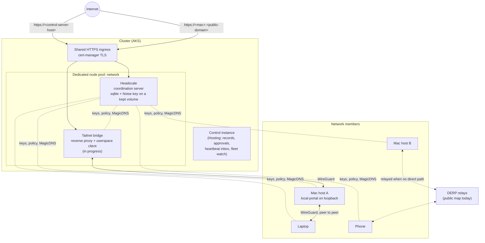
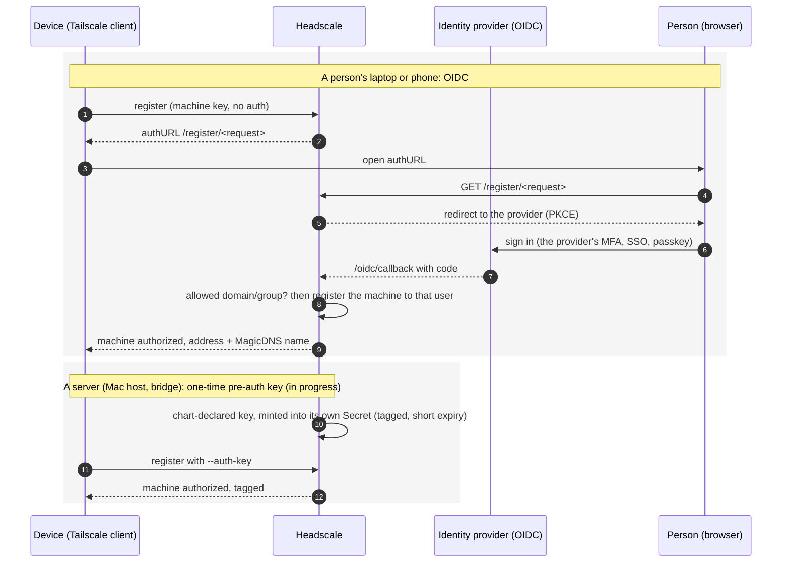
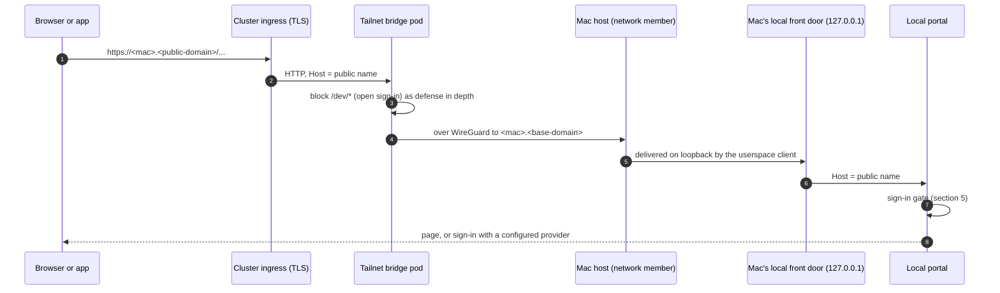
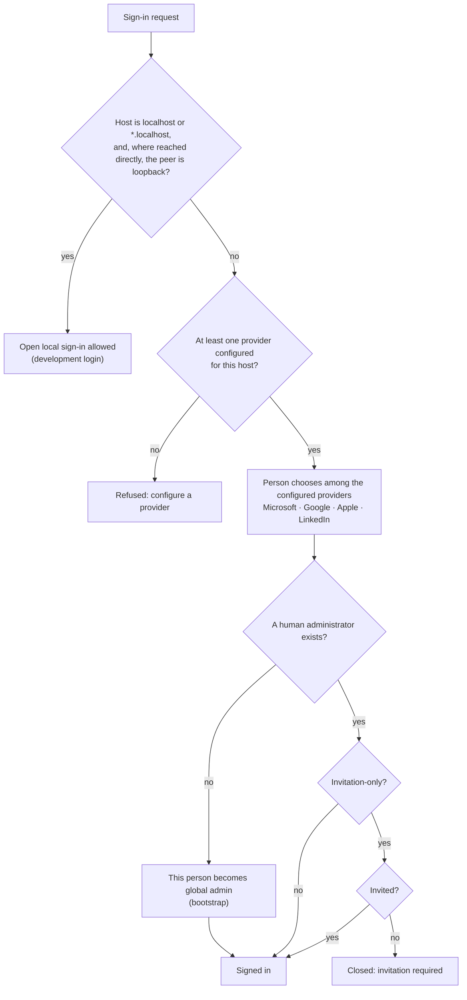
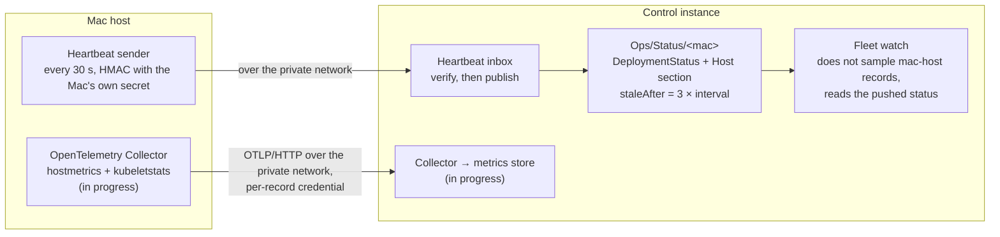

# The private network

An estate's machines (build Macs, people's laptops and phones, and a proxy inside the cluster) join
**one private network**. They reach each other by name, wherever they are, without opening a port
anywhere. The network is the open-source **Headscale** control server plus the stock **Tailscale**
client; traffic is WireGuard, end to end encrypted, and never passes through the control server.

> **Status.** Built and running: the Headscale chart and image, its node pool, the governed `ApplyChart`
> with its DNS step, and the Mac status written from a verified heartbeat (not yet exercised on a
> joined Mac). **In progress:**
> one-time join keys minted by the chart, the tailnet bridge, the portal's sign-in gate for
> non-local hosts, sign-in with Apple as the default in the Apple apps, Apple Intelligence as a Mac's
> default model provider, the OpenTelemetry path and the job queue on a Mac. Each section says which.

## 1. The shape

- **Control server.** Headscale runs as ONE replica (`Recreate`) in the control namespace. Its state
  is a sqlite file on a ReadWriteOnce volume that is **kept on uninstall**, because it holds the
  network's Noise private key: losing it un-registers every machine. It sits on its own one-node pool
  (label `workload=network`, taint `network=headscale:NoSchedule`) so a portal restart storm cannot
  starve it. It is plain HTTP inside the cluster with TLS at the ingress, and a `NetworkPolicy` lets
  in only the ingress namespace and lets out only DNS and HTTPS (issuer, DERP map). Chart:
  MeshWeaver.Deploy `deploy/headscale`.
- **Client.** The stock Tailscale app or daemon on every device, pointed at the estate's server
  (`--login-server`, or the `LoginURL` MDM policy). For Headscale 0.29.7 the minimum is v1.80.0, and
  v1.104.4 or newer is recommended.
- **Addresses and names.** Each machine gets an address in `100.64.0.0/10` and a MagicDNS name
  `<machine>.<base-domain>`. The base domain is private and is never a public zone. A public name such
  as `<mac>.<public-domain>` is a different thing: an ingress host served through the bridge (§4).
- **Relays (DERP).** Where two machines cannot reach each other directly, traffic relays through a
  DERP server and the relay sees only ciphertext. Today that is Tailscale's public DERP map. Headscale
  embeds its own relay, but STUN needs UDP 3478, which an HTTP ingress cannot carry, so running it is
  a separate change with a `LoadBalancer` Service of its own.
- **Who may reach what.** The HuJSON ACL policy in the chart overlay, reviewed like any other change.
  It starts as "every member's machines reach each other". Servers carry tags (`tag:mac-host`,
  `tag:bridge`) and the policy narrows by tag.

## 2. Joining

People sign in and servers present a key. Nobody types a credential on a server.

- **OIDC** registers an admitted account's machine with no admin step (`oidc.allowedDomains`,
  `allowedGroups`). The authorize link a client prints expires after about 15 minutes, and the client
  then asks for a new one.
- **Pre-auth keys (in progress).** The chart declares the keys a release needs. A sidecar mints each
  one into its own Kubernetes Secret, so there is no `kubectl exec` and no new action kind: it rides on
  the governed `ApplyChart`. A Mac host reads its key without printing it. A key in an MDM profile
  (`AuthKey`) is only for unattended servers, never for a profile that reaches a person's device.
- **Managed devices (MDM).** On Apple platforms a managed `com.apple.vpn.managed` payload pre-installs
  the VPN configuration, using the macOS or iOS identifiers of the Tailscale app. Separately, the
  `LoginURL` system policy points the app at the estate's server: a preference-domain profile on
  macOS, AppConfig on iOS and iPadOS, the ADMX on Windows. `AlwaysOn.Enabled` keeps a laptop on the
  network.

## 3. Installing and changing the server

Nobody runs `helm install` by hand. An estate vendors the chart byte-identical into its deployments
repository, writes its overlay (host, ingress class and issuer, OIDC issuer, client and allow-list, Key
Vault names, node pool) and applies it with the governed **`ApplyChart`** instance action from a
`Hosting/ChartRelease` record. The record's optional `host` and `dnsZone` make the approved plan also
write the public DNS record at the shared ingress address, so the name exists before the certificate
is requested. See [/Hosting/PrivateNetwork](/Hosting/PrivateNetwork) for the Hosting half.

The OIDC client secret is a Key Vault object mounted as a **file** through the CSI driver and never
synced into a Kubernetes Secret. A change to it, or to the config, rolls the pod (checksum
annotations).

## 4. A Mac's local portal at a public name (in progress)

A Mac's local portal listens on the Mac's loopback only. To answer at `https://<mac>.<public-domain>`
it is reached **through the network**, and the Mac opens no port:

The bridge is a small reverse proxy plus a userspace Tailscale client. It runs on the network node
pool with Headscale and joins with its own pre-auth key. Its public host is a `ChartRelease` with
`host` and `dnsZone`, so the same approved `ApplyChart` writes its DNS record.

## 5. The sign-in gate

The default configuration accepts **any account, but only on localhost**. Any other host must have a
real sign-in provider configured, or the open sign-in is refused (in progress in the portal; the
bridge blocks it as well).

- **Why the host and not the peer address.** On a Mac the portal runs inside a local VM behind an
  ingress controller, so every request reaches it from the ingress pod, never from loopback. The host
  is what tells local from forwarded: the bridge sets `Host` to the public name, and browsers resolve
  `*.localhost` only to loopback (RFC 6761). The local front door binds `127.0.0.1` only, so a
  forged `Host` needs a path onto the Mac itself. The remaining exposure is a network member sending
  `Host: localhost`, and the ACL limits who can reach the Mac at all.
- **Choosing a provider.** When several are configured, the person picks one. On Apple devices
  **Sign in with Apple** is pre-selected and uses the Apple ID the person is signed in with on the
  device; the choice is remembered per device (in progress in the apps). On a device enrolled in
  Intune with Company Portal, choosing Microsoft signs in silently with the device account through
  Microsoft's Enterprise SSO plug-in.
- **First sign-in becomes global admin.** The bootstrap promotion is the platform's existing rule
  (`AdministratorProbeService`, `OnboardingGate.Decide`): a seeded grant for an identity nobody has
  signed in as does not count as an administrator. After that, admission follows
  `Features:Onboarding:InvitationOnly`. A deployment that wants "first person in, everyone else
  locked out" sets it to `true` and offers only a single-tenant provider.
- **General Macs stay open.** The platform ships no organisation-specific default. A Mac's owner
  configures any provider from the catalog, and an estate's own fleet declares its choice in that
  fleet's records and overlays.

## 6. Telemetry over the network

Built: a verified heartbeat from a `mac-host` record, signed with that record's own secret, writes the
Mac's status with a host section (CPU, memory, disk, thermal state, VM usage, scheduled runs), and fleet
watch reads that status instead of sampling the cluster. A Mac silent past `staleAfter` reads
**Unobserved**, never green. In progress: the OpenTelemetry collector for metric history, its
per-record credential (the receiving collector overwrites the claimed identity with the record the
credential belongs to), and the job queue and leasing monitor on a Mac.

## Related

- [/Hosting/PrivateNetwork](/Hosting/PrivateNetwork): the Hosting module's half (governed actions,
  records, status).
- [/Hosting/MacStudioFleet](/Hosting/MacStudioFleet): the Mac fleet design.
- [/Hosting/GuiDevicePairing](/Hosting/GuiDevicePairing): pairing a machine from the GUI.
- MeshWeaver.Deploy `deploy/headscale/README.md`: the chart, its image and its tests.
