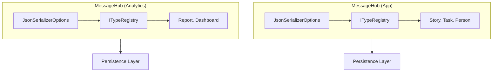
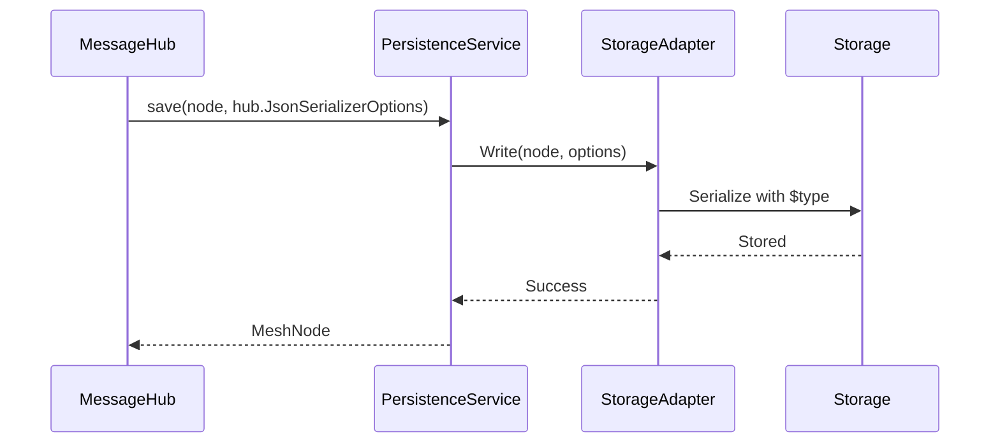

MeshWeaver serializes all mesh node content as polymorphic JSON. Rather than using a single global serializer, every `MessageHub` carries its own `JsonSerializerOptions` instance backed by a dedicated `ITypeRegistry`. This design means each hub serializes only the types it knows about and round-trips them correctly — without coupling unrelated hubs to each other's type systems.

## Architecture Overview

The hub-per-registry model is the foundation. Two hubs running side-by-side can own completely different type sets, and both write to the persistence layer with their own discriminators.

Metadata resolution visits registered types to discover derived types. Its duplicate check compares
the existing derived-type list directly: a captured LINQ predicate in that loop allocated about
88 bytes for every registry candidate, including unrelated types. The allocation regression test
uses the real hub registry and subtracts registry traversal costs; adding 512 unrelated types
previously added about 45 KB to each resolution. Attribute-defined discriminators retain precedence
over registry aliases, and registered subtypes still round-trip. This removes a measured allocation
source; allocation samples alone do not establish the callers or retained roots of a production OOM.



## How Serialization Works

### 1. Register types with the hub

Types are declared during hub configuration. Every type listed here will be given a `$type` discriminator on write and resolved back to its CLR type on read.

```csharp
services.AddMeshWeaver(meshWeaver => meshWeaver
    .AddMesh(mesh => mesh
        .ConfigureHub(hub => hub
            .WithTypes(typeof(Story), typeof(Task), typeof(Person))
        )
    )
);
```

### 2. `$type` discriminators on the wire

When the serializer writes a registered type, it injects a `$type` property. Readers use that property to reconstruct the correct CLR type — even when the declared field is typed as `object` or a base class.

```json
{
  "$type": "Story",
  "id": "story-123",
  "title": "Implement feature",
  "status": "InProgress"
}
```

### 3. Options flow through every persistence call

The hub's `JsonSerializerOptions` travels from the hub through the persistence stack all the way to the storage adapter. No intermediate layer substitutes its own options.



## Key Interfaces

All persistence contracts accept `JsonSerializerOptions` explicitly — there is no global fallback.
They are also **reactive**: every one of these returns `IObservable<T>`, never `Task<T>` (see
[Asynchronous Calls](/Doc/Architecture/AsynchronousCalls)).

### `IStorageAdapter`

Each backend adapter serializes and deserializes using exactly the options it is given
(`src/MeshWeaver.Mesh.Contract/Services/IStorageAdapter.cs`):

```csharp
IObservable<MeshNode?> Read(string path, JsonSerializerOptions options);
IObservable<MeshNode?> Write(MeshNode node, JsonSerializerOptions options);
IObservable<MeshNode> ReadMany(IReadOnlyCollection<string> paths, JsonSerializerOptions options);
IObservable<IReadOnlyList<MeshNode>> WriteMany(/* … */);
IObservable<string> Delete(string path);
IObservable<object> GetPartitionObjects(string nodePath, string? subPath, JsonSerializerOptions options);
```

> There is **no `IMeshStorage` interface** and no `GetNodeAsync` / `SaveNodeAsync` /
> `ReadAsync` / `WriteAsync` on the adapter contract. `GetNodeAsync` / `SaveNodeAsync` exist
> only as legacy **test-only** aliases in `MeshWeaver.Fixture/IStorageAdapterTestExtensions.cs`,
> which forward to `Read` / `Write`. Application code never touches an adapter directly —
> see [Data Access Patterns](/Doc/Architecture/DataAccessPatterns).

### `IMeshService`

Query and autocomplete take the caller's options for type resolution during result projection.
Both are reactive; the `QueryAsync` interface method is **gone** — `IMeshService.Query<T>`'s
`Initial` emission is the old "QueryAsync" snapshot (see
`MeshWeaver.Mesh.Contract/Services/MeshQueryExtensions.cs`):

```csharp
IObservable<IReadOnlyCollection<QueryResult>> Autocomplete(/* … */ AutocompleteMode mode = AutocompleteMode.RelevanceFirst /* … */);
```

## Default Configuration

Every hub's options are built by `SerializationExtensions.CreateSerializationConfiguration`
with these settings:

| Setting | Value | Purpose |
|---|---|---|
| `PropertyNamingPolicy` | `CamelCase` | JavaScript compatibility |
| `DefaultIgnoreCondition` | **`WhenWritingDefault`** | Compact output |
| `UnmappedMemberHandling` | `Skip` | Tolerate unknown properties on read |
| `ReferenceHandler` | `null` | Reference handling fully disabled |
| `ReadCommentHandling` / `AllowTrailingCommas` | `Skip` / `true` | Tolerant parsing |
| `IncludeFields` | `true` | `ValueTuple` support |
| `AllowOutOfOrderMetadataProperties` | `true` | Accept a `$type` that isn't the first property (legacy persisted rows) |

> 🚨 **`DefaultIgnoreCondition` is `WhenWritingDefault`, not `WhenWritingNull`** — and the
> difference bites. Under `WhenWritingDefault` a `bool` property whose value is `false` is
> **omitted from the JSON entirely**, so a property declared `public bool Flag { get; init; } = true`
> would silently fail to round-trip a `true → false` change: the `false` is not written, and the
> reader re-applies the `true` default.
>
> **The hub's resolver now closes that class** (`DeclaredDefaultsSurviveTheWire`, applied by
> `PolymorphicTypeInfoResolver`): a settable scalar member — primitive, enum, `decimal`, their
> nullable forms, or `string` — keeps `WhenWritingDefault` only when the reader PROVABLY rebuilds
> its CLR default; otherwise it is always written, so an explicitly stored `false` / `0` / `null` is
> never re-materialised as a declared value.
>
> The proof is **static**: when the type's metadata is resolved, the resolver reads the IL of the
> constructor the reader calls (and the base constructors it chains to). A member is omittable
> when it is a compiler-generated auto-property (or a field) and that constructor chain either
> never stores its backing field — no initializer, no assignment — or stores it exactly once,
> straight from the member's OWN constructor parameter (`ldarg.0; ldarg.n; stfld`, the positional
> record shape) whose default is the CLR default. Everything else is written: any initializer
> (`= true`, `= Id`, `= Left != Right`), a value copied from another parameter, a store in a base
> constructor, a constructor body that does anything at all (it could set the member through a
> call), a hand-written accessor, a value type, or IL the reader does not understand. The proof is
> also refused — every candidate written — when something else can write during the read: a type
> with an `OnDeserializing` callback (it runs after the constructor), a hand-written setter that
> does more than store its value into a field no candidate lives in (one member's setter could set
> another, omitted member), or a constructor that writes or takes the address of an argument
> (`starg`, `ldarga`) before the store that copies it. Writing an unproven value costs bytes; the
> one way it can change a value is a hand-written setter that NORMALIZES the CLR default it is
> handed (`set => text = value ?? "fallback"`) — such a type does not round-trip its own getter
> under any ignore condition, and no hub-serialized type in this repository has one. So
> `ActionHandlerRule.Enabled = true` and `MeshNode.MainNode = … Id …` are always written, while a
> sparse `MeshNode`'s unset `Name` / `Description` / `Icon` stay omitted.
>
> **Populate is not a construction, so it gets no proof.** Every proof above is about a reader that
> CONSTRUCTS the instance. Under `JsonObjectCreationHandling.Populate` the reader fills the object
> the holder already has, so an omitted member keeps whatever the holder initialized
> (`Flags = new() { Enabled = true }` turns a stored `false` back into `true`), and the child's
> metadata cannot know who holds it. So: options that prefer Populate prove nothing — every
> candidate is written; and a type whose property can populate an object (the property's own
> `[JsonObjectCreationHandling(Populate)]`, or the holder type's preference) is REFUSED at
> resolution with an `InvalidOperationException` when that object's metadata would omit any
> value. The child's verdict is shared by every holder and cannot be made per holder; refusing
> before the first byte is written is the only outcome that loses nothing. Populating a child
> that omits nothing — every candidate written, or marked `[JsonIgnore(Condition = Never)]` —
> stays allowed. Guard: `A_populated_child_never_loses_an_explicit_false`, with its negative
> control over options without the rule.
>
> **The proof is of the constructor the reader RUNS, and of fields that do not overlap.** A resolver
> modifier can replace `JsonTypeInfo.CreateObject` with a factory that sets members the constructor
> never touches (`() => new Flags { Enabled = true }`). The factory is never invoked to find out:
> when the resolver has any modifier (they run before the rule), nothing is proven and every
> candidate is written; and a proven member is still written whenever the type's factory at write
> time is not the one the proof saw (a modifier added outside, which runs after the rule). An
> explicit layout (`[StructLayout(LayoutKind.Explicit)]` anywhere in the hierarchy) can place a
> candidate at the same `[FieldOffset]` as an initialized field, so one store initializes both;
> such a type has every candidate written. Guards: `A_replaced_factory_never_loses_an_explicit_false`
> and `An_overlapping_field_keeps_an_explicit_false`, each with a negative control.
>
> **Nothing is constructed and nothing is cached per instance.** The verdict is a constant per
> member, fixed at metadata resolution; no constructor, initializer or getter runs to decide it,
> during resolution or during a write. An earlier design rebuilt each instance through its
> constructor at write time to decide "equals default → omit"; it ran constructors against live
> payload objects (and could mutate them), misjudged members derived from inputs that their own
> write condition omits, and kept per-instance verdicts that interleaved writes could leave stale.
> The static rule cannot have any of those shapes.
>
> **The trade-off: bytes for soundness.** Some values the reader would in fact rebuild identically
> are now written — e.g. a `Flag = Left != Right` that happens to be `false`, or a member whose
> initializer the proof cannot see through. An explicit CLR default reads back identically, so the
> conservative branch costs bytes, never a value. A member carrying its own `[JsonIgnore(...)]` keeps
> its author's condition, so the per-property `[JsonIgnore(Condition = JsonIgnoreCondition.Never)]`
> annotations that predate the rule are redundant but harmless. Measured before the rule: an
> `ActionHandlerRule` committed with `"enabled": false` read `enabled: true` after its repository
> sync, re-arming a rule that ships disabled. Guard: `DeclaredDefaultsSurviveTheWireTest` (with
> negative controls over options without the rule). Options built OUTSIDE the hub (a bare
> `new JsonSerializerOptions` with `WhenWritingDefault`) do not get the rule.
>
> `WriteIndented` and `PropertyNameCaseInsensitive` are **not** set on the hub's options —
> they keep the `System.Text.Json` defaults (`false`). Indented output is opt-in per adapter:
> `FileSystemStorageAdapterFactory` supplies a `writeOptionsModifier` that copies the options
> with `WriteIndented = true` for on-disk JSON.

## Best Practices

### Always pass the hub's options

Never create a fresh `JsonSerializerOptions` for persistence calls — a bare instance has no type registry and silently discards `$type` discriminators.

```csharp
// Correct — type registry flows through, and the write is subscribed (cold observable)
adapter.Write(node, hub.JsonSerializerOptions)
    .Subscribe(_ => { }, ex => logger.LogWarning(ex, "Write failed for {Path}", node.Path));

// Incorrect — loses type information
adapter.Write(node, new JsonSerializerOptions());
```

### Register every content type

Any type that appears as `MeshNode.Content` must be registered. Use `WithTypes` for domain types and `WithContentType<T>` for well-known content shapes:

```csharp
hub.WithTypes(typeof(Story), typeof(Task), typeof(Comment))
   .WithContentType<AgentConfiguration>()
```

A missing registration does not throw on write — the discriminator is simply absent, and the object deserializes as `JsonElement` or `object` instead of the expected CLR type. Register early; diagnose by inspecting stored JSON for a missing `$type`.

For a NodeType, `WithContentType` lives in the type's own hub configuration, and **the registration must not depend on an instance of that type existing** — see [Content-Type Registration](../ContentTypeRegistration) for how the platform sweeps definitions at startup, and for the whole commerce surface that went dead when it did not.

### The `$type` discriminator is the SHORT name — register the type on BOTH ends

The `$type` discriminator defaults to the **short** type name (`StackControl`, `LayoutStackSkin`), **not** the namespace-qualified full name (`MeshWeaver.Layout.StackControl`). A short name is **only** resolvable through the type registry — there is no `Type.GetType("StackControl")` reflection fallback the way there is for a full name. Two consequences, both non-negotiable:

1. **Every control, skin, and content type must be registered on BOTH the sending hub and the receiving hub.** The sender writes `"$type":"StackControl"`; the receiver can only turn that back into a `StackControl` if its own registry maps `StackControl → typeof(StackControl)`. A type registered on the sender but missing on the receiver comes back as an untyped `JsonElement` — every `Content is StackControl` soft-cast fails, the value "renders empty", and reactive waits time out (this is the class of bug behind the untyped-`JsonElement` sync-hub storms). For layout, both ends call `AddLayoutTypes()`, whose reflection sweep registers every `IUiControl` / `Skin` / `StreamMessage` — so controls and skins are covered automatically; **any non-control record you nest inside control state must be added explicitly** (see the `WithTypes(...)` list of `LayoutAreaDefinition`, `PivotConfiguration`, … in `AddLayoutTypes`).

2. **Never resolve a discriminator with `Type.GetType` (reflection) instead of the registry.** Reflection only ever worked because the old discriminator was a full name; it silently masked types that were never registered on the receiver. With short names it returns `null` and the value is dropped. The registry is the single source of truth — resolution flows through `ITypeRegistry.TryGetType` (which also resolves legacy full names via an alias) or, for polymorphic members, through the hub's `PolymorphicTypeInfoResolver` (whose derived-type discriminators are the same registry short names). A custom `JsonConverter` that resolves a `$type` by hand (e.g. `SkinListConverter`) **must** go through the registry / resolver, never bare `Type.GetType` — otherwise short-named elements are silently skipped.

> Backward compatibility: the registry keeps an alias from each type's full name to its definition, so JSON persisted with a legacy `"$type":"MeshWeaver.Layout.StackControl"` still deserializes. New writes always emit the short name.

### The resolver's diagnostics must never fail the serialization they run in

`PolymorphicTypeInfoResolver` runs two kinds of work inside `GetTypeInfo`: the work the serializer
needs (the `$type` discriminators for a base type's registered subtypes) and **diagnostics** — the
"unregistered type serialised here" warning, and a scan of the base type's assembly for polymorphic
subtypes nobody registered (which would drop to the nearest ancestor and render empty on the
receiver). Because `GetTypeInfo` is on the path of *every* serialization on the hub, a diagnostic
that throws does not merely lose its own warning: it fails whatever message was being written.

That was measured on the one message that must never be lost. `MessageService.ReportFailure` posts
a `DeliveryFailure` back to the sender of a request that could not be delivered; serializing that
envelope resolved type info for a base type whose assembly came from a module with an incomplete
dependency closure (a closure without `Microsoft.Agents.AI` — see
[Module Closure Accounting](../ModuleClosureAccounting)). `Assembly.GetTypes()` on such an
assembly throws `ReflectionTypeLoadException` for the *one* type it cannot load, the exception
escaped the scan, and the hub logged
`Failed to post DeliveryFailure message for CreateNodeRequest … - breaking error cascade` — the
sender waited for a verdict that never came.

The rule, and how the resolver now honours it:

- **Enumerate types loader-safely.** `GetTypes()` is wrapped in the canonical
  `catch (ReflectionTypeLoadException e) → e.Types.Where(t => t is not null)`: the loadable types
  are scanned, the rest are skipped.
- **Report the skipped remainder once per assembly, per hub.** The de-duplicated
  `LoaderExceptions` messages name the missing dependency, so the warning is the actionable
  diagnostic for the closure defect — one line, not one per serialized type.
- **Compute the per-assembly type list once.** The loadable types are cached per assembly in an
  instance `ConditionalWeakTable<Assembly, Type[]>` on the resolver (it dies with the hub's options
  and, being weak-keyed, does not root a collectible module assembly), so a busy hub does not
  re-enumerate — and, in the failing case, re-attempt the failed load — for every base type it
  serializes.

The closure defect itself stays a defect and is fixed where closures are built; the resolver's job
is to make sure it can no longer silence the report of some *other* request's failure.

### Use typed query helpers

`IMeshService.Query<T>` filters by `$type` and projects directly to `T`, avoiding manual
casting — reactively, so subscribe rather than `await foreach`:

```csharp
// Type-safe query with automatic $type filtering
meshService.Query<Story>(query)
    .Subscribe(change => { /* change.Items are already typed as Story */ },
               ex => logger.LogWarning(ex, "Query failed"));
```

## Storage Backends

All adapters implement the same interface and accept the same options — swapping backends requires no serialization changes.

| Adapter | Description |
|---|---|
| `FileSystemStorageAdapter` | Local `.json` files |
| `PostgreSqlStorageAdapter` | PostgreSQL (the production backend) |
| `CosmosStorageAdapter` | Azure Cosmos DB documents |
| `SqliteStorageAdapter` | SQLite |
| `InMemoryStorageAdapter` | In-memory store for testing |

## Related Topics

- [Data Configuration](../../DataMesh/DataConfiguration) — setting up data sources
- [Message-Based Communication](../MessageBasedCommunication) — hub architecture
